# Game Art

[中文](README.md)

This directory contains 91 independent style packages. Each card links to its bilingual README and representative image. Some recent packages use temporary abstract palette cards pending reviewed original illustrations.

<table>
<tr><td width="33%" valign="top" align="center"><a href="2d-character-3d-world-game-art/README.en.md">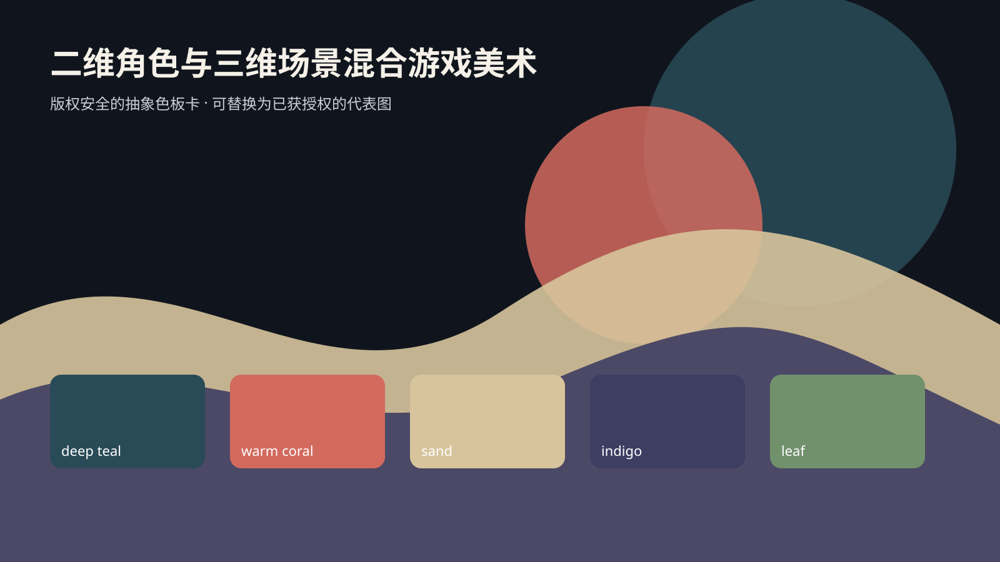</a> <strong>2D Characters in 3D Worlds Game Art</strong> <a href="2d-character-3d-world-game-art/README.en.md">Open README</a></td><td width="33%" valign="top" align="center"><a href="abstract-geometric-neon-game-art/README.en.md">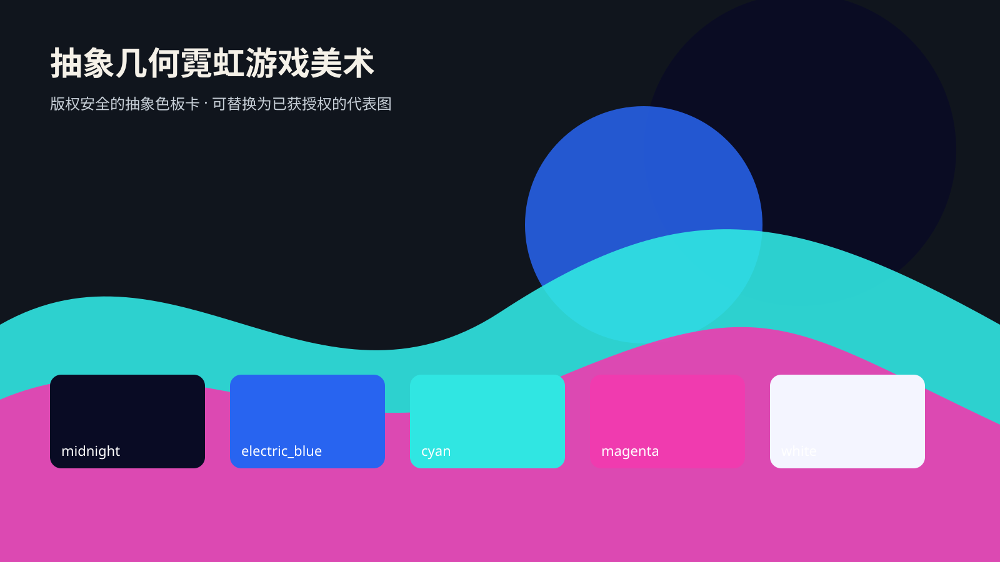</a> <strong>Abstract Geometric Neon Game Art</strong> <a href="abstract-geometric-neon-game-art/README.en.md">Open README</a></td><td width="33%" valign="top" align="center"><a href="ascii-character-game-art/README.en.md">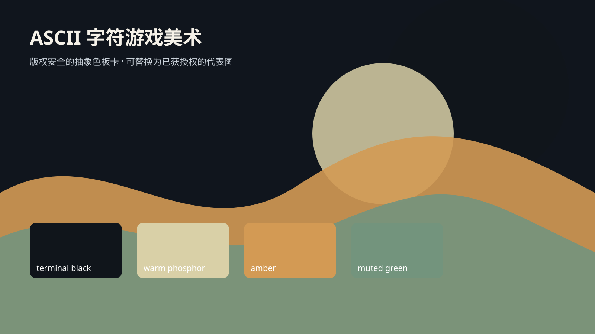</a> <strong>ASCII Character Game Art</strong> <a href="ascii-character-game-art/README.en.md">Open README</a></td></tr>
<tr><td width="33%" valign="top" align="center"><a href="braid-hand-painted-puzzle/README.en.md">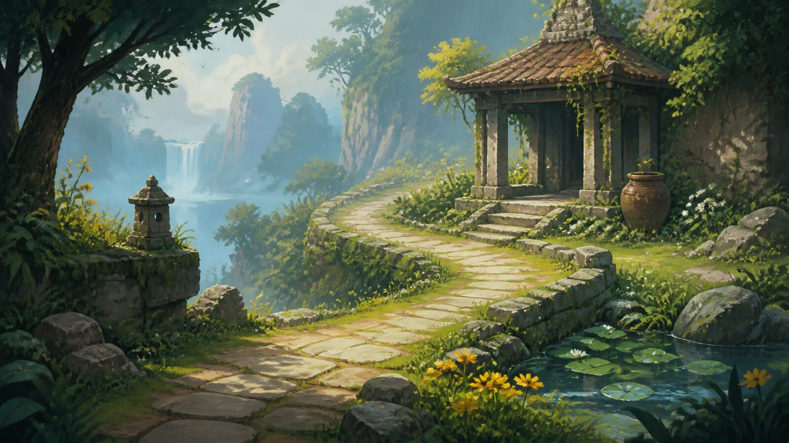</a> <strong>Braid Hand-Painted Puzzle Game Art</strong> <a href="braid-hand-painted-puzzle/README.en.md">Open README</a></td><td width="33%" valign="top" align="center"><a href="breath-of-the-wild-open-world/README.en.md">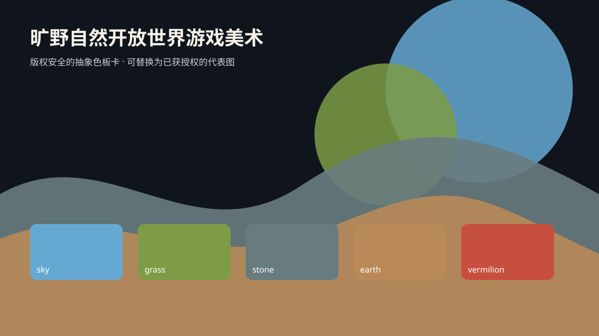</a> <strong>Open-World Painted Nature Game Art</strong> <a href="breath-of-the-wild-open-world/README.en.md">Open README</a></td><td width="33%" valign="top" align="center"><a href="cel-shaded-nature-game-art/README.en.md">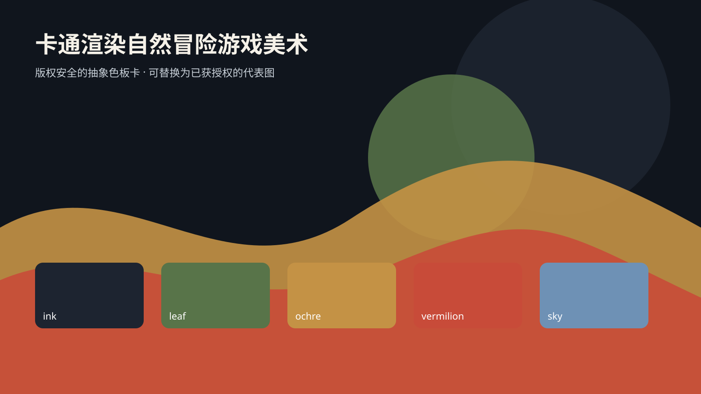</a> <strong>Cel-Shaded Nature Adventure Game Art</strong> <a href="cel-shaded-nature-game-art/README.en.md">Open README</a></td></tr>
<tr><td width="33%" valign="top" align="center"><a href="chibi-superdeformed-3d-game-art/README.en.md">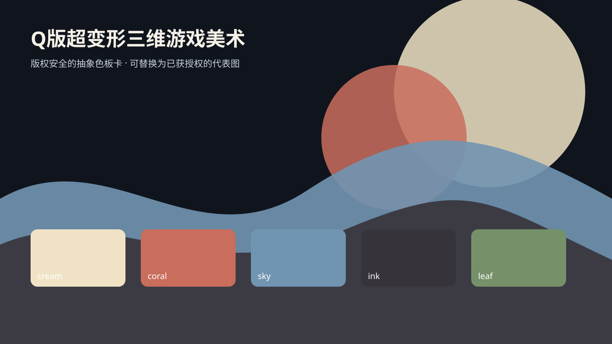</a> <strong>Chibi Super-Deformed 3D Game Art</strong> <a href="chibi-superdeformed-3d-game-art/README.en.md">Open README</a></td><td width="33%" valign="top" align="center"><a href="cinematic-pixel-adventure/README.en.md">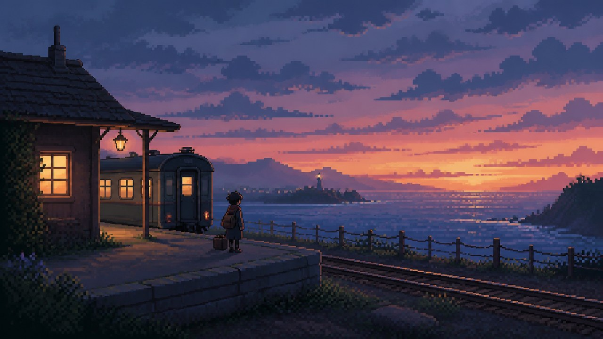</a> <strong>Cinematic Pixel Adventure Art</strong> <a href="cinematic-pixel-adventure/README.en.md">Open README</a></td><td width="33%" valign="top" align="center"><a href="collage-mixed-media-game-art/README.en.md">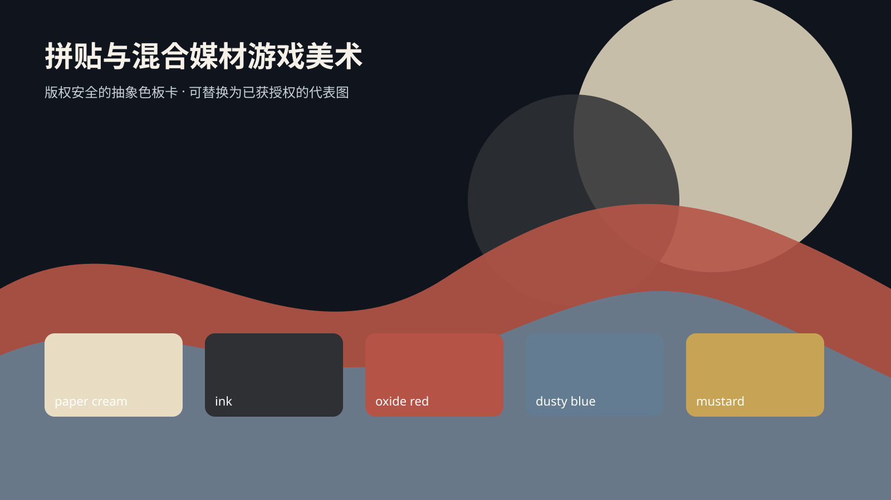</a> <strong>Collage and Mixed-Media Game Art</strong> <a href="collage-mixed-media-game-art/README.en.md">Open README</a></td></tr>
<tr><td width="33%" valign="top" align="center"><a href="comic-halftone-game-art/README.en.md">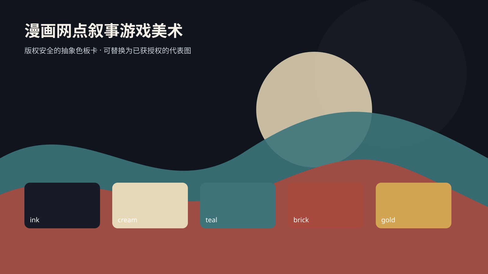</a> <strong>Comic Halftone Narrative Game Art</strong> <a href="comic-halftone-game-art/README.en.md">Open README</a></td><td width="33%" valign="top" align="center"><a href="control-paranormal-architecture/README.en.md">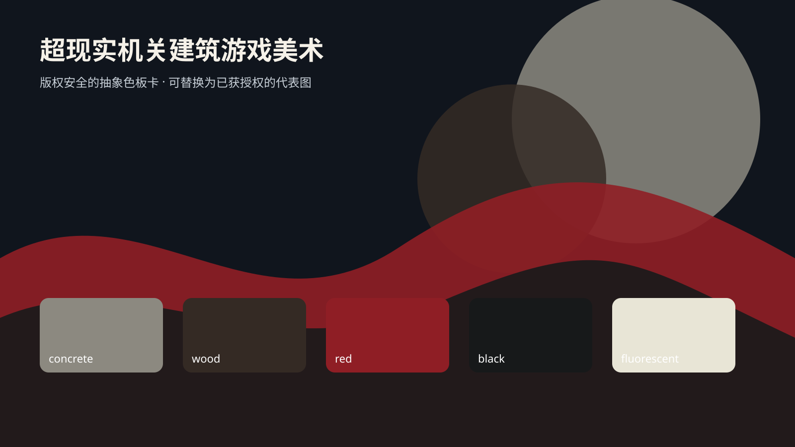</a> <strong>Paranormal Bureaucratic Architecture Game Art</strong> <a href="control-paranormal-architecture/README.en.md">Open README</a></td><td width="33%" valign="top" align="center"><a href="cosmic-horror-biomechanical-game-art/README.en.md">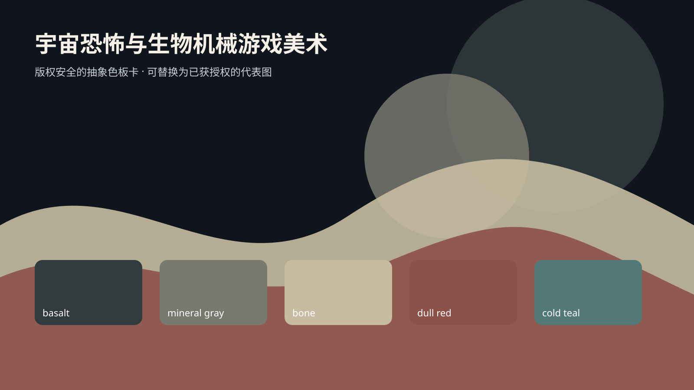</a> <strong>Cosmic Horror and Biomechanical Game Art</strong> <a href="cosmic-horror-biomechanical-game-art/README.en.md">Open README</a></td></tr>
<tr><td width="33%" valign="top" align="center"><a href="cuphead-rubber-hose-animation/README.en.md">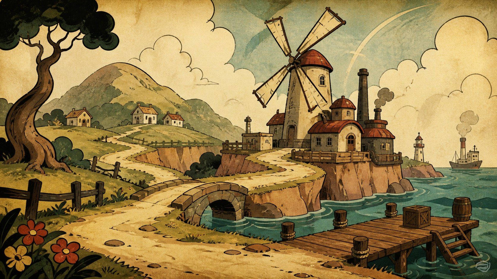</a> <strong>1930s Rubber-Hose Animation Game Art</strong> <a href="cuphead-rubber-hose-animation/README.en.md">Open README</a></td><td width="33%" valign="top" align="center"><a href="cyberpunk-night-city/README.en.md">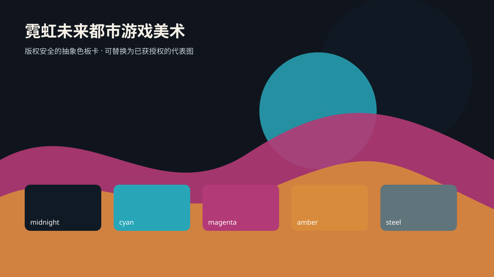</a> <strong>Grounded Neon Future City Game Art</strong> <a href="cyberpunk-night-city/README.en.md">Open README</a></td><td width="33%" valign="top" align="center"><a href="dark-fairytale-grotesque-game-art/README.en.md">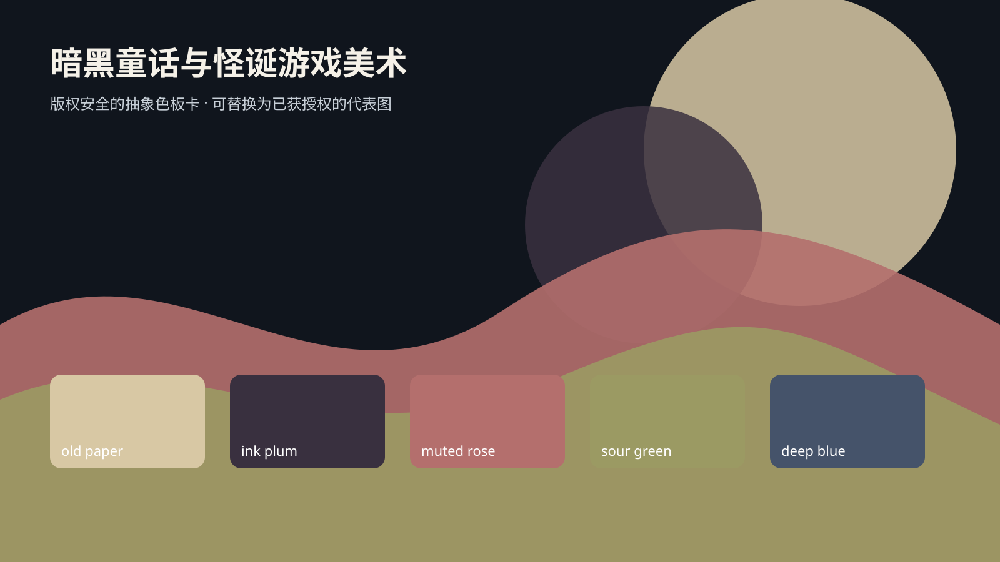</a> <strong>Dark Fairytale and Grotesque Game Art</strong> <a href="dark-fairytale-grotesque-game-art/README.en.md">Open README</a></td></tr>
<tr><td width="33%" valign="top" align="center"><a href="death-stranding-cinematic-wilderness/README.en.md">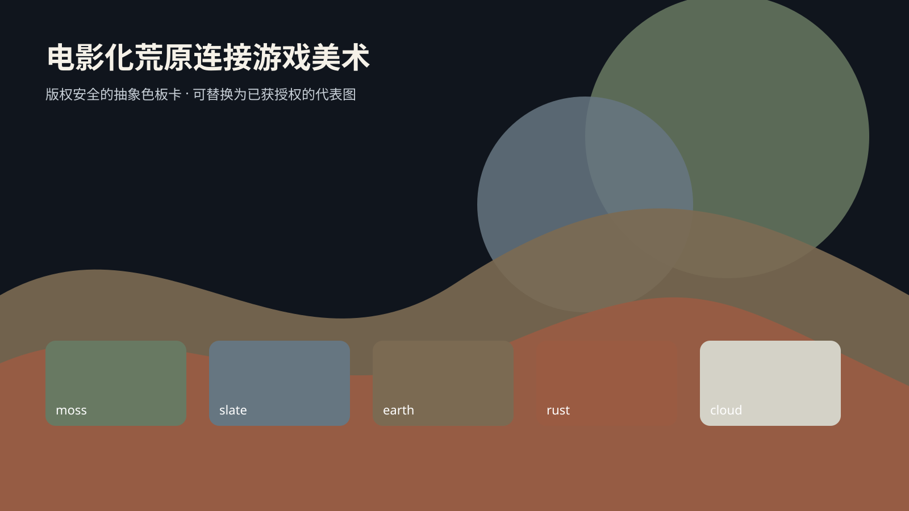</a> <strong>Cinematic Connected Wilderness Game Art</strong> <a href="death-stranding-cinematic-wilderness/README.en.md">Open README</a></td><td width="33%" valign="top" align="center"><a href="dieselpunk-industrial-game-art/README.en.md">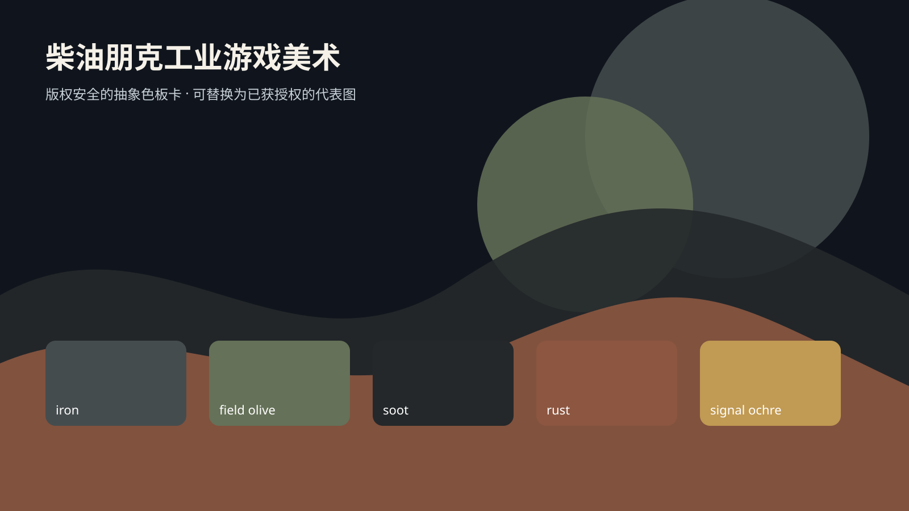</a> <strong>Dieselpunk Industrial Game Art</strong> <a href="dieselpunk-industrial-game-art/README.en.md">Open README</a></td><td width="33%" valign="top" align="center"><a href="disco-elysium-painterly-noir/README.en.md">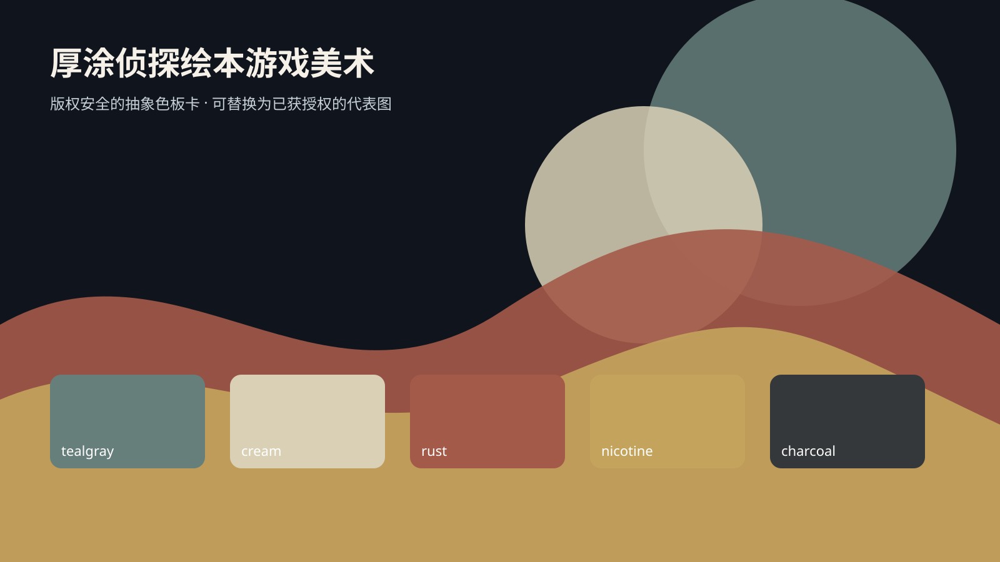</a> <strong>Painterly Noir Graphic-RPG Game Art</strong> <a href="disco-elysium-painterly-noir/README.en.md">Open README</a></td></tr>
<tr><td width="33%" valign="top" align="center"><a href="dry-media-pastel-game-art/README.en.md">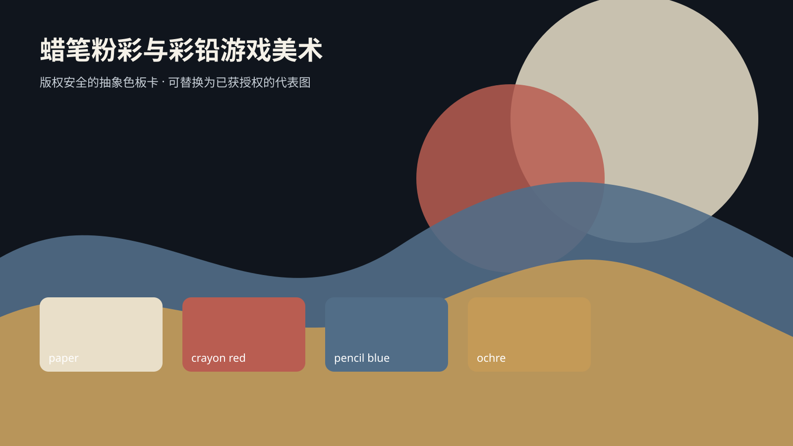</a> <strong>Dry Media Crayon Pastel Game Art</strong> <a href="dry-media-pastel-game-art/README.en.md">Open README</a></td><td width="33%" valign="top" align="center"><a href="early-2000s-glossy-3d-game-art/README.en.md">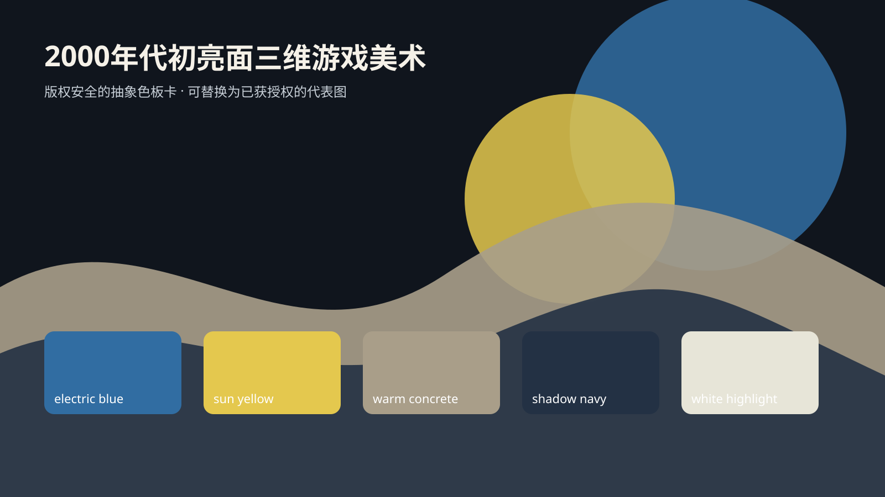</a> <strong>Early 2000s Glossy 3D Game Art</strong> <a href="early-2000s-glossy-3d-game-art/README.en.md">Open README</a></td><td width="33%" valign="top" align="center"><a href="elden-ring-dark-fantasy/README.en.md">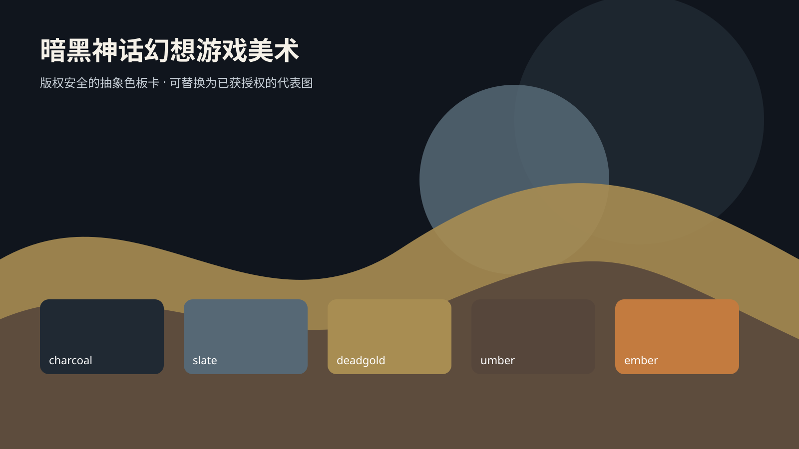</a> <strong>Dark Mythic Fantasy Game Art</strong> <a href="elden-ring-dark-fantasy/README.en.md">Open README</a></td></tr>
<tr><td width="33%" valign="top" align="center"><a href="exaggerated-cartoon-3d-game-art/README.en.md">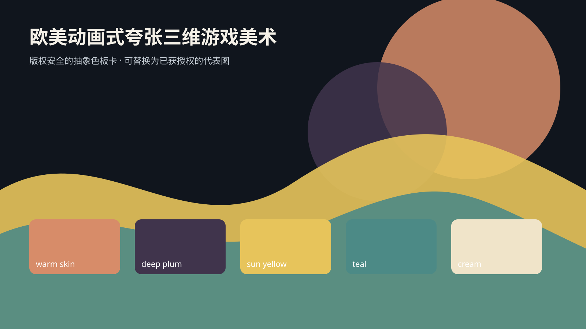</a> <strong>Exaggerated Cartoon 3D Game Art</strong> <a href="exaggerated-cartoon-3d-game-art/README.en.md">Open README</a></td><td width="33%" valign="top" align="center"><a href="final-fantasy-ix-painted-fantasy/README.en.md">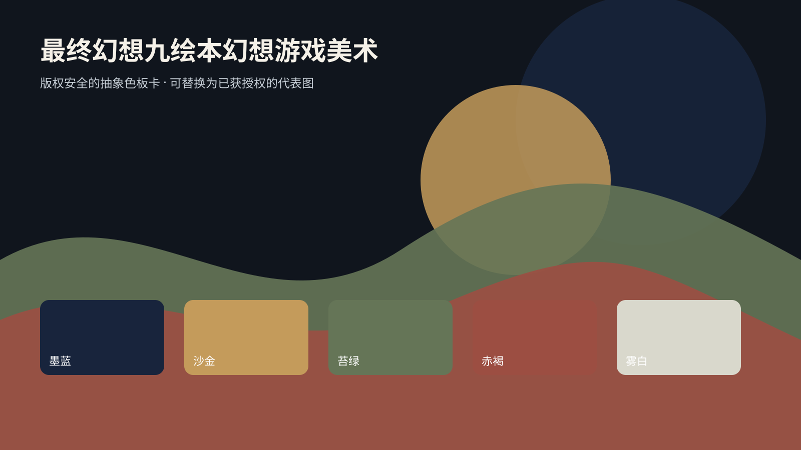</a> <strong>Storybook Fantasy RPG Game Art</strong> <a href="final-fantasy-ix-painted-fantasy/README.en.md">Open README</a></td><td width="33%" valign="top" align="center"><a href="flat-design-puzzle-game-art/README.en.md">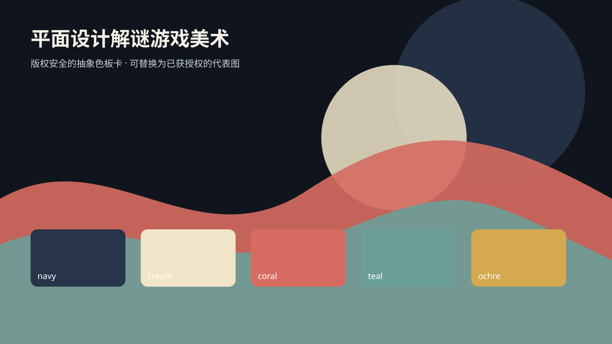</a> <strong>Flat Design Puzzle Game Art</strong> <a href="flat-design-puzzle-game-art/README.en.md">Open README</a></td></tr>
<tr><td width="33%" valign="top" align="center"><a href="gris-watercolor-game-art/README.en.md">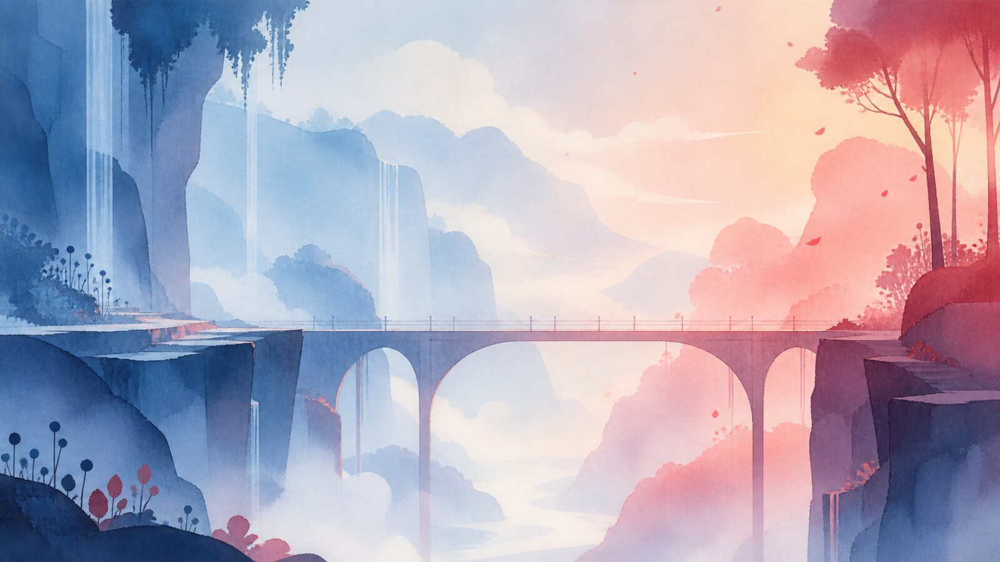</a> <strong>GRIS Watercolor Game Art</strong> <a href="gris-watercolor-game-art/README.en.md">Open README</a></td><td width="33%" valign="top" align="center"><a href="hades-mythic-illustration/README.en.md">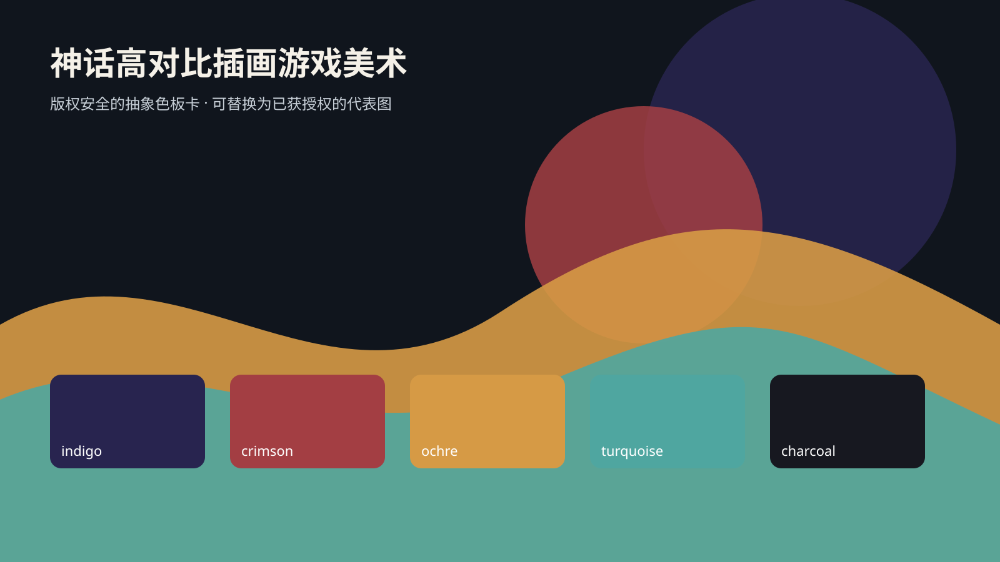</a> <strong>High-Contrast Mythic Illustration Game Art</strong> <a href="hades-mythic-illustration/README.en.md">Open README</a></td><td width="33%" valign="top" align="center"><a href="hand-drawn-linework-game-art/README.en.md">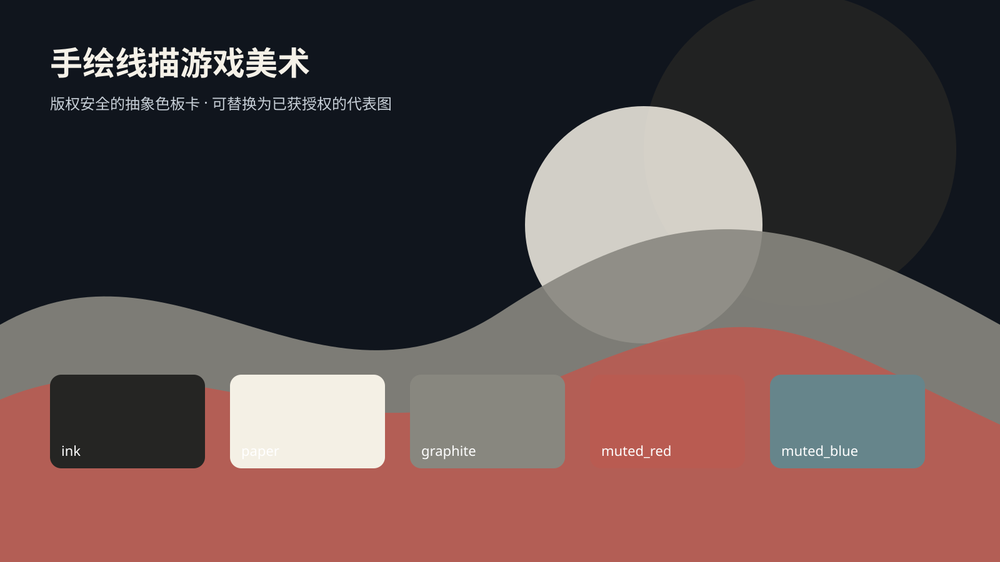</a> <strong>Hand-Drawn Linework Game Art</strong> <a href="hand-drawn-linework-game-art/README.en.md">Open README</a></td></tr>
<tr><td width="33%" valign="top" align="center"><a href="hand-inked-animation-game-art/README.en.md">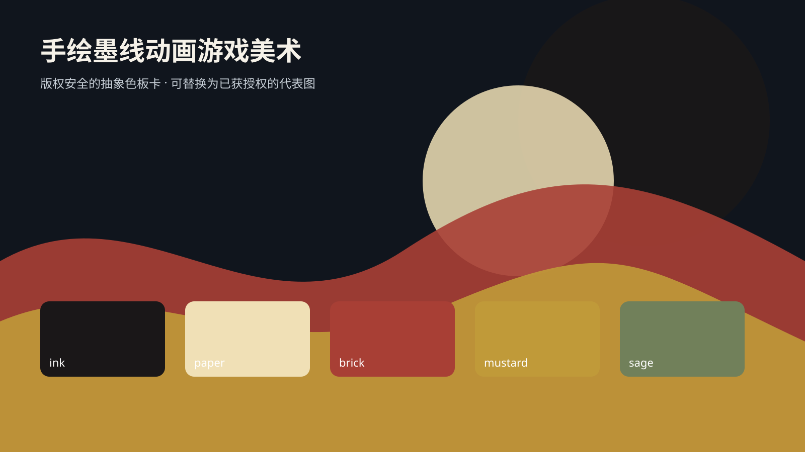</a> <strong>Hand-Inked Animation Game Art</strong> <a href="hand-inked-animation-game-art/README.en.md">Open README</a></td><td width="33%" valign="top" align="center"><a href="hand-painted-isometric-strategy/README.en.md">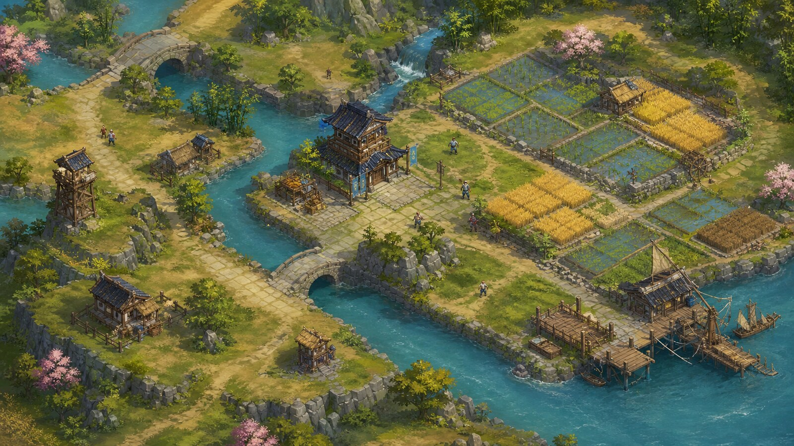</a> <strong>Hand-Painted Isometric Strategy Game Art</strong> <a href="hand-painted-isometric-strategy/README.en.md">Open README</a></td><td width="33%" valign="top" align="center"><a href="hand-painted-point-and-click/README.en.md">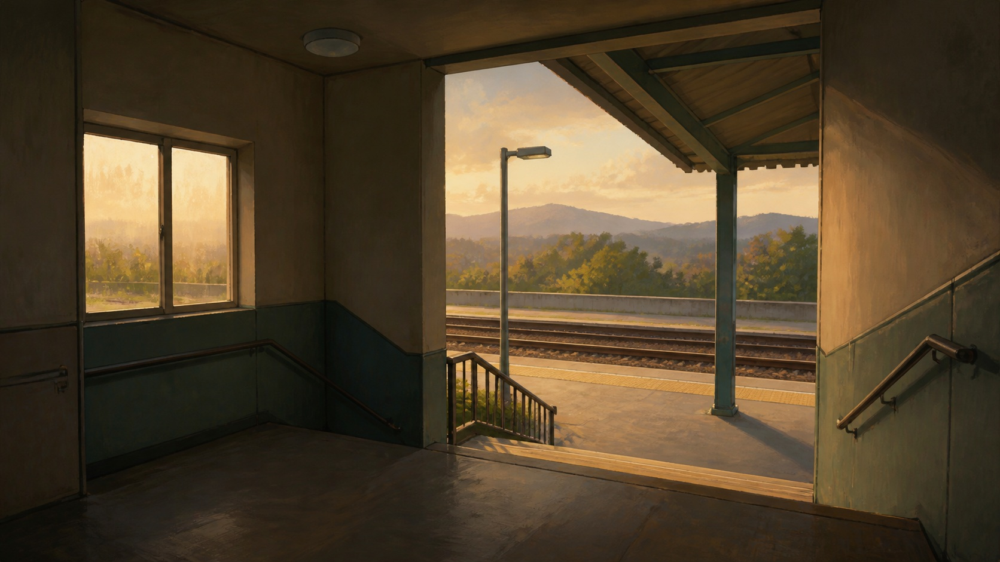</a> <strong>Hand-Painted Point-and-Click Adventure Game Art</strong> <a href="hand-painted-point-and-click/README.en.md">Open README</a></td></tr>
<tr><td width="33%" valign="top" align="center"><a href="hd-2d-pixel-cg-game-art/README.en.md">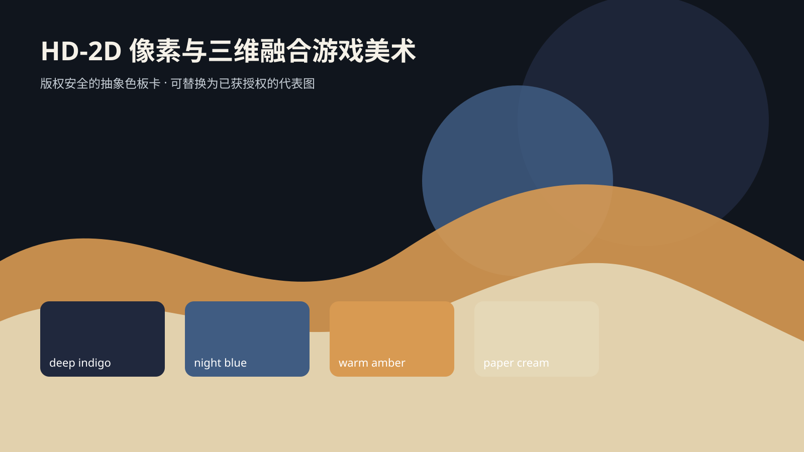</a> <strong>HD-2D Pixel and 3D Hybrid Game Art</strong> <a href="hd-2d-pixel-cg-game-art/README.en.md">Open README</a></td><td width="33%" valign="top" align="center"><a href="hi-fi-rush-rhythm-comic/README.en.md">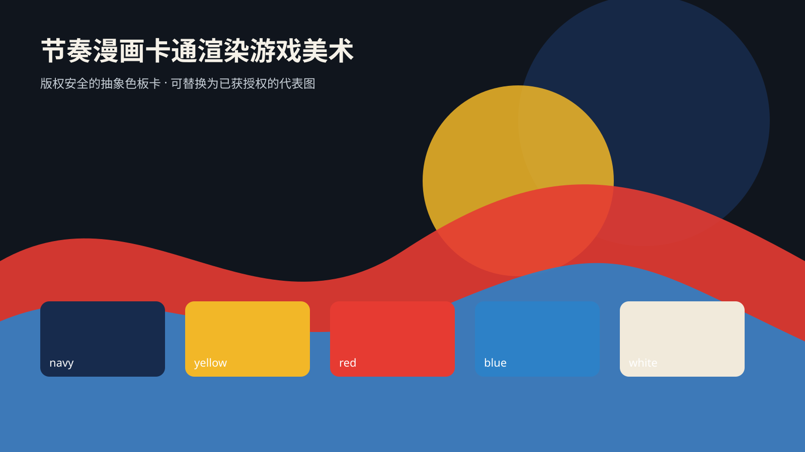</a> <strong>Rhythm Comic Cel-Shaded Game Art</strong> <a href="hi-fi-rush-rhythm-comic/README.en.md">Open README</a></td><td width="33%" valign="top" align="center"><a href="high-density-modern-pixel-game-art/README.en.md">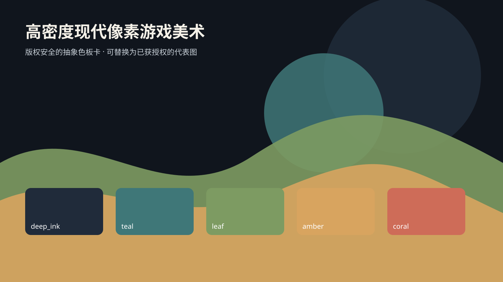</a> <strong>High-Density Modern Pixel Game Art</strong> <a href="high-density-modern-pixel-game-art/README.en.md">Open README</a></td></tr>
<tr><td width="33%" valign="top" align="center"> <strong>Inked Gothic Metroidvania Game Art</strong> <a href="hollow-knight-inked-gothic/README.en.md">Open README</a></td><td width="33%" valign="top" align="center"><a href="impossible-architecture-game-art/README.en.md">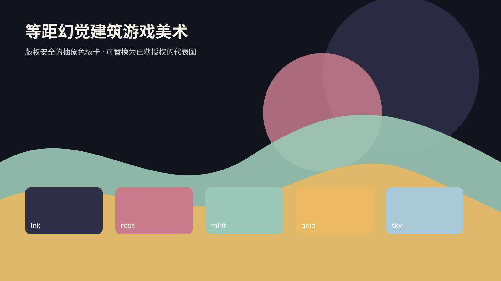</a> <strong>Isometric Impossible-Architecture Game Art</strong> <a href="impossible-architecture-game-art/README.en.md">Open README</a></td><td width="33%" valign="top" align="center"><a href="ink-wash-adventure/README.en.md">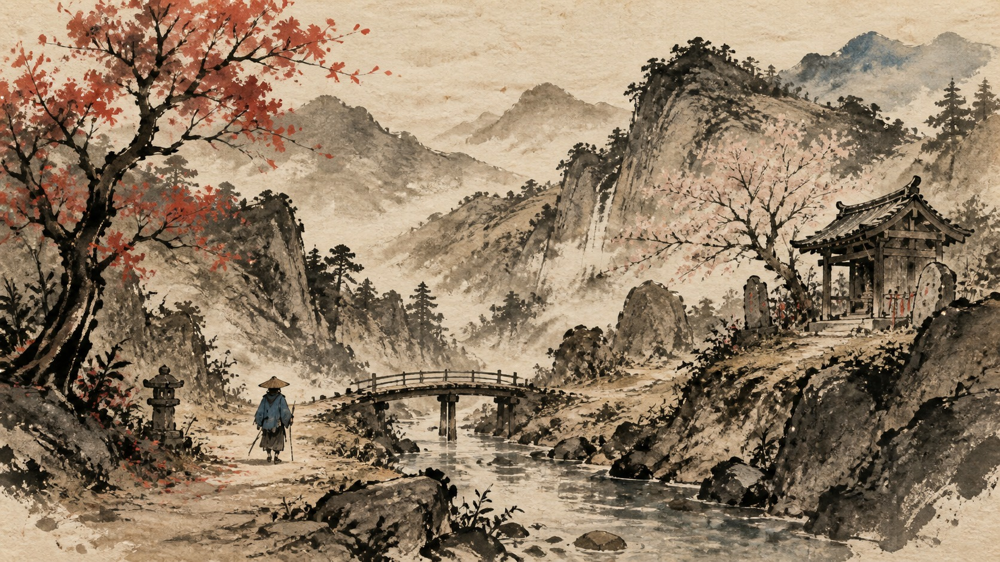</a> <strong>Ink-Wash Adventure Game Art</strong> <a href="ink-wash-adventure/README.en.md">Open README</a></td></tr>
<tr><td width="33%" valign="top" align="center"><a href="inside-minimalist-silhouette/README.en.md">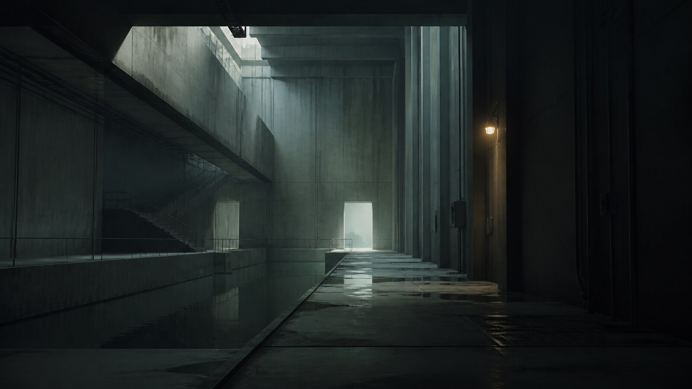</a> <strong>Inside Minimalist Silhouette Game Art</strong> <a href="inside-minimalist-silhouette/README.en.md">Open README</a></td><td width="33%" valign="top" align="center"><a href="island-cel-shaded-game-art/README.en.md">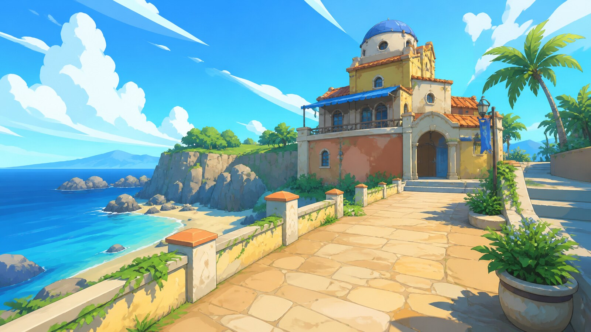</a> <strong>Island Cel-Shaded Game Art</strong> <a href="island-cel-shaded-game-art/README.en.md">Open README</a></td><td width="33%" valign="top" align="center"><a href="isometric-pixel-tactics/README.en.md">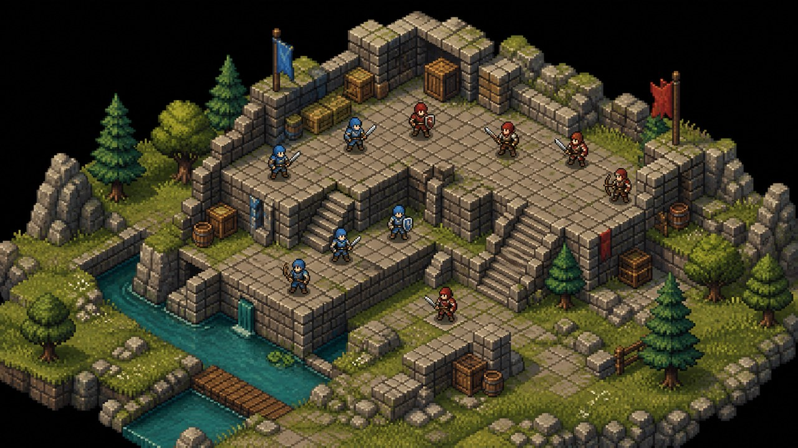</a> <strong>Isometric Pixel Tactics Art</strong> <a href="isometric-pixel-tactics/README.en.md">Open README</a></td></tr>
<tr><td width="33%" valign="top" align="center"><a href="japanese-cel-shaded-action-game-art/README.en.md">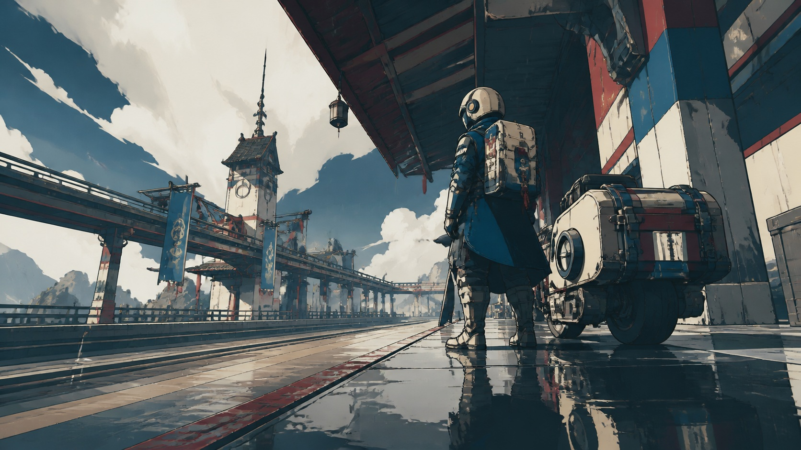</a> <strong>Japanese Cel-Shaded Action Game Art</strong> <a href="japanese-cel-shaded-action-game-art/README.en.md">Open README</a></td><td width="33%" valign="top" align="center"> <strong>Minimalist Desert Journey Game Art</strong> <a href="journey-minimalist-desert/README.en.md">Open README</a></td><td width="33%" valign="top" align="center"><a href="kentucky-route-zero-scenographic-game-art/README.en.md">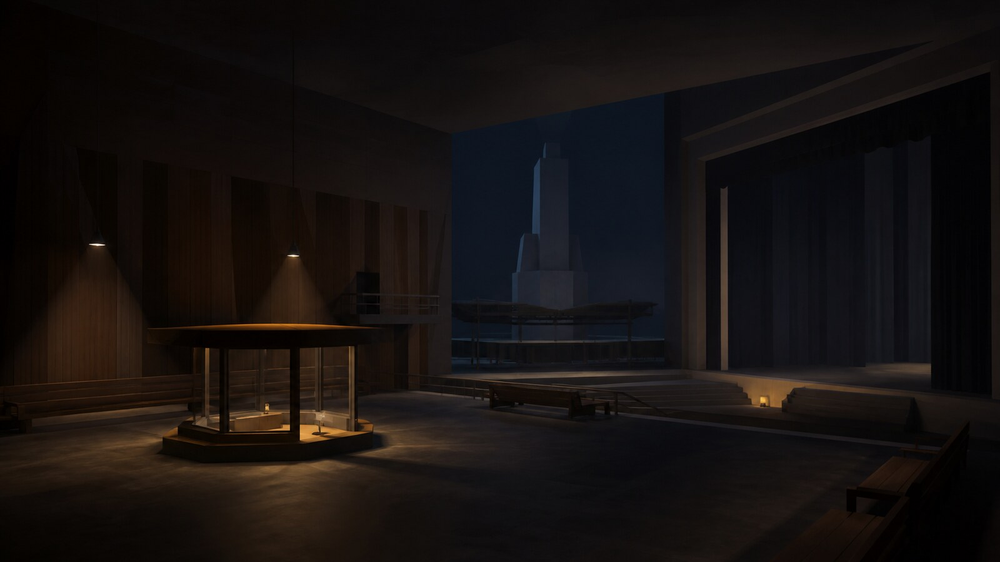</a> <strong>Kentucky Route Zero Scenographic Game Art</strong> <a href="kentucky-route-zero-scenographic-game-art/README.en.md">Open README</a></td></tr>
<tr><td width="33%" valign="top" align="center"><a href="last-of-us-cinematic-survival/README.en.md">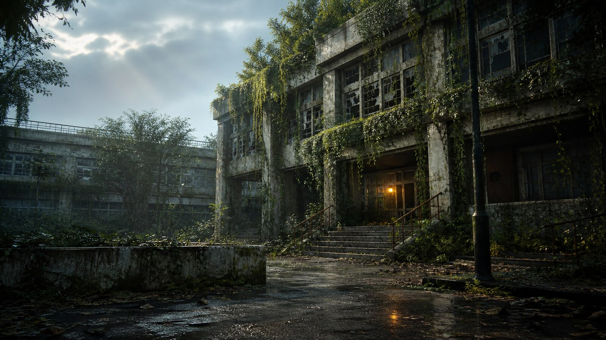</a> <strong>Beautiful Decay Survival Game Art</strong> <a href="last-of-us-cinematic-survival/README.en.md">Open README</a></td><td width="33%" valign="top" align="center"><a href="low-poly-adventure-game-art/README.en.md">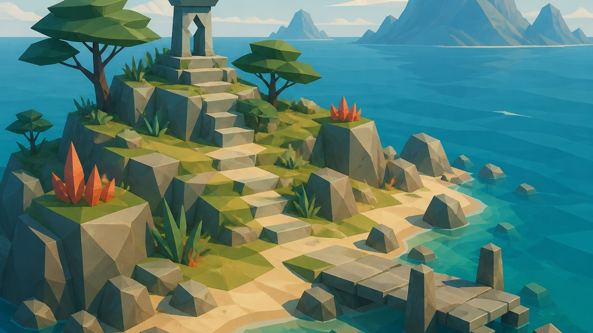</a> <strong>Low-poly Adventure Game Art</strong> <a href="low-poly-adventure-game-art/README.en.md">Open README</a></td><td width="33%" valign="top" align="center"><a href="miniature-diorama-game-art/README.en.md">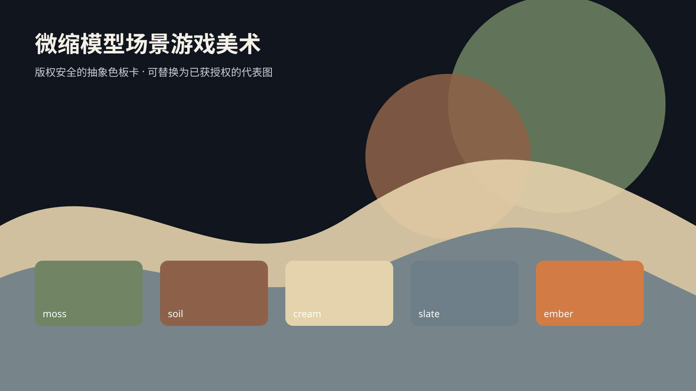</a> <strong>Miniature Diorama Game Art</strong> <a href="miniature-diorama-game-art/README.en.md">Open README</a></td></tr>
<tr><td width="33%" valign="top" align="center"><a href="monochrome-1bit-deduction-game-art/README.en.md">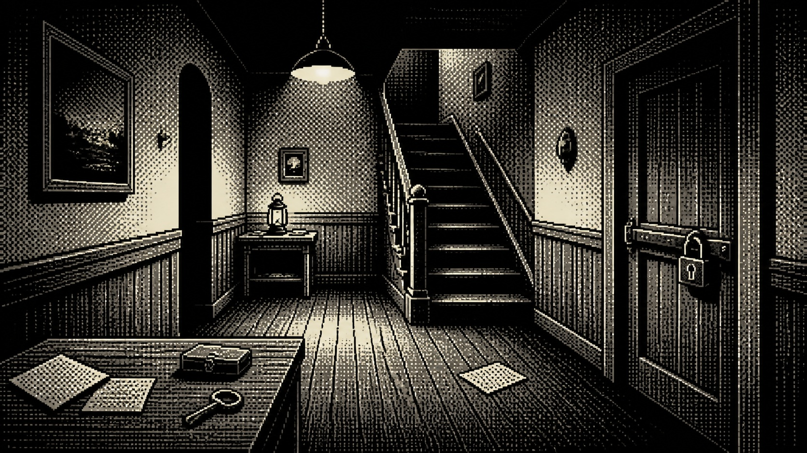</a> <strong>Monochrome 1-bit Deduction Game Art</strong> <a href="monochrome-1bit-deduction-game-art/README.en.md">Open README</a></td><td width="33%" valign="top" align="center"><a href="monochrome-3d-value-game-art/README.en.md">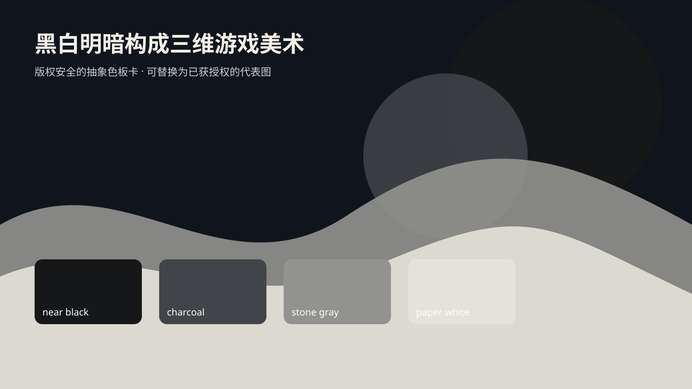</a> <strong>Monochrome 3D Value-Structure Game Art</strong> <a href="monochrome-3d-value-game-art/README.en.md">Open README</a></td><td width="33%" valign="top" align="center"><a href="monument-valley-impossible-geometry/README.en.md">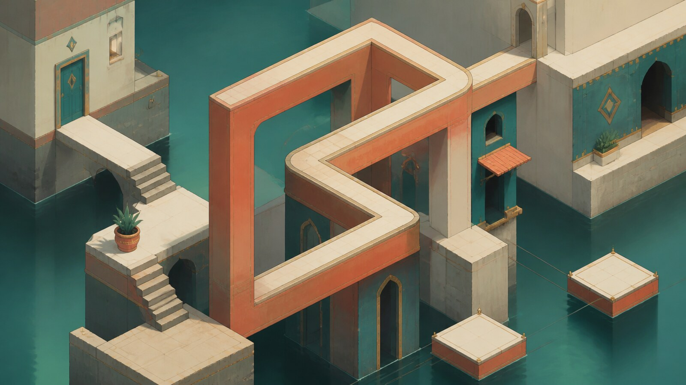</a> <strong>Monument Valley Impossible Geometry Game Art</strong> <a href="monument-valley-impossible-geometry/README.en.md">Open README</a></td></tr>
<tr><td width="33%" valign="top" align="center"><a href="naturalistic-realism-game-art/README.en.md">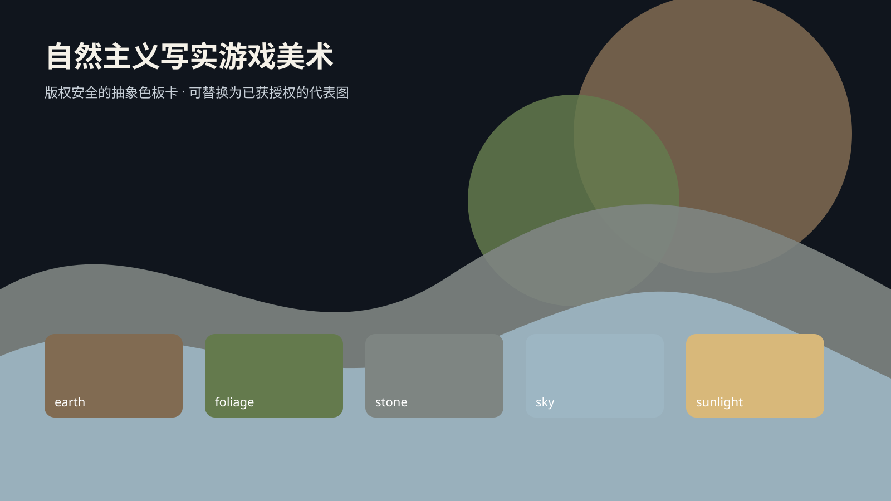</a> <strong>Naturalistic Realist Game Art</strong> <a href="naturalistic-realism-game-art/README.en.md">Open README</a></td><td width="33%" valign="top" align="center"><a href="neon-noir-3d-game-art/README.en.md">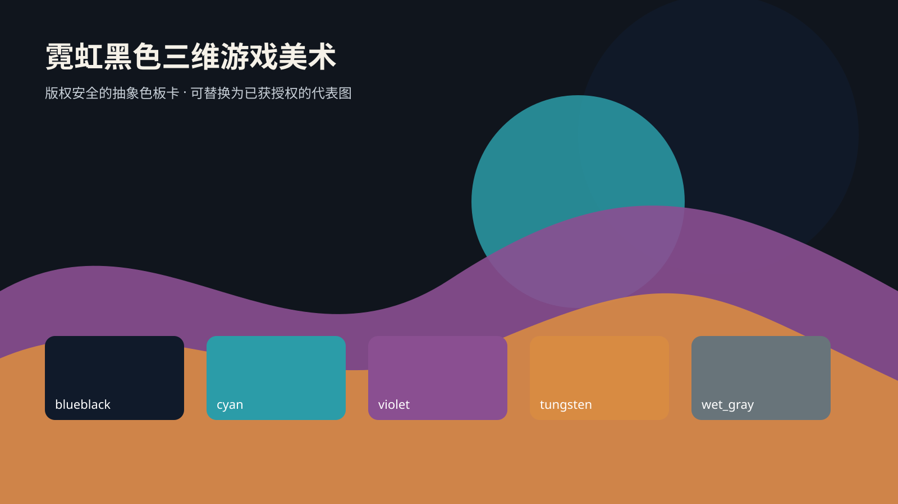</a> <strong>Neon Noir 3D Game Art</strong> <a href="neon-noir-3d-game-art/README.en.md">Open README</a></td><td width="33%" valign="top" align="center"><a href="okami-sumi-e-game-art/README.en.md">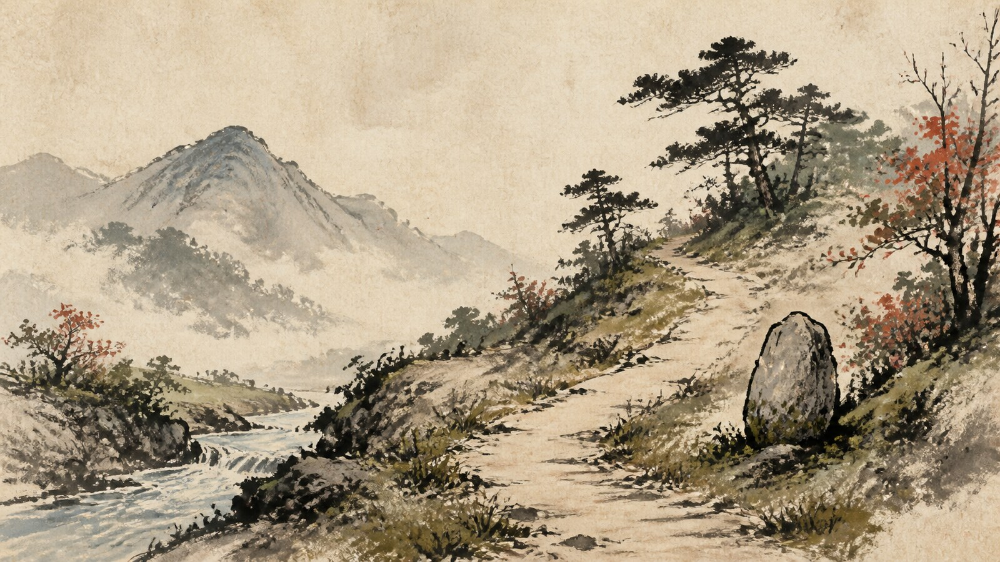</a> <strong>Ōkami Sumi-e Game Art</strong> <a href="okami-sumi-e-game-art/README.en.md">Open README</a></td></tr>
<tr><td width="33%" valign="top" align="center"><a href="ori-luminous-forest/README.en.md">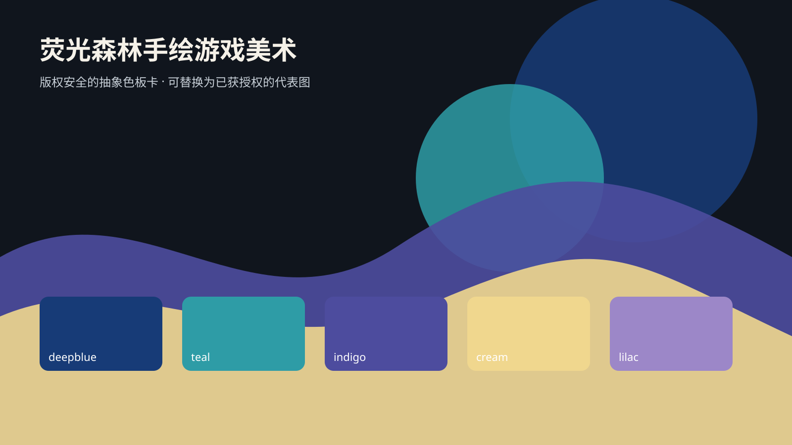</a> <strong>Luminous Hand-Painted Forest Game Art</strong> <a href="ori-luminous-forest/README.en.md">Open README</a></td><td width="33%" valign="top" align="center"> <strong>Origami and Folded Paper Game Art</strong> <a href="origami-folded-paper-game-art/README.en.md">Open README</a></td><td width="33%" valign="top" align="center"> <strong>Painterly 3D Fantasy Game Art</strong> <a href="painterly-3d-fantasy-game-art/README.en.md">Open README</a></td></tr>
<tr><td width="33%" valign="top" align="center"> <strong>Painterly Frame-by-Frame Animation Game Art</strong> <a href="painterly-frame-animation-game-art/README.en.md">Open README</a></td><td width="33%" valign="top" align="center"> <strong>Paper-cut Puppet 2D Game Art</strong> <a href="paper-cut-puppet-game-art/README.en.md">Open README</a></td><td width="33%" valign="top" align="center"> <strong>Papercraft Diorama Game Art</strong> <a href="papercraft-diorama-game-art/README.en.md">Open README</a></td></tr>
<tr><td width="33%" valign="top" align="center"> <strong>Pencil-Hatched 3D Game Art</strong> <a href="pencil-etching-3d-game-art/README.en.md">Open README</a></td><td width="33%" valign="top" align="center"> <strong>Pentiment Medieval Manuscript Game Art</strong> <a href="pentiment-medieval-manuscript-game-art/README.en.md">Open README</a></td><td width="33%" valign="top" align="center"> <strong>Persona 3 Reload Game Art</strong> <a href="persona-3-reload/README.en.md">Open README</a></td></tr>
<tr><td width="33%" valign="top" align="center"> <strong>Persona 4 Golden Game Art</strong> <a href="persona-4-golden/README.en.md">Open README</a></td><td width="33%" valign="top" align="center"> <strong>Persona 5 Royal Game Art</strong> <a href="persona-5-royal/README.en.md">Open README</a></td><td width="33%" valign="top" align="center"> <strong>Early 3D Survival-Horror Game Art</strong> <a href="ps1-survival-horror-low-poly/README.en.md">Open README</a></td></tr>
<tr><td width="33%" valign="top" align="center"> <strong>Qinglü Landscape Scroll Game Art</strong> <a href="qinglv-landscape-scroll-game-art/README.en.md">Open README</a></td><td width="33%" valign="top" align="center"> <strong>Retro 3D Console</strong> <a href="retro-3d-console/README.en.md">Open README</a></td><td width="33%" valign="top" align="center"> <strong>Atomic Age Retrofuturist Game Art</strong> <a href="retrofuturist-atomic-age-game-art/README.en.md">Open README</a></td></tr>
<tr><td width="33%" valign="top" align="center"> <strong>Rotoscoped Action Game Art</strong> <a href="rotoscoped-action-game-art/README.en.md">Open README</a></td><td width="33%" valign="top" align="center"> <strong>RPG Maker Pixel Art</strong> <a href="rpg-maker-pixel-art/README.en.md">Open README</a></td><td width="33%" valign="top" align="center"> <strong>Shadow of the Colossus Atmospheric 3D Game Art</strong> <a href="shadow-of-the-colossus-atmospheric-3d/README.en.md">Open README</a></td></tr>
<tr><td width="33%" valign="top" align="center"> <strong>Side-scrolling Platformer Pixel Art</strong> <a href="side-scrolling-platformer-pixel/README.en.md">Open README</a></td><td width="33%" valign="top" align="center"> <strong>Silhouette Light-and-Shadow Platformer Game Art</strong> <a href="silhouette-platformer-game-art/README.en.md">Open README</a></td><td width="33%" valign="top" align="center"> <strong>Solarpunk Ecological Future Game Art</strong> <a href="solarpunk-ecological-game-art/README.en.md">Open README</a></td></tr>
<tr><td width="33%" valign="top" align="center"> <strong>Spiritfarer Hand-Drawn Game Art</strong> <a href="spiritfarer-hand-drawn-game-art/README.en.md">Open README</a></td><td width="33%" valign="top" align="center"> <strong>Stained Glass Panel Game Art</strong> <a href="stained-glass-panel-game-art/README.en.md">Open README</a></td><td width="33%" valign="top" align="center"> <strong>Steampunk Industrial Game Art</strong> <a href="steampunk-industrial-game-art/README.en.md">Open README</a></td></tr>
<tr><td width="33%" valign="top" align="center"> <strong>Stop-Motion Clay Game Art</strong> <a href="stop-motion-clay-game-art/README.en.md">Open README</a></td><td width="33%" valign="top" align="center"> <strong>Neon Ruined-City Game Art</strong> <a href="stray-neon-cybercity/README.en.md">Open README</a></td><td width="33%" valign="top" align="center"> <strong>Stylized Low-Poly World Game Art</strong> <a href="stylized-low-poly-world/README.en.md">Open README</a></td></tr>
<tr><td width="33%" valign="top" align="center"> <strong>Stylized PBR Science-Fiction Game Art</strong> <a href="stylized-pbr-sci-fi-game-art/README.en.md">Open README</a></td><td width="33%" valign="top" align="center"> <strong>Top-down 16-bit Adventure Game Art</strong> <a href="top-down-16-bit-adventure/README.en.md">Open README</a></td><td width="33%" valign="top" align="center"> <strong>Voxel World Game Art</strong> <a href="voxel-world-game-art/README.en.md">Open README</a></td></tr>
<tr><td width="33%" valign="top" align="center"> <strong>Watercolor Storybook Adventure Game Art</strong> <a href="watercolor-storybook-game-art/README.en.md">Open README</a></td><td width="33%" valign="top" align="center"> <strong>Woodcut Print Game Art</strong> <a href="woodcut-print-game-art/README.en.md">Open README</a></td><td width="33%" valign="top" align="center"> <strong>Wuxia Jianghu Game Art</strong> <a href="wuxia-jianghu-game-art/README.en.md">Open README</a></td></tr>
<tr><td width="33%" valign="top" align="center"> <strong>Yarn and Felt Textile Game Art</strong> <a href="yarn-felt-textile-game-art/README.en.md">Open README</a></td><td width="33%" valign="top" align="center"> <strong>ZX Spectrum Attribute Pixel Art</strong> <a href="zx-spectrum-attribute-pixel/README.en.md">Open README</a></td><td width="33%"></td></tr>
<tr><td width="33%" valign="top" align="center"> <strong>Pre-Rendered Isometric Environment Game Art</strong> <a href="pre-rendered-isometric-environment-game-art/README.en.md">Open README</a></td><td width="33%" valign="top" align="center"> <strong>Layered Parallax Storybook Game Art</strong> <a href="layered-parallax-storybook-game-art/README.en.md">Open README</a></td><td width="33%" valign="top" align="center"> <strong>Hand-Painted Low-Poly Game Art</strong> <a href="hand-painted-low-poly-game-art/README.en.md">Open README</a></td><td width="33%" valign="top" align="center"> <strong>Real-Time Brushstroke 3D Game Art</strong> <a href="real-time-brushstroke-3d-game-art/README.en.md">Open README</a></td><td width="33%" valign="top" align="center"> <strong>Cutout 2.5D Stage Game Art</strong> <a href="cutout-2-5d-stage-game-art/README.en.md">Open README</a></td></tr>
</table>
