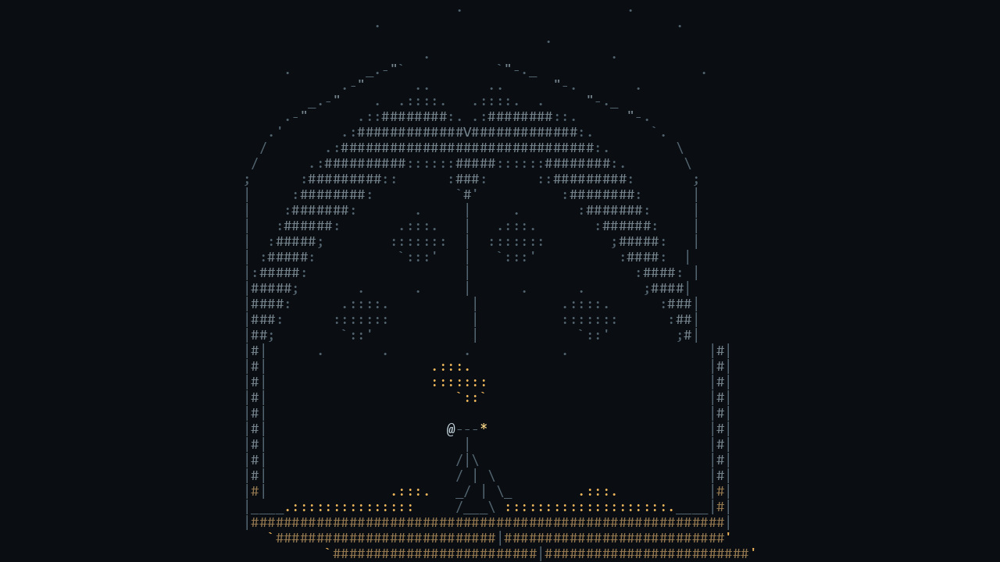

# ASCII Character Game Art

[中文版](README.md)



> **Category:** game_art
> **Domain:** game_art
> **Path:** `style-packages/game-art/ascii-character-game-art`

## Overview

Letters, numerals, and punctuation construct spaces and materials, with glyph density and type legibility as the main visual structure.

This is an independently usable style package. It turns observable medium,
composition, lighting, color, surface, texture, and reproduction decisions into
executable guidance for new subjects. It is not intended to reproduce a specific
work.

## Curatorial note

This package translates observable ASCII Character Game Art traits into transferable decisions about composition, medium, palette, and surface without recreating a source work.

## Subject independence

This package controls *how* an image is generated, not *what* it depicts.
People, objects, places, architecture, plants, vehicles, and narrative come
from your prompt. Concrete scenes in this package are examples or tests only
and must never be added as default content.

## Literal character construction

ASCII art must be stacked row by row in a fixed-width grid of printable ASCII characters. Every visible scene shape must correspond to a character cell. The final image may only rasterize those characters in a monospaced font; glyphs may be tinted, but no shape may be added beyond the grid. Do not generate an ordinary picture and then overlay character texture or imitate a character effect.

The gallery source grid is `examples/ascii-cave-grid.txt`, and its renderer is `render_gallery.py`. Run `python render_gallery.py` to rebuild `gallery-16x9.jpg` from the grid. The cave, torch, and explorer in the gallery are all drawn by stacking characters.

## Read before use

- `identity.yaml`: scope, subjects, and exclusions
- `visual-signature.yaml`: features that should survive a subject change
- `reproduction.yaml`: medium, materials, and construction order
- `prompts/base.txt`, `prompts/negative.txt`: prompt constraints
- `palette/palette.json`: color roles and values
- `evaluation.yaml`: post-generation checks
- `art-direction.yaml`: optional experimental rules for the literal-grid route; the legacy default remains available
- `references/manifest.csv`, `provenance.yaml`: sources and rights boundaries

## Sources and rights

References are used for research and visual analysis. External artworks,
photographs, game imagery, trademarks, and platform pages remain the property of
their respective rights holders. Generated examples are new anonymous scenes and
are not original works by, or endorsements from, the referenced person, movement,
school, or game.

See [`provenance.yaml`](provenance.yaml),
[`references/manifest.csv`](references/manifest.csv), and the repository
[`NOTICE`](../../../NOTICE) for source and redistribution boundaries.

## Use only this package

Choose one of the following methods.

### Method 1: Give the package to an Agent that can output a character grid

Upload this package directory to an Agent, or provide its local path, and ask:

```text
Use this style package to help me construct ASCII art.

First read identity.yaml, visual-signature.yaml, reproduction.yaml,
prompts/base.txt, prompts/negative.txt, palette/palette.json, and evaluation.yaml.
Compile their rules into the generation process. Do not use only the style name
as a prompt and do not copy a reference work.

My image request is:
<subject, objects, scene, aspect ratio, and purpose>

First output a fixed-width, row-by-row grid containing printable ASCII only.
Every scene shape must be formed by the characters themselves. Do not call an
image generator to make a picture that merely looks like ASCII art, and do not
add graphics outside the grid. To make an image, use render_gallery.py as a
reference for rasterizing the grid. Then check the grid, composition, color,
material, and request adherence against evaluation.yaml, and report any issues.
```

### Method 2: Copy the character construction rules

Replace the subject, objects, scene, and aspect ratio in `prompts/base.txt`, and
ask a text model to return a fixed-width ASCII grid. Do not submit these rules to
a standard text-to-image model. To make an image, render the grid cell by cell
in a monospaced font. `prompts/negative.txt` lists approaches to exclude.

### Method 3: Submit through your own API tool

Configure your API key in your own text-model API or prompt compiler and have it
return a character grid, then rasterize that grid cell by cell in your
application. Do not send the grid to an image-generation API for redrawing. The
repository does not host an online service or manage API keys.

### Method 4: Local model + ComfyUI

Use a local text model to produce the fixed-width character grid, then render it
with code or a ComfyUI node that preserves each glyph cell exactly. Avoid image
generation nodes that redraw the character structure. Review the output against
`evaluation.yaml`.

Users manage model weights, API keys, and generated images themselves. References
are for observable traits only; do not copy a source work's exact composition,
figures, text, trademark, or logo.

## New architecture: literal ASCII grid direction (experimental)

[`art-direction.yaml`](art-direction.yaml) uses direction format 2.1.0 to express strict character construction as compiler-readable rules: first produce a fixed-size source containing printable ASCII only, then rasterize each cell with a monospaced font. Callers must declare `literal-ascii-grid-construction`, which requires every scene shape to be composed from literal characters in the grid and forbids image-model repainting. The new direction and legacy default coexist; select the new one explicitly with `--direction package` and this context.

```powershell
python tools/compile-style.py style-packages/game-art/ascii-character-game-art --direction package --context literal-ascii-grid-construction --subject "One explorer holding a torch inside a cavern" --output runs/style-v2/ascii-job.json
python tools/render-ascii-grid.py runs/style-v2/ascii-job.json --source style-packages/game-art/ascii-character-game-art/examples/ascii-cave-grid.txt --font C:/Windows/Fonts/consola.ttf --output runs/style-v2/ascii-cave-render
```

The renderer draws only the characters in the source grid; it does not add contours, shadows, or texture outside the grid. For a new subject, author and inspect its character source before rasterizing. The direction fixes the grid at 100 columns by 36 rows. The [three-task literal-grid pilot](evidence/literal-grid-pilot/README.md) passed character-set, grid-size, basic task-readability, and same-source replay checks, but covers only one hand-authored grid per task and does not establish a style advantage or cross-subject stability.

## New architecture render sample

[View the deterministic character-grid render](examples/generated/README.md). It is rasterized from the literal source grid with a monospaced font. The [three-task literal-grid pilot](evidence/literal-grid-pilot/README.md) adds limited construction checks; neither artifact establishes generalization or overall style quality.
