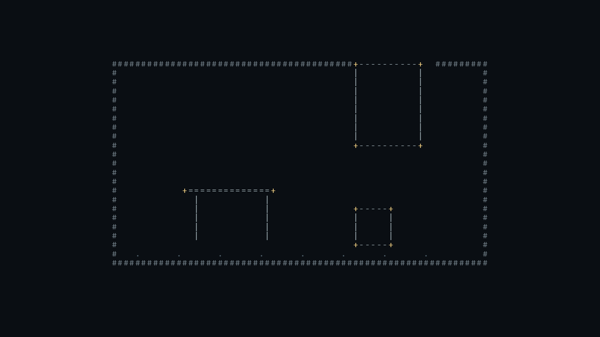
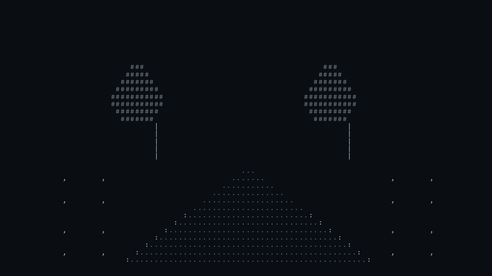
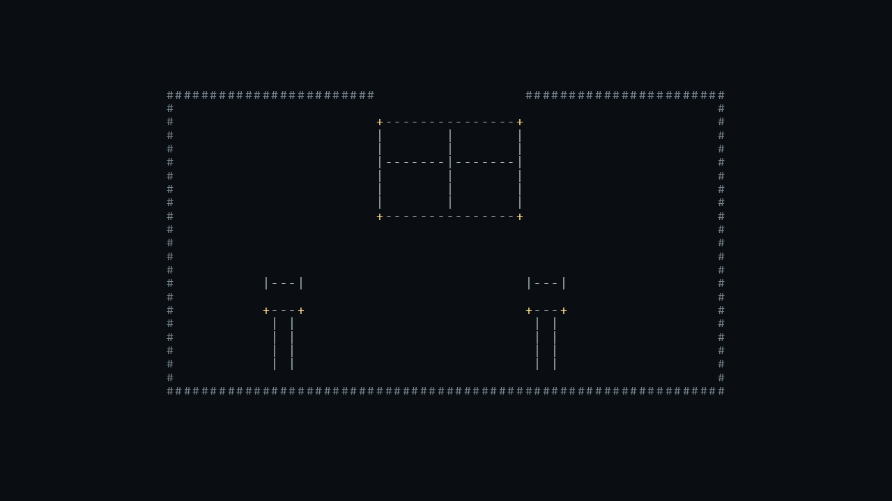

# Strict ASCII grid pilot

> Scope: deterministic construction and basic task readability for three pre-registered subjects. This is not a legacy-versus-new style comparison and does not establish a visual-quality advantage.

## Task outputs

### Workshop room

Request: 一个房间内有一张桌子、一个箱子和一个门口；对象由真实 ASCII 字符构建。

### Garden

Request: 一个有小路和两棵树的简化花园；对象由真实 ASCII 字符构建。

### Room with chairs and window

Request: 一个房间内有两把椅子和一扇窗；对象由真实 ASCII 字符构建。

## Construction and checks

- Each task has a fixed 100-column by 36-row source in `source_grid.txt`. The source files contain only printable ASCII characters; the renderer pads short rows on the right with spaces and disables word wrapping.
- Each compiled direction job and exact task request is archived as `direction-job.json`.
- Every scene pixel was rasterized from a character cell using `tools/render-ascii-grid.py`, the same hashed Consolas font file, and the same renderer environment. No image model was asked to repaint or embellish the grid.
- Each frozen source was independently rasterized twice. The two lossless master images have identical RGB pixel hashes for all three tasks. Both outputs and `render_record.json` files are retained under each task's `render-a/` and `render-b/` folders.
- The runtime records the font file path and hash, Pillow and Python versions, cell dimensions, source hash, and output hashes.

## Visual review

One reviewer inspected the three first-pass outputs against the task constraints and each core rule. Literal construction passes: every visible mark comes from a source-grid glyph. Density and negative space pass this limited check: the requested objects read at presentation size, and the garden path separates clearly from the trees. Grid alignment passes: rows use a fixed-width font and consistent cells. The workshop contains one table, one box, and one framed doorway; the garden has two separate tree silhouettes and one widening path; the last room has two chairs and one divided window. No extra pictorial geometry appears outside the grid.

This review is limited: the grids were authored directly for the tasks rather than sampled from an external text-generation provider; there is one source per task, one reviewer, and no legacy baseline arm. It confirms hard character-grid construction and basic task readability for these three cases only. Cross-subject repeatability, aesthetic quality, and the full style direction remain under review; the rule judgments are preliminary and have not been independently replicated.
