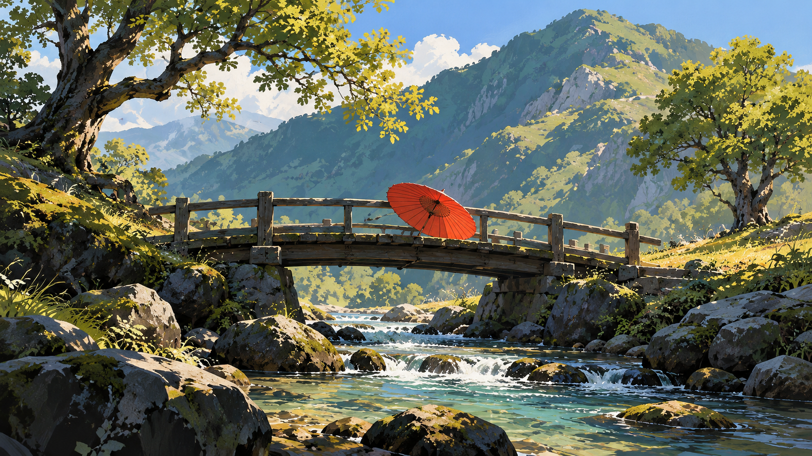
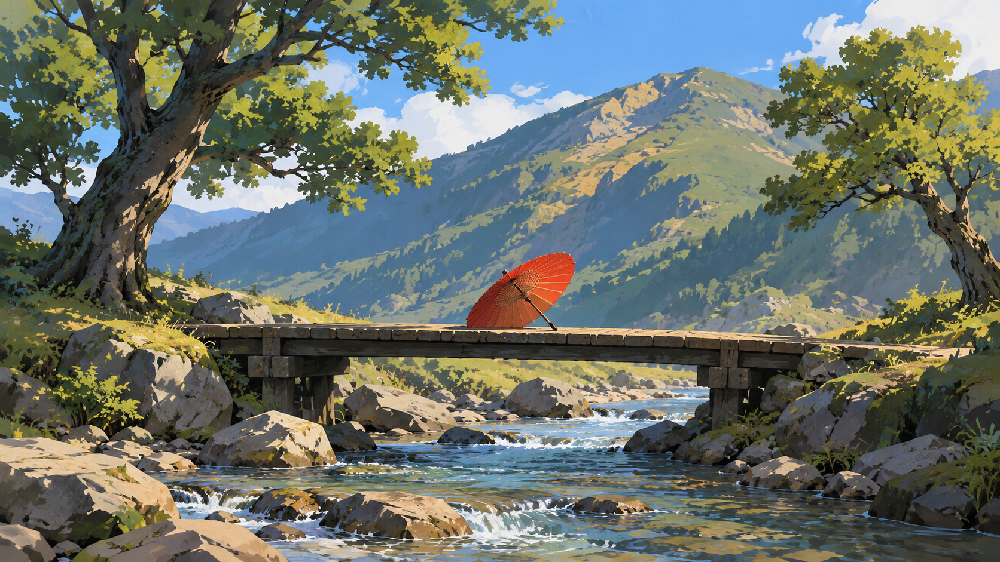
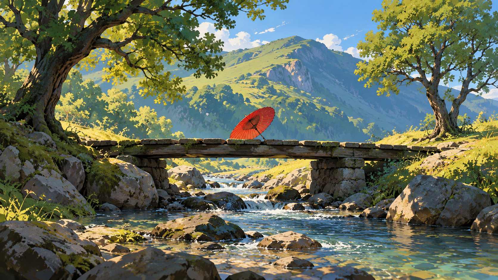
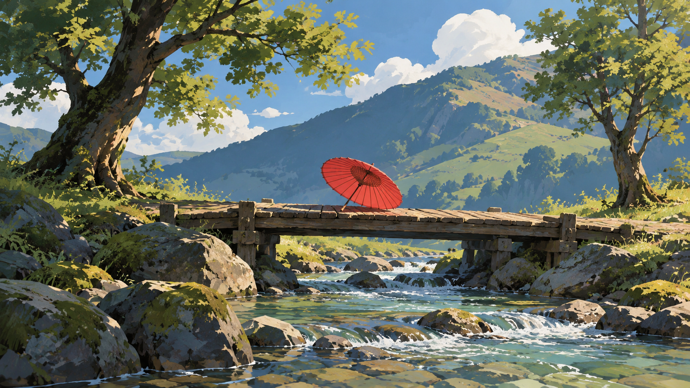

# 卡通渲染自然冒险：红伞与溪桥

> 两轮同题复核。第一轮发现 cel shading 只部分成立；第二轮收紧色阶、轮廓和纹理规则后复测。仍是单题、单人评审，不代表跨题材稳定性。

## 第二轮：修订方向复测

| 旧包编译 | 修订后的新版方向 |
| --- | --- |
|  |  |

两图都保留一把朱红色纸伞、一座木桥、浅溪、两棵树和远山；无人、无建筑，主体布局与首轮请求一致。新版的主要明暗面分界更清楚，桥面和山石形体更概括，纹理笔触减少，平面化着色比旧包更明显。山体和水面仍含连续渐变与较多细节，因此 cel shading 改善但只部分成立。

## 第一轮：原方向基线

| 旧包编译 | 原版结构化方向 |
| --- | --- |
|  |  |

第一轮的新版图与旧包结果接近，色阶仍偏连续，未能清楚体现平面化明暗。基于这个观察，我们把方向规则改为每个主要表面使用 2–4 个边界清楚的明暗区域，减少大面积连续渐变和密集笔触，并在相同请求下进行了第二轮复测。

## 逐项复核

- **主体和构图：通过。** 两轮中两组都保留请求的伞、桥、浅溪、两棵树和山坡；无人物或建筑。前景石块属于溪岸环境。
- **媒介与明暗：部分通过。** 第二轮新版的明暗面边界更清楚，较符合 cel shading；主要山体和水流仍使用连续渐变，未完全达到规则要求。
- **色彩与光线：通过。** 绿植、蓝色水山、朱红伞保持分工，日光方向和主要投影清晰。
- **表面与纹理：部分通过。** 木、石、叶片可区分；新版减少部分纹理，但局部仍偏细碎。
- **结论：规则修订有局部可见效果，尚未完全解决风格遵循问题。** 当前方向保持 `experimental`；需要其他题材及重复样本继续验证。

## 生成记录

- 四次生成都使用同一中文主体请求、不输入参考图，并调用同一图像生成工具。第一轮按旧包后新版的顺序生成；第二轮按修订新版后旧包的顺序生成。
- 两轮每个输出对应的编译任务和实际提交提示均存档在本目录。第二轮新版任务的方向哈希对应收紧后的 `art-direction.yaml`。
- 输出均为 1672 × 941 像素。工具未提供可核实的具体模型版本或随机种子，随机状态无法匹配；轮次间比较只作定性复核。
- 单人逐图目视复核。第一轮和第二轮不是盲评，也不提供统计性结论。

## English note

Two same-subject review rounds are recorded. Round 1 showed that cel shading remained weak, so the direction was revised to require 2–4 clearly bounded value regions on major surfaces, with fewer broad gradients and dense brush marks. In round 2, the revised output has clearer value boundaries, more simplified bridge and rock forms, and less texture than the legacy output. The mountain and water still contain continuous gradients, so the style is only partially achieved. All outputs preserve the requested umbrella, bridge, stream, two trees, and hillside. One reviewer inspected the images; the generator did not expose a verifiable model version or seed, and the rounds were not blind or randomized. The direction remains `experimental`.
