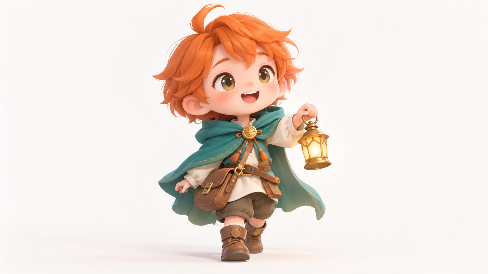
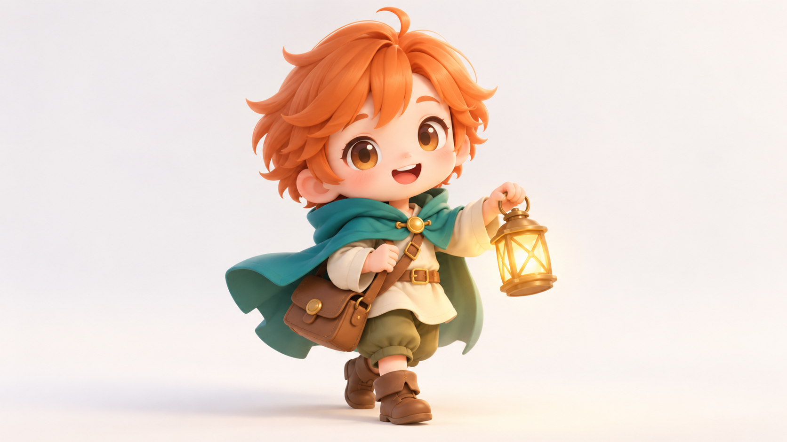

# Q版超变形三维：青绿斗篷邮差

> 单次同题对照；检查头身比例、体积和装备简化，不据此宣称新版有优势。

## 图像

| 旧包编译 | 新版结构化方向 |
| --- | --- |
|  |  |

共同请求：横版 16:9，无文字。浅色纯净背景前只有一名原创Q版奇幻邮差：头部明显大于身体，短四肢，穿青绿色短斗篷，橘色短发，手提一盏小金色灯；全身完整入镜，无其他人物、动物、建筑、标志或道具。姿势自然，面部表情清楚。

## 逐项复核

- **主体和遵循：通过。** 两图均只出现一名邮差，青绿斗篷、橘发和金色灯都在；全身完整，无额外人物或文字。
- **头身比例与媒介：两组均通过。** 两张图都有大头、短肢体和柔和简化的三维体积，面部表情可辨。
- **服装与材质：两组均通过。** 斗篷、短衫、腰带和挎包都可区分；装备细节适中，未遮挡主体比例。
- **新旧差异：未显示明显改变。** 新版图让人物略大、动作更向前；两组的比例、材质、灯具和整体呈现非常接近。旧包本身已明显符合 Q 版三维特征，单次结果没有证明结构化方向带来更好的风格表达。
- **结论：** 主体与风格任务都完成，但新版相对旧包的增量效果未通过本次检验。方向保持 `experimental`。

## 生成记录

- 两组使用完全相同的中文请求，不输入参考图，各自独立调用同一图像生成工具。
- `legacy-job.json`、`direction-job.json` 保存编译任务；对应实际提交提示（编译 Prompt 加负面约束）保存在两个 `*-prompt.txt` 文件。
- 输出均为 1672 × 941 像素。工具未提供可核实的具体模型版本或随机种子，随机状态无法匹配。
- 单人目视复核两张原图。此评审只覆盖一个人物设计和一轮输出。

## English note

This single same-subject comparison checks head-to-body ratio, form, and simplified gear. Both outputs show one full-body courier with an oversized head, short limbs, teal cape, orange hair, and gold lantern on a clean background. The structured-direction figure is slightly larger and leans forward, but proportions, materials, lantern, and overall treatment are nearly identical. The legacy package already strongly expresses chibi 3D traits, so this trial does not show a clear incremental effect from the structured direction. One reviewer inspected the images; model version and seed were unavailable. The direction remains `experimental`.
