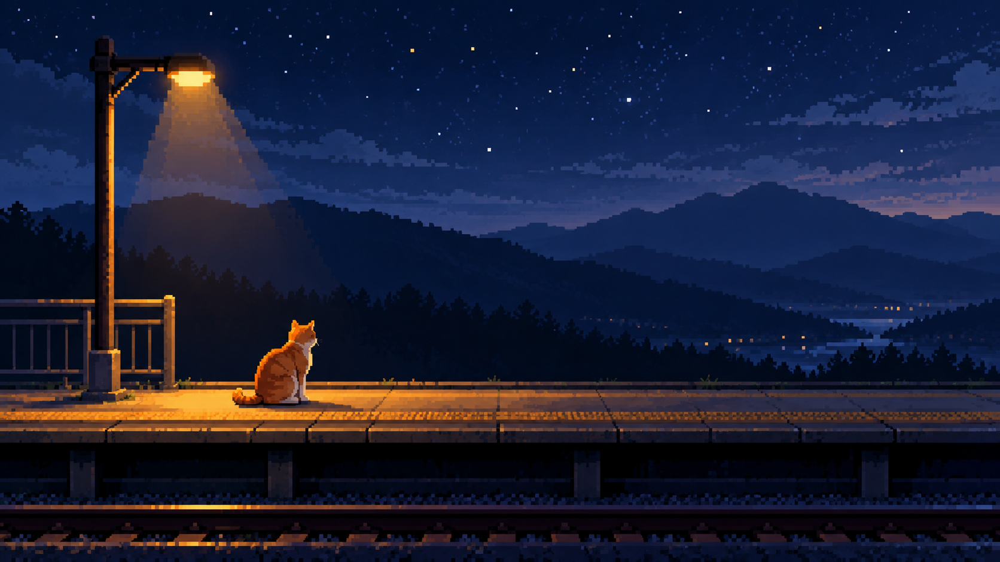

# 电影化像素冒险：夜站台上的橘猫

> 单次同题对照；检查像素簇、冷暖层次与用户内容遵循度，不据此推断跨题材稳定性。

## 图像

| 旧包编译 | 新版结构化方向 |
| --- | --- |
|  |  |

共同请求：横版 16:9，无文字。夜晚空旷的户外站台上只有一只橘猫，猫停在一盏暖黄色站台灯下；背景为深蓝夜空和三层远处山形剪影，不出现人物、列车、建筑标识或其他动物。猫的轮廓清晰，地面与远景分层可读。

## 逐项复核

- **媒介：通过。** 两图都以清晰的阶梯像素簇构成猫、灯、站台和山形，没有用平滑重绘替换像素边缘。
- **空间层级：新版较明确。** 新版把前景平台、近山、远山和天空分成较清楚的层次；旧版也有多层山形和开阔天空，差异有限。
- **冷暖关系：通过。** 两图都以暖灯和橘猫对比冷蓝夜空。新版的灯下暖色区域较集中。
- **主体与约束：主体通过，细节有偏离。** 两图都只有一只猫，无人物、列车或标识。新版额外加入了月牙和多颗星点；任务没有要求这些装饰，因此记为轻微内容扩展。
- **结论：** 新版的分层和暖光焦点更明显，但仍保留像素媒介与用户主体。单次输出无法证明普遍优势，方向保持 `experimental`。

## 生成记录

- 两组使用完全相同的中文请求，不输入参考图，分别独立调用同一图像生成工具。
- 编译结果保存在 `legacy-job.json` 和 `direction-job.json`；对应实际提交提示（编译 Prompt 加负面约束）保存在 `legacy-prompt.txt` 和 `direction-prompt.txt`。
- 输出均为 1672 × 941 像素。工具没有提供可核实的具体模型版本或随机种子，随机状态无法匹配。
- 单人目视复核原图；主体数、像素媒介和主要层级通过，新版额外月亮与星点记作约束偏离。

## English note

This single same-subject comparison checks pixel clusters, warm-cool depth, and request adherence. Both outputs preserve one orange cat under a warm platform lamp against a dark-blue sky and layered mountain silhouettes. Crisp stepped pixel clusters remain visible in both. The structured-direction output separates foreground and distant layers more clearly and concentrates the warm light, but adds an unrequested crescent moon and stars. No people, train, signs, or other animals appear. One reviewer inspected the original images; the generator did not expose a verifiable model version or seed. The direction remains `experimental`.
