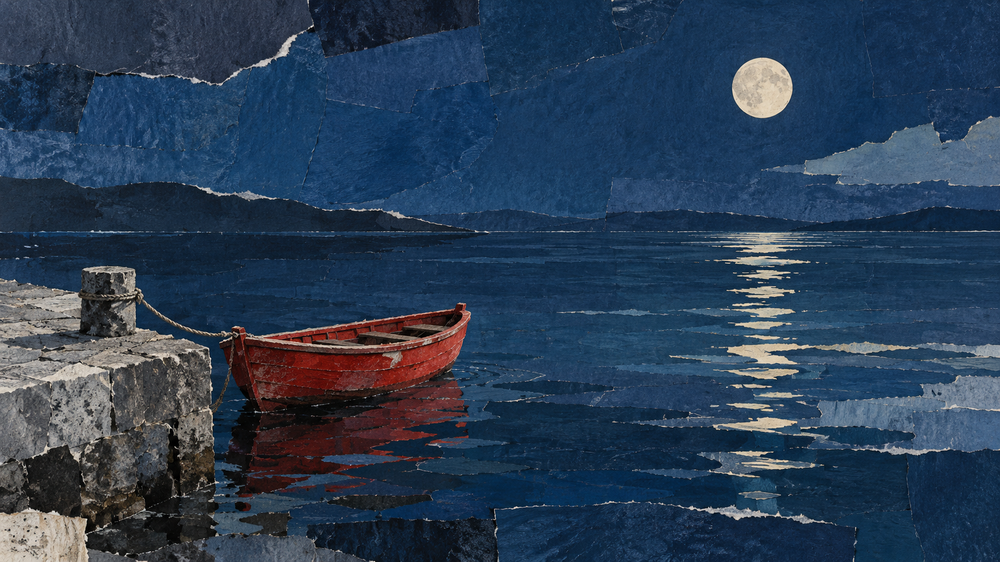
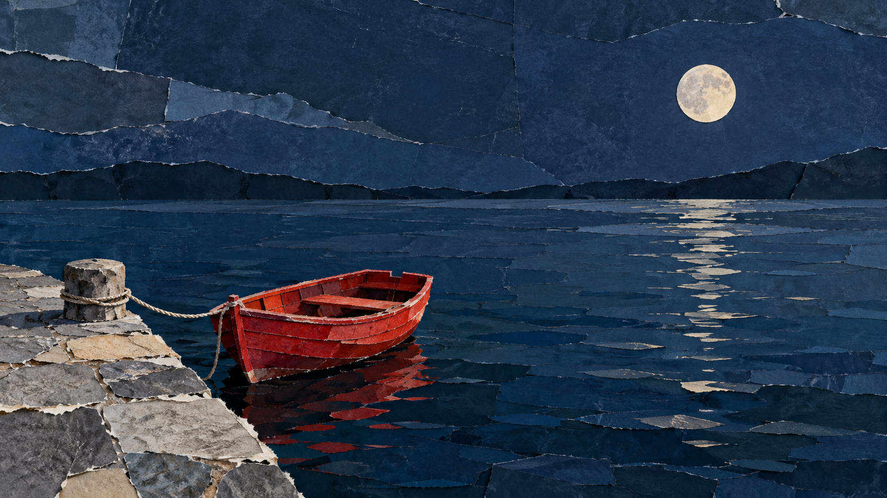

# 拼贴混合媒材：月下红木船

> 单次同题对照；记录新版规则是否改变接缝、层叠和材质表现，不据此推断整体优势。

## 图像

| 旧包编译 | 新版结构化方向 |
| --- | --- |
|  |  |

共同请求：横版 16:9，无文字。静水旁有一艘小红色木船，系在灰色石码头边；船上无人，远处只有一轮淡色月亮，构图简洁，留出大片水面和夜空，不加入其他船只、建筑、人物或标志。

## 观察结果

两图都保留一艘红色木船、灰色石码头和一轮月亮；海面、天空、岸石与船体均由明显分层的纸片质感构成，撕切边缘和材料纹理可见。新版的海面接缝更宽、更连续，红船略大；旧包的纸片边界更碎，前景码头占比更大。两种结果都清楚呈现拼贴媒材，新增规则没有带来明显的整体质量优势。

媒介、层级、有限色域和接缝纹理在两张图中均可辨。新版与旧版基线所含规则接近；这一单次输出只能表明结构化方向保留了风格，无法说明格式重组本身带来稳定改善。方向保持 `experimental`。

## 生成记录

- 两组使用完全相同的中文主体请求，不输入参考图，分别独立调用同一图像生成工具。
- `legacy-job.json`、`direction-job.json` 保存编译结果；对应的 `*-prompt.txt` 是实际提交提示（编译 Prompt 加负面约束）。新版编译记录包含方向文件哈希。
- 输出均为 1672 × 941 像素。工具未提供可核实的模型版本或随机种子；两次生成的随机状态无法匹配。
- 单人目视复核两张原图；主体数量及拼贴特征通过，风格优势不通过。需用其他题材及重复结果继续评估。

## English note

This single same-subject comparison records changes in seams, layering, and material treatment without claiming an overall advantage. Both outputs show one red wooden boat beside a gray stone pier under one pale moon. The water, sky, shore, and boat use visibly layered paper textures with torn or cut edges. The structured-direction output has broader, more continuous water seams and a slightly larger boat; the legacy image has finer paper boundaries and a larger foreground pier. Both clearly read as collage, and the new rules do not show a clear overall quality advantage. One reviewer checked the original images. The generator did not expose a verifiable model version or seed; each arm has one output.
