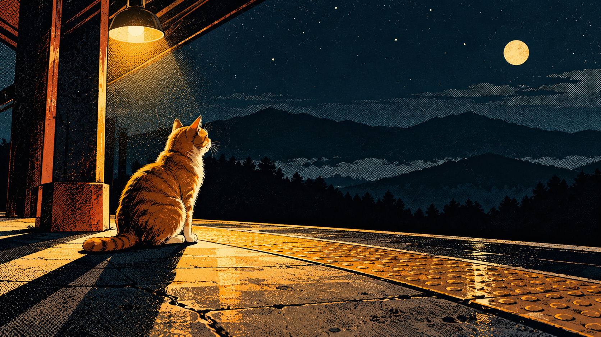
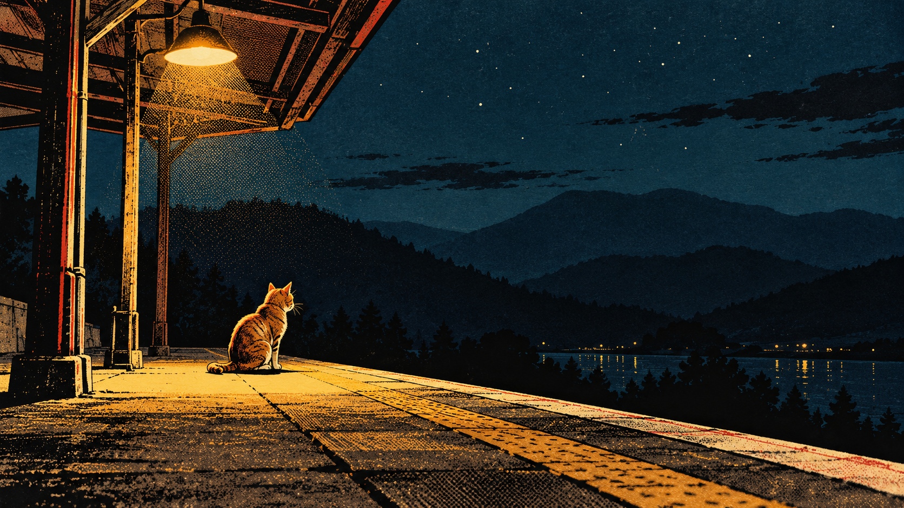

# 漫画网点叙事：夜站台上的橘猫

> 单次同题对照；检查印刷媒介、网点与戏剧构图，不代表跨题材稳定性。

## 图像

| 旧包编译 | 新版结构化方向 |
| --- | --- |
|  |  |

共同请求：横版 16:9，无文字。夜晚空旷的户外站台上只有一只橘猫，猫停在一盏暖黄色站台灯下；背景为深蓝夜空和三层远处山形剪影，不出现人物、列车、建筑标识或其他动物。猫的轮廓清晰，地面与远景分层可读。

## 逐项复核

- **主体和数量：通过。** 两图都保留一只橘猫、暖黄色站台灯和分层的深色远景；未见人物、列车、文字或标志。新版加入站台顶棚结构，属于环境补充。
- **媒介：新版特征更强。** 新版使用明显的网点、粗细变化的墨色轮廓、平涂暖色和近似印刷的颗粒；旧包图也有颗粒，但更接近像素化游戏插画。
- **构图：新版戏剧性更强。** 新版把灯柱、顶棚和地面边缘组成斜向框景，并扩大猫在近景中的视觉权重；旧包强调开阔天空和远景层次。
- **色彩：两组均可读。** 暖橙光与深蓝背景形成对比；新版更接近黑、金黄、暗青的有限印刷色组。
- **结论：** 同一主体在两组中呈现出明显不同的媒介和构图处理；新版的漫画印刷特征更清楚。单次生成仍不能证明跨主题稳定性；方向保持 `experimental`。

## 生成记录

- 两组使用完全相同的中文请求，不输入参考图，分别独立调用同一图像生成工具。
- 编译结果保存在 `legacy-job.json` 和 `direction-job.json`；实际提交提示（编译 Prompt 加负面约束）保存在对应的 `*-prompt.txt` 文件。
- 输出均为 1672 × 941 像素。工具没有提供可核实的具体模型版本或随机种子，随机状态无法匹配。
- 单人目视复核原图。方向差异主要来自新版明确的漫画网点规则；评审未将单次结果解释为普遍质量优势。

## English note

This single same-subject comparison checks print medium, halftone, and dramatic composition. Both outputs preserve one orange cat, a warm platform lamp, and layered dark mountains. The structured-direction output has stronger halftone, variable ink outlines, flat warm color, and print-like grain; it also frames the cat more dramatically with the lamp canopy and platform edges. The legacy output emphasizes open sky and distant layers and reads more like a pixel-game illustration. The subject remains legible in both. One reviewer inspected the original images; model version and seed were unavailable. The direction remains `experimental`.
