# Movements and periods

[中文](README.md)

This directory contains 87 independent style packages. Each card uses a horizontal 16:9 representative image; click an image or name to open the package README.

<table>
<tr>
<td width="33%" valign="top" align="center"><a href="abstract-expressionism/README.en.md">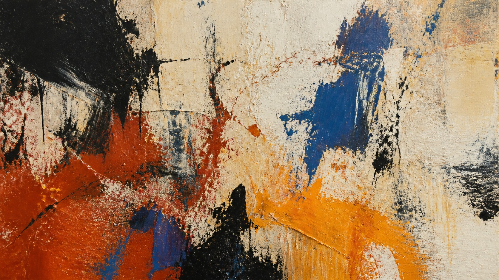</a> <strong>Abstract Expressionism</strong> <a href="abstract-expressionism/README.en.md">Open README</a></td>
<td width="33%" valign="top" align="center"> <strong>Art Deco</strong> <a href="art-deco/README.en.md">Open README</a></td>
<td width="33%" valign="top" align="center"><a href="art-nouveau/README.en.md">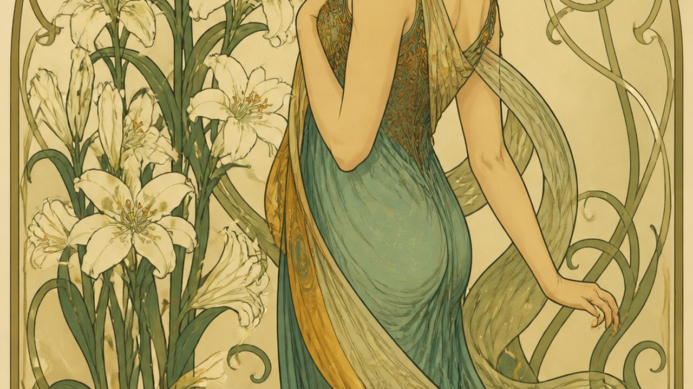</a> <strong>Art Nouveau</strong> <a href="art-nouveau/README.en.md">Open README</a></td>
</tr>
<tr>
<td width="33%" valign="top" align="center"><a href="arts-and-crafts/README.en.md">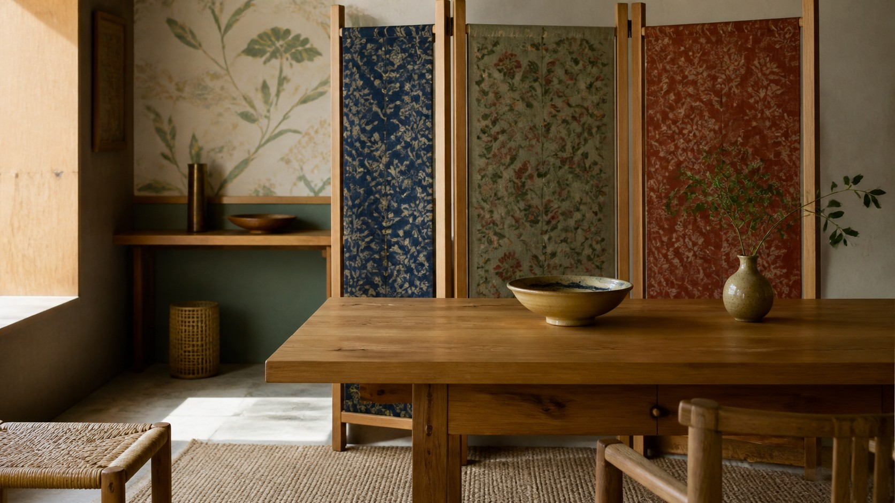</a> <strong>Arts and Crafts Movement</strong> <a href="arts-and-crafts/README.en.md">Open README</a></td>
<td width="33%" valign="top" align="center"> <strong>Baroque</strong> <a href="baroque/README.en.md">Open README</a></td>
<td width="33%" valign="top" align="center"><a href="conceptual-art/README.en.md">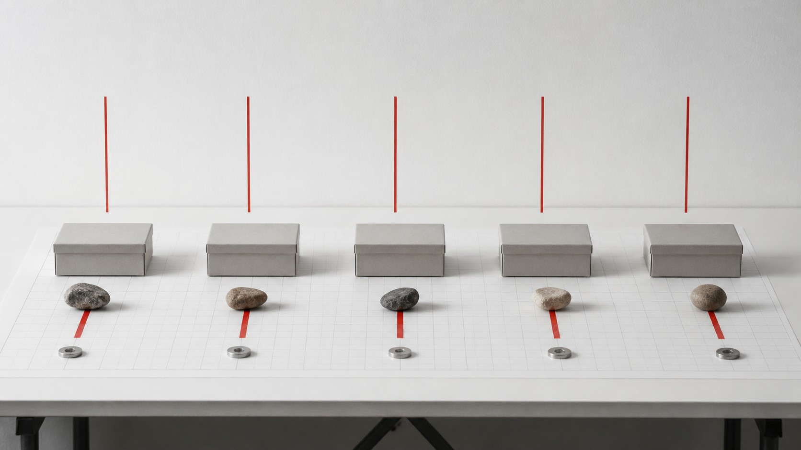</a> <strong>Conceptual Art</strong> <a href="conceptual-art/README.en.md">Open README</a></td>
</tr>
<tr>
<td width="33%" valign="top" align="center"><a href="constructivism/README.en.md">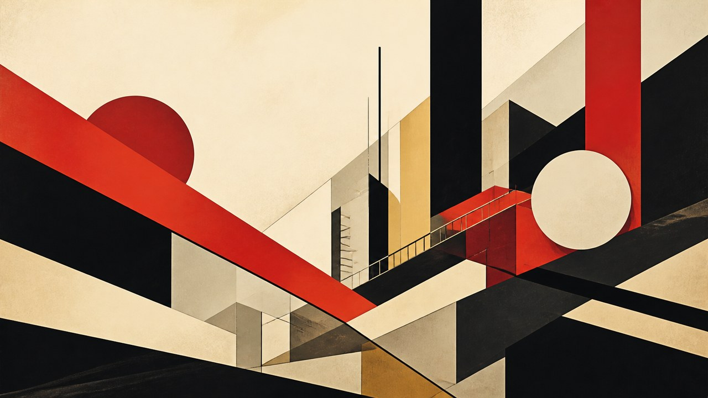</a> <strong>Constructivism</strong> <a href="constructivism/README.en.md">Open README</a></td>
<td width="33%" valign="top" align="center"><a href="cubism/README.en.md">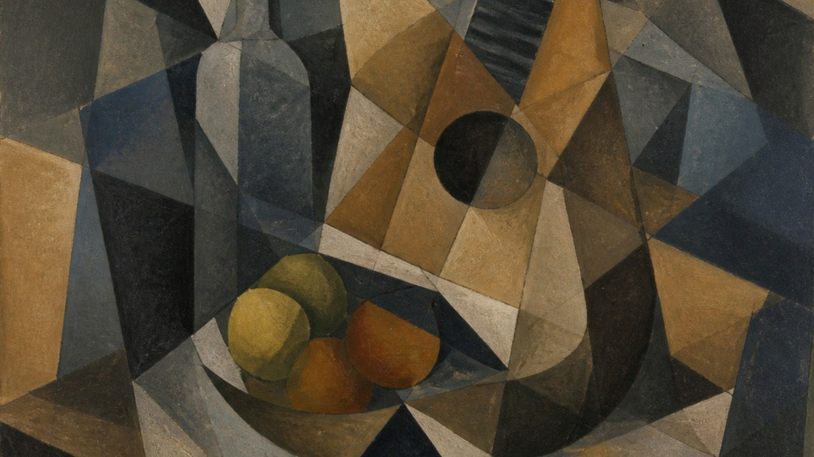</a> <strong>Cubism</strong> <a href="cubism/README.en.md">Open README</a></td>
<td width="33%" valign="top" align="center"><a href="dada/README.en.md">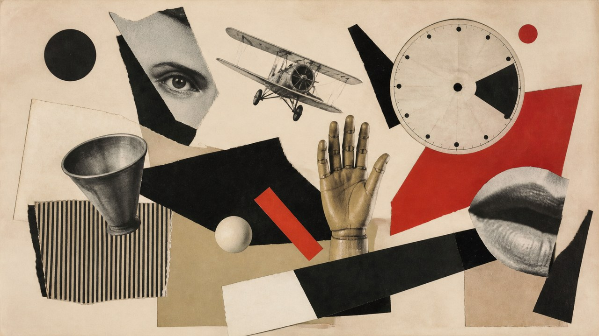</a> <strong>Dada</strong> <a href="dada/README.en.md">Open README</a></td>
</tr>
<tr>
<td width="33%" valign="top" align="center"> <strong>De Stijl</strong> <a href="de-stijl/README.en.md">Open README</a></td>
<td width="33%" valign="top" align="center"><a href="expressionism/README.en.md">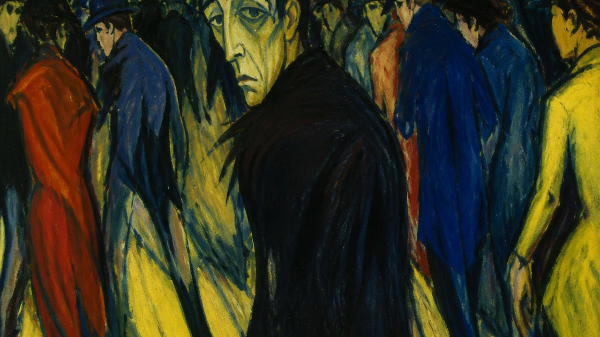</a> <strong>Expressionism</strong> <a href="expressionism/README.en.md">Open README</a></td>
<td width="33%" valign="top" align="center"><a href="futurism/README.en.md">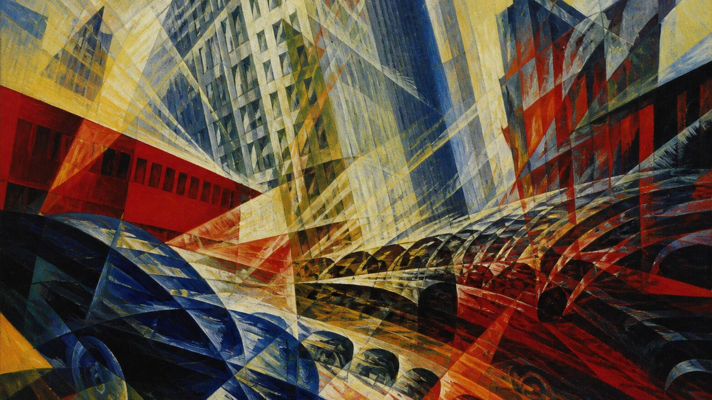</a> <strong>Futurism</strong> <a href="futurism/README.en.md">Open README</a></td>
</tr>
<tr>
<td width="33%" valign="top" align="center"><a href="greek-archaic-period/README.en.md">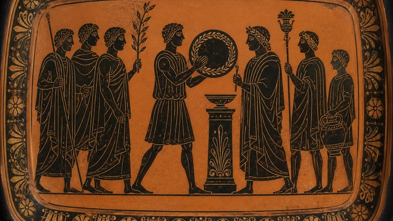</a> <strong>Greek Archaic Period</strong> <a href="greek-archaic-period/README.en.md">Open README</a></td>
<td width="33%" valign="top" align="center"><a href="greek-classical-period/README.en.md">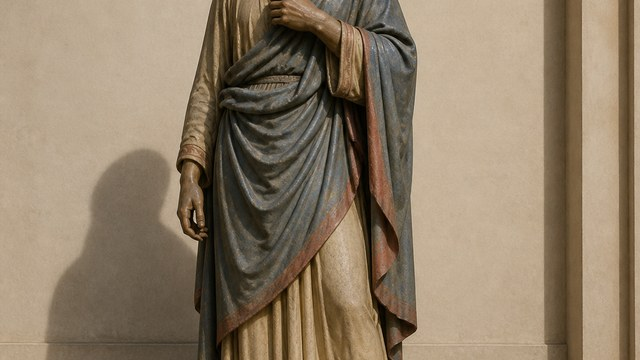</a> <strong>Greek Classical Period</strong> <a href="greek-classical-period/README.en.md">Open README</a></td>
<td width="33%" valign="top" align="center"><a href="greek-geometric-period/README.en.md">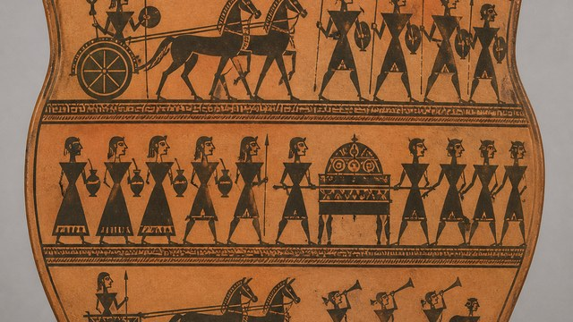</a> <strong>Greek Geometric Period</strong> <a href="greek-geometric-period/README.en.md">Open README</a></td>
</tr>
<tr>
<td width="33%" valign="top" align="center"><a href="greek-hellenistic-period/README.en.md">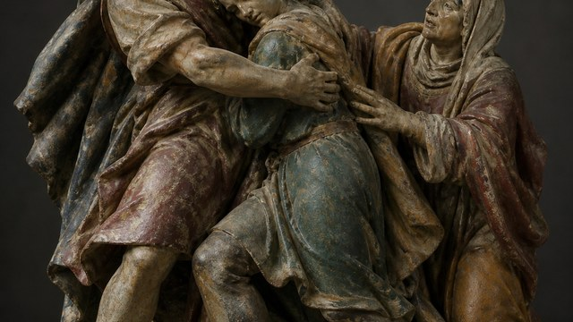</a> <strong>Greek Hellenistic Period</strong> <a href="greek-hellenistic-period/README.en.md">Open README</a></td>
<td width="33%" valign="top" align="center"> <strong>Harlem Renaissance</strong> <a href="harlem-renaissance/README.en.md">Open README</a></td>
<td width="33%" valign="top" align="center"> <strong>Impressionism</strong> <a href="impressionism/README.en.md">Open README</a></td>
</tr>
<tr>
<td width="33%" valign="top" align="center"> <strong>International Typographic Style</strong> <a href="international-typographic-style/README.en.md">Open README</a></td>
<td width="33%" valign="top" align="center"><a href="italian-high-renaissance-raphaelesque/README.en.md">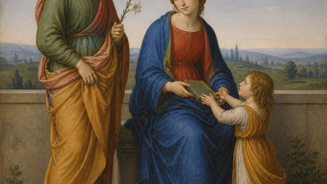</a> <strong>Italian High Renaissance</strong> <a href="italian-high-renaissance-raphaelesque/README.en.md">Open README</a></td>
<td width="33%" valign="top" align="center"><a href="land-art/README.en.md">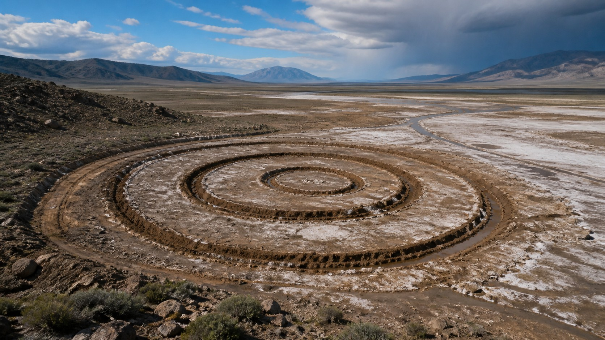</a> <strong>Land Art</strong> <a href="land-art/README.en.md">Open README</a></td>
</tr>
<tr>
<td width="33%" valign="top" align="center"><a href="magic-realism/README.en.md">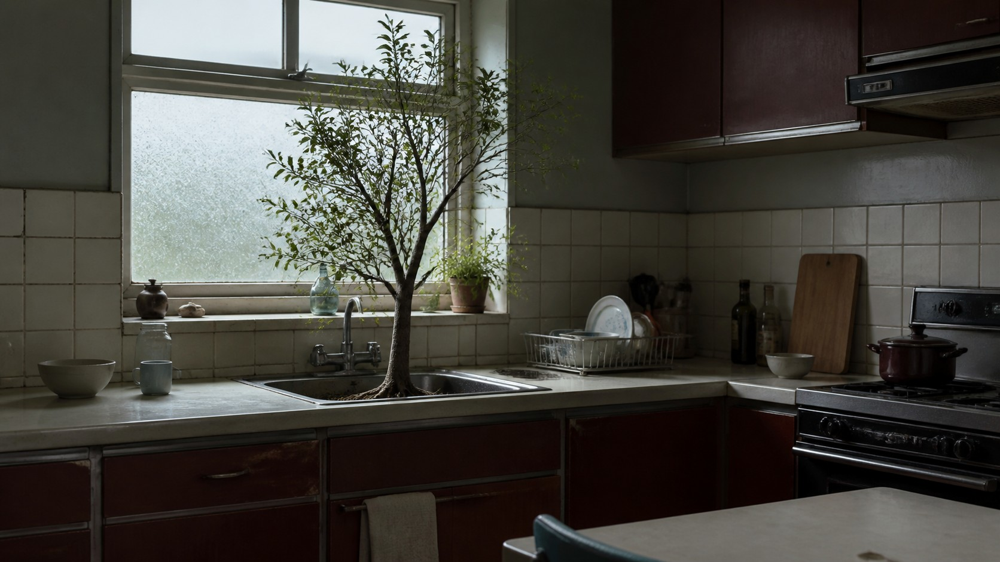</a> <strong>Magic Realism</strong> <a href="magic-realism/README.en.md">Open README</a></td>
<td width="33%" valign="top" align="center"><a href="mannerism/README.en.md">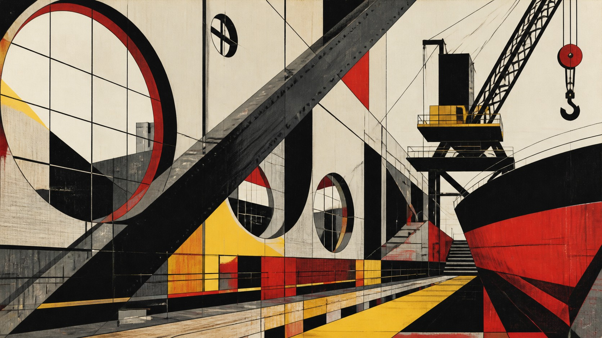</a> <strong>Mannerism</strong> <a href="mannerism/README.en.md">Open README</a></td>
<td width="33%" valign="top" align="center"><a href="minimalism/README.en.md">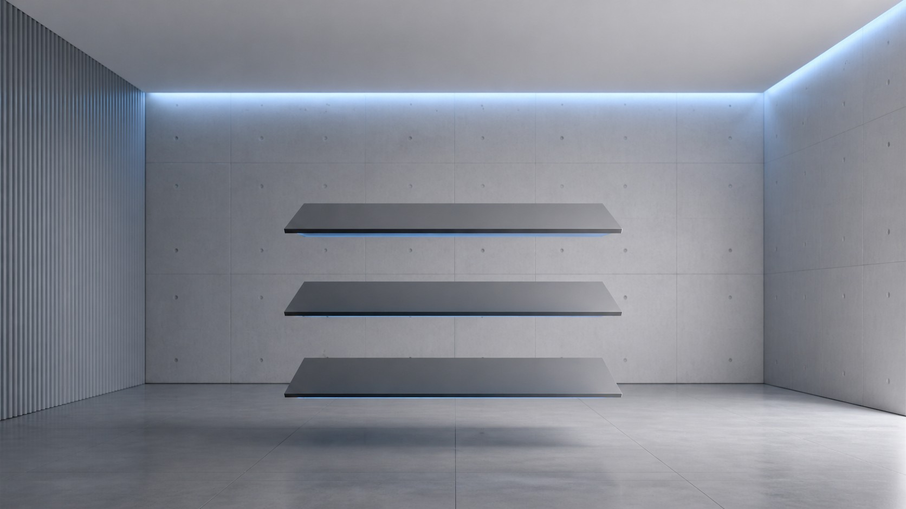</a> <strong>Minimalism</strong> <a href="minimalism/README.en.md">Open README</a></td>
</tr>
<tr>
<td width="33%" valign="top" align="center"><a href="neoclassicism/README.en.md">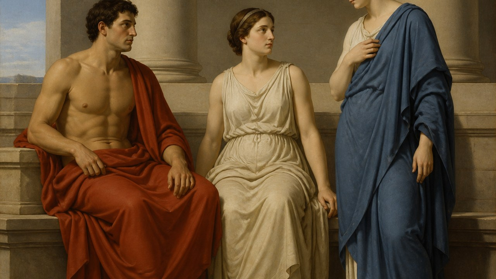</a> <strong>Neoclassicism</strong> <a href="neoclassicism/README.en.md">Open README</a></td>
<td width="33%" valign="top" align="center"> <strong>Neue Sachlichkeit / New Objectivity</strong> <a href="neue-sachlichkeit/README.en.md">Open README</a></td>
<td width="33%" valign="top" align="center"><a href="new-topographics/README.en.md">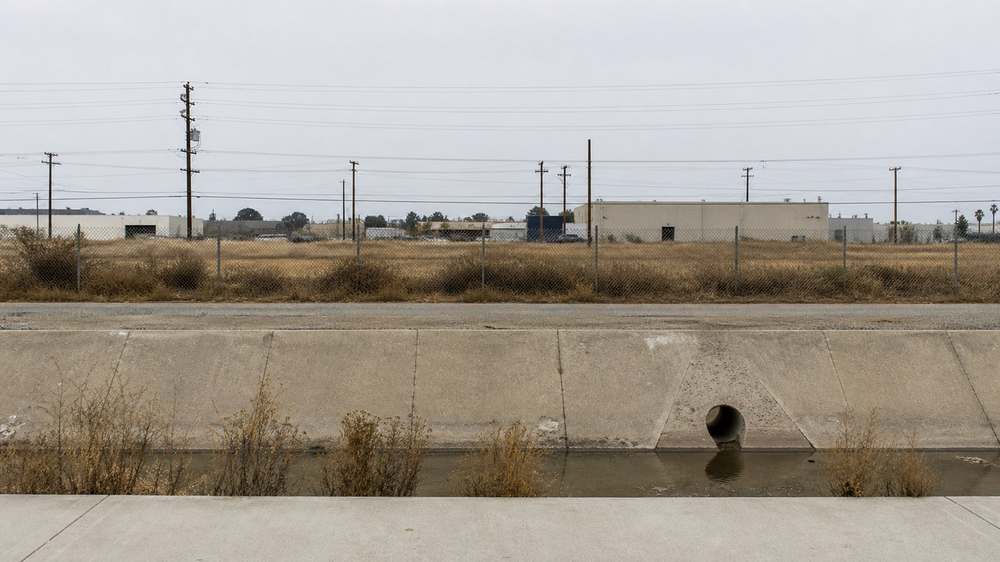</a> <strong>New Topographics</strong> <a href="new-topographics/README.en.md">Open README</a></td>
</tr>
<tr>
<td width="33%" valign="top" align="center"> <strong>Northern Renaissance</strong> <a href="northern-renaissance/README.en.md">Open README</a></td>
<td width="33%" valign="top" align="center"><a href="op-art/README.en.md">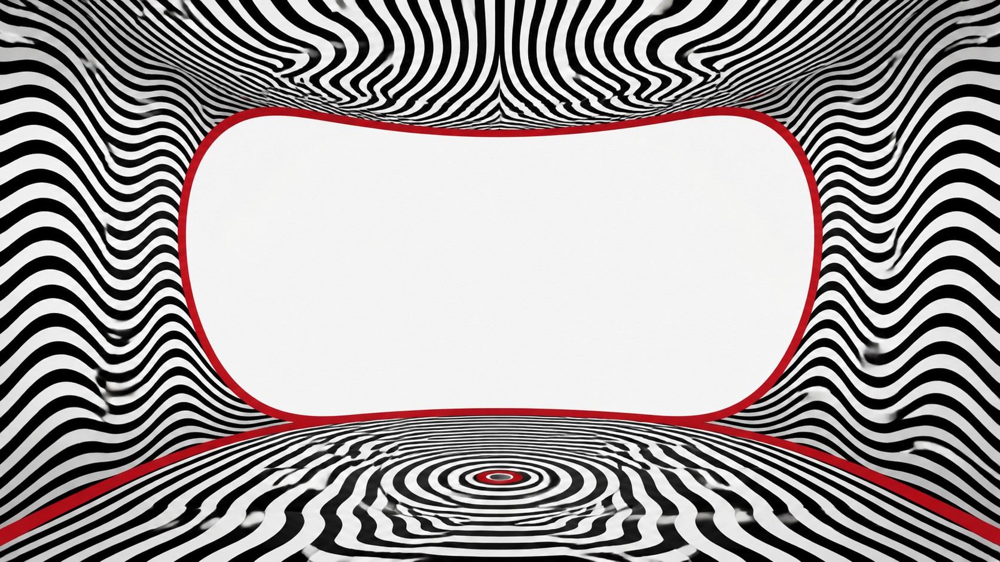</a> <strong>Op Art</strong> <a href="op-art/README.en.md">Open README</a></td>
<td width="33%" valign="top" align="center"> <strong>Photorealism</strong> <a href="photorealism/README.en.md">Open README</a></td>
</tr>
<tr>
<td width="33%" valign="top" align="center"><a href="pop-art/README.en.md">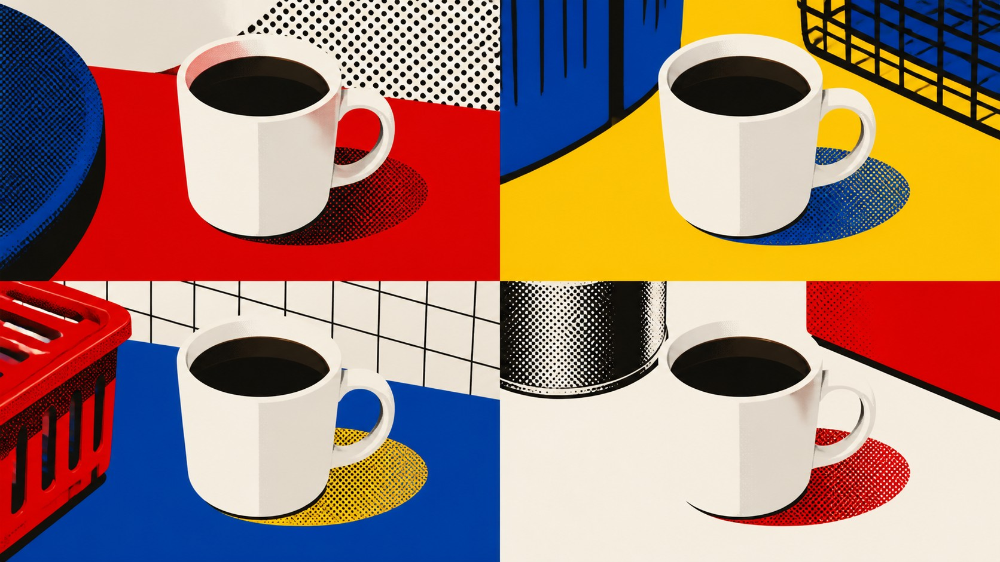</a> <strong>Pop Art</strong> <a href="pop-art/README.en.md">Open README</a></td>
<td width="33%" valign="top" align="center"><a href="post-impressionism/README.en.md">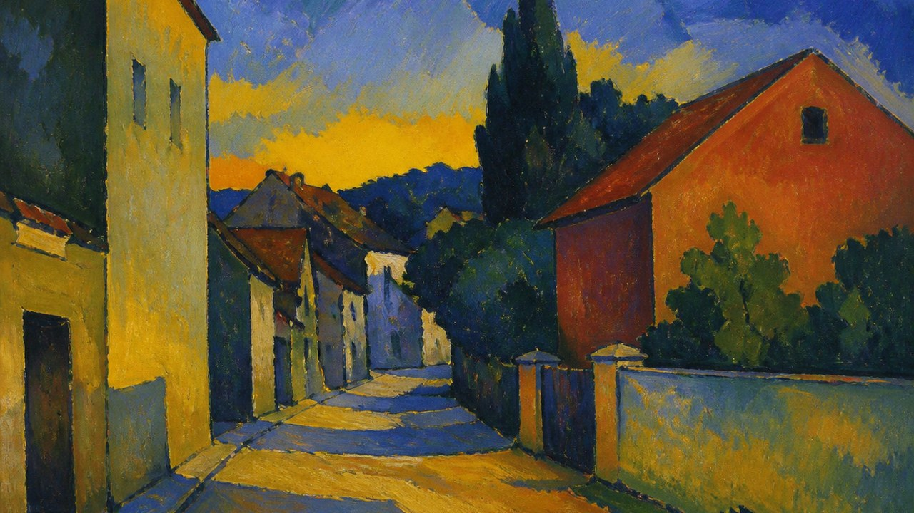</a> <strong>Post-Impressionism</strong> <a href="post-impressionism/README.en.md">Open README</a></td>
<td width="33%" valign="top" align="center"><a href="pre-raphaelites/README.en.md">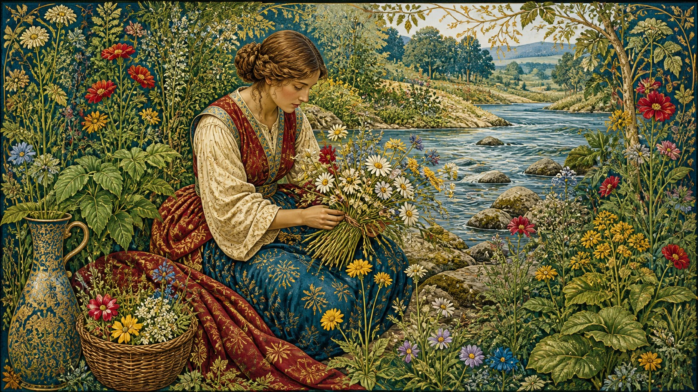</a> <strong>Pre-Raphaelite Brotherhood</strong> <a href="pre-raphaelites/README.en.md">Open README</a></td>
</tr>
<tr>
<td width="33%" valign="top" align="center"> <strong>Precisionism</strong> <a href="precisionism/README.en.md">Open README</a></td>
<td width="33%" valign="top" align="center"><a href="realism/README.en.md">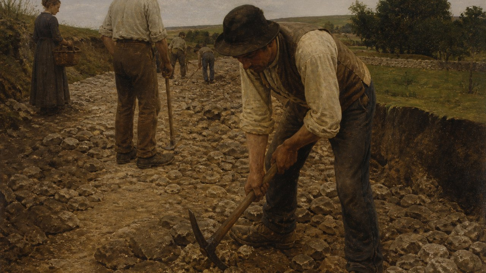</a> <strong>Realism</strong> <a href="realism/README.en.md">Open README</a></td>
<td width="33%" valign="top" align="center"><a href="renaissance/README.en.md">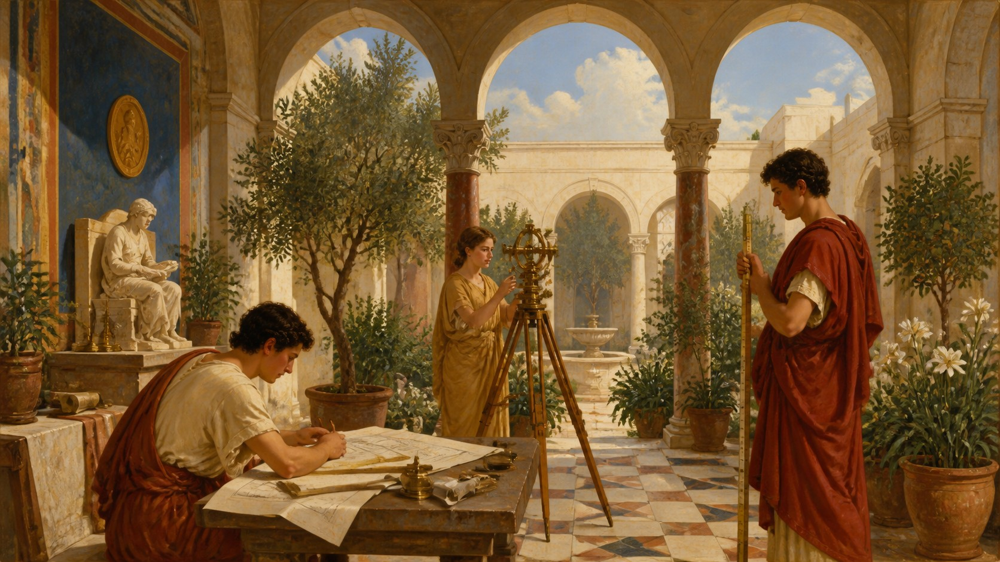</a> <strong>Renaissance</strong> <a href="renaissance/README.en.md">Open README</a></td>
</tr>
<tr>
<td width="33%" valign="top" align="center"><a href="rococo/README.en.md">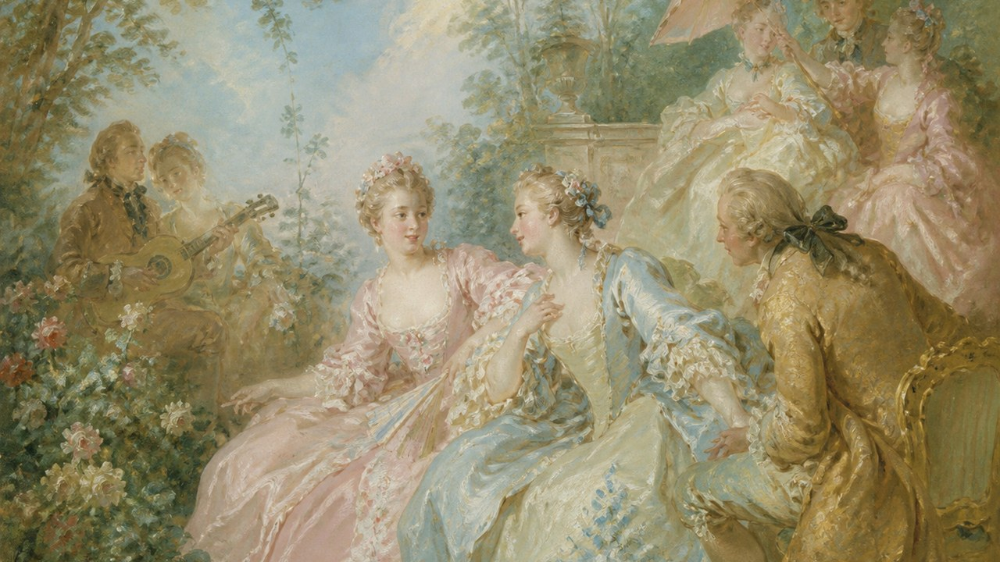</a> <strong>Rococo</strong> <a href="rococo/README.en.md">Open README</a></td>
<td width="33%" valign="top" align="center"> <strong>Romanticism</strong> <a href="romanticism/README.en.md">Open README</a></td>
<td width="33%" valign="top" align="center"> <strong>Socialist Realism</strong> <a href="socialist-realism/README.en.md">Open README</a></td>
</tr>
<tr>
<td width="33%" valign="top" align="center"><a href="suprematism/README.en.md">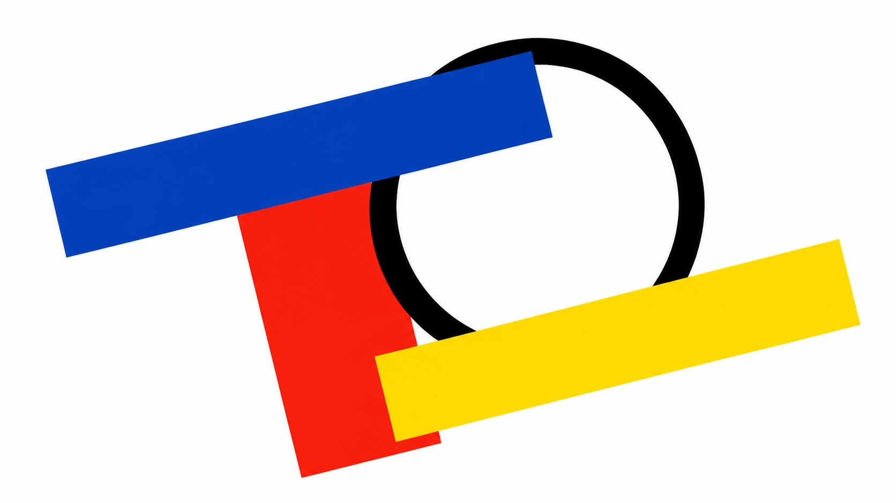</a> <strong>Suprematism</strong> <a href="suprematism/README.en.md">Open README</a></td>
<td width="33%" valign="top" align="center"><a href="surrealism/README.en.md">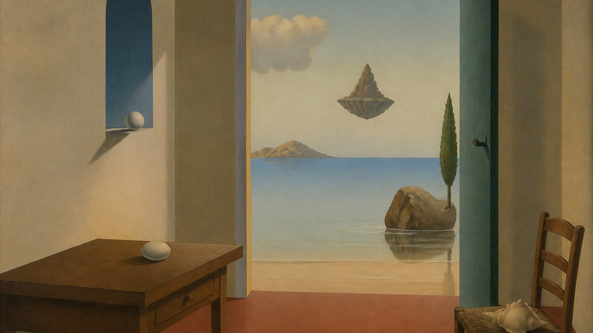</a> <strong>Surrealism</strong> <a href="surrealism/README.en.md">Open README</a></td>
<td width="33%" valign="top" align="center"><a href="symbolism/README.en.md">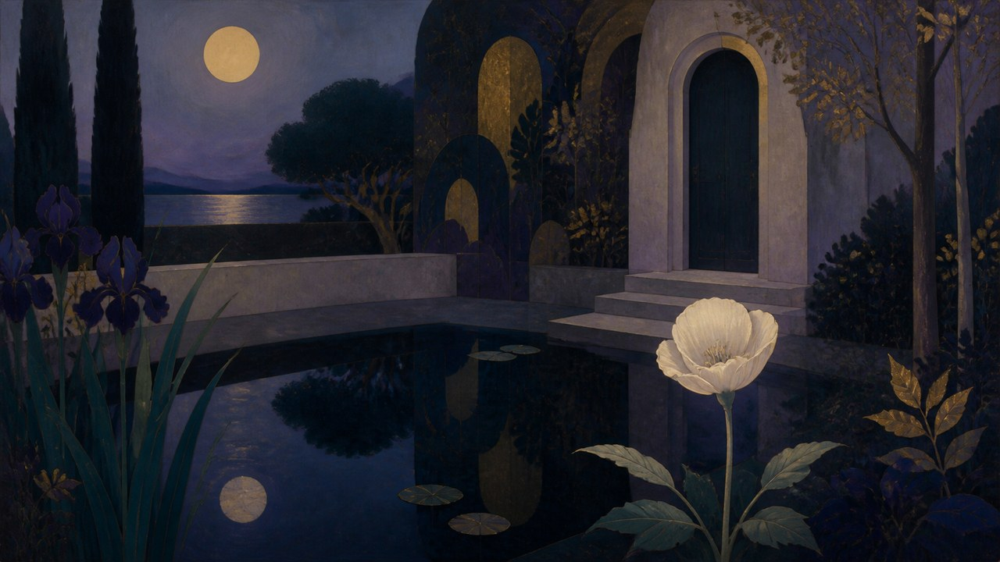</a> <strong>Symbolism</strong> <a href="symbolism/README.en.md">Open README</a></td>
</tr>
</table>

## Additional packages

The cards below complete the category index.

<table width="100%">
<tr><td width="33%" valign="top" align="center"><a href="./aestheticism/README.en.md">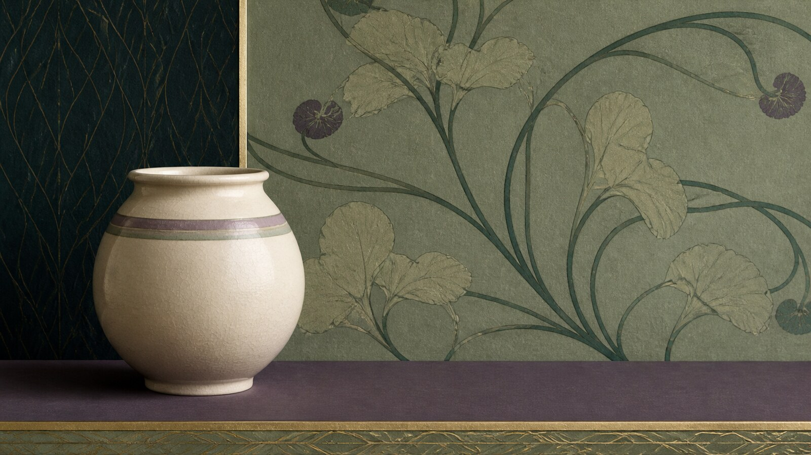</a> <strong>Aestheticism</strong> <a href="./aestheticism/README.en.md">Open README</a></td><td width="33%" valign="top" align="center"> <strong>American Luminism</strong> <a href="./american-luminism/README.en.md">Open README</a></td><td width="33%" valign="top" align="center"><a href="./art-brut/README.en.md">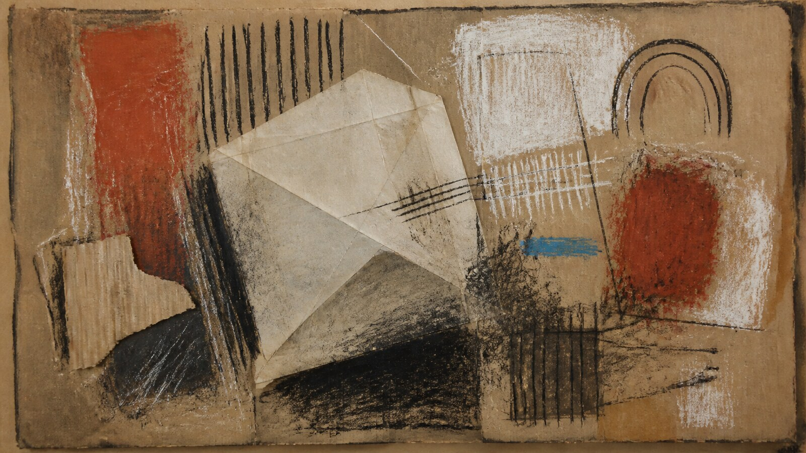</a> <strong>Art Brut</strong> <a href="./art-brut/README.en.md">Open README</a></td></tr>
<tr><td width="33%" valign="top" align="center"><a href="./art-informel/README.en.md">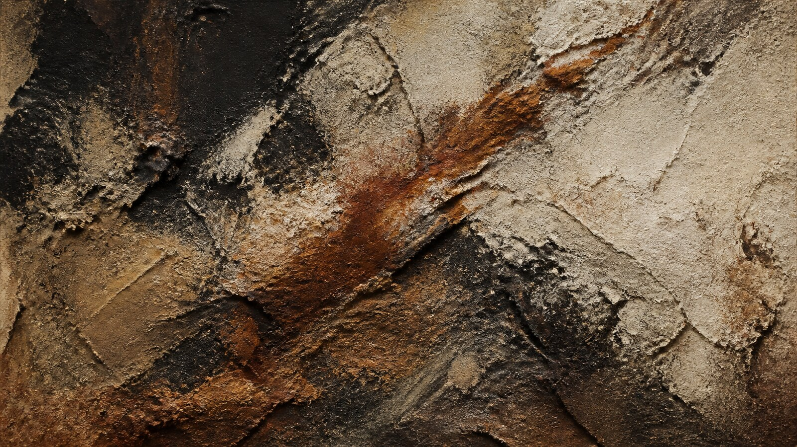</a> <strong>Art Informel</strong> <a href="./art-informel/README.en.md">Open README</a></td><td width="33%" valign="top" align="center"><a href="./arte-povera/README.en.md">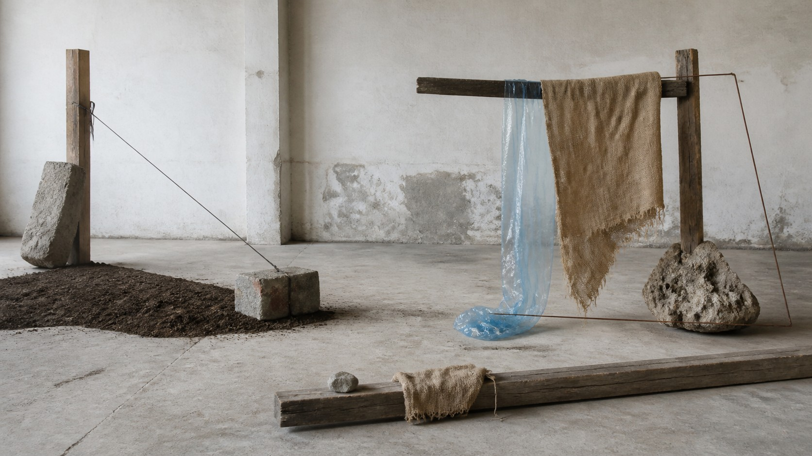</a> <strong>Arte Povera</strong> <a href="./arte-povera/README.en.md">Open README</a></td><td width="33%" valign="top" align="center"><a href="./bohemian/README.en.md">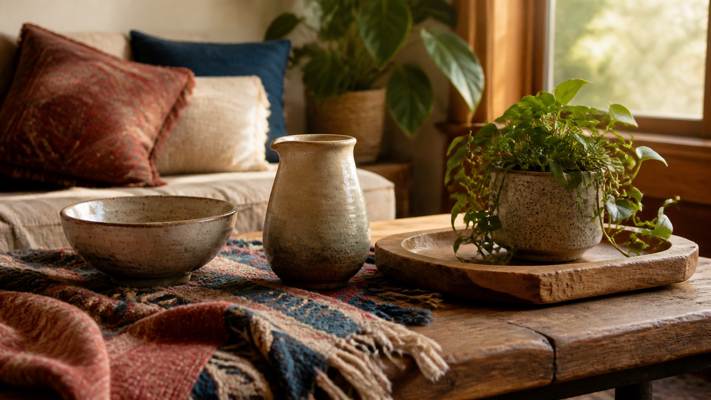</a> <strong>Bohemian Style</strong> <a href="./bohemian/README.en.md">Open README</a></td></tr>
<tr><td width="33%" valign="top" align="center"><a href="./brutalism/README.en.md">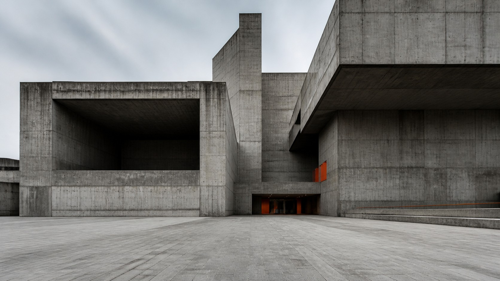</a> <strong>Brutalism</strong> <a href="./brutalism/README.en.md">Open README</a></td><td width="33%" valign="top" align="center"><a href="./byzantine-art/README.en.md">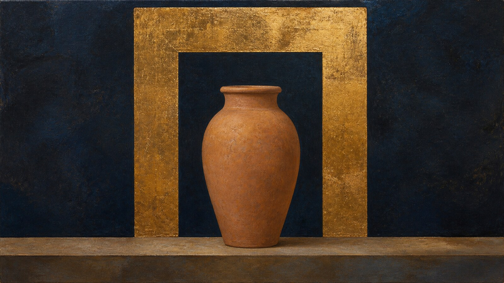</a> <strong>Byzantine Art</strong> <a href="./byzantine-art/README.en.md">Open README</a></td><td width="33%" valign="top" align="center"><a href="./chinese-literati-ink-painting/README.en.md">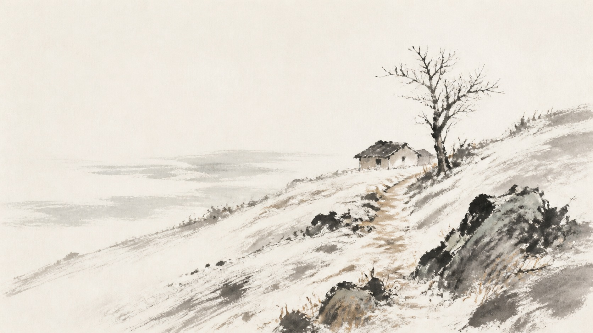</a> <strong>Chinese Literati Ink Painting</strong> <a href="./chinese-literati-ink-painting/README.en.md">Open README</a></td></tr>
<tr><td width="33%" valign="top" align="center"><a href="./color-field-painting/README.en.md">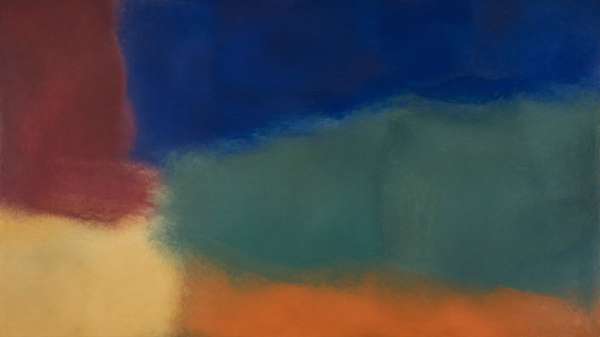</a> <strong>Color Field Painting</strong> <a href="./color-field-painting/README.en.md">Open README</a></td><td width="33%" valign="top" align="center"> <strong>Coquette</strong> <a href="./coquette/README.en.md">Open README</a></td><td width="33%" valign="top" align="center"> <strong>Deconstructivist Architecture</strong> <a href="./deconstructivist-architecture/README.en.md">Open README</a></td></tr>
<tr><td width="33%" valign="top" align="center"> <strong>Farmhouse / Cottagecore</strong> <a href="./farmhouse-cottagecore/README.en.md">Open README</a></td><td width="33%" valign="top" align="center"><a href="./fauvism/README.en.md">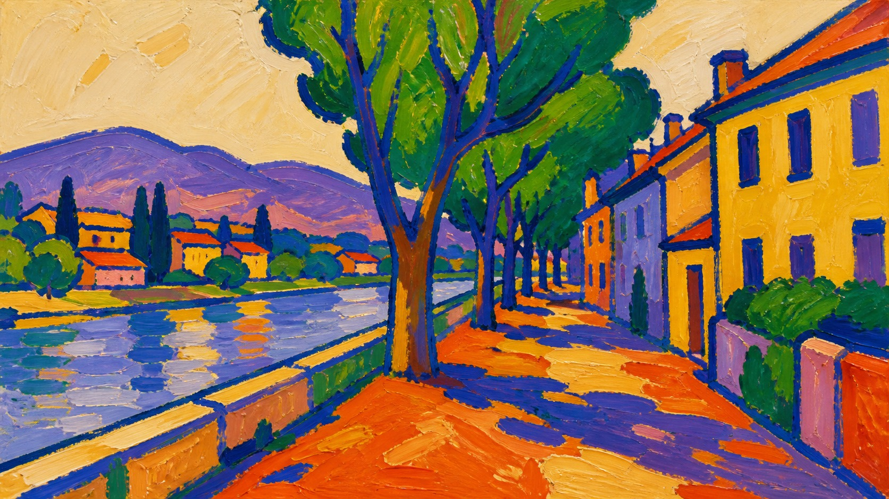</a> <strong>Fauvism</strong> <a href="./fauvism/README.en.md">Open README</a></td><td width="33%" valign="top" align="center"><a href="./fluxus/README.en.md">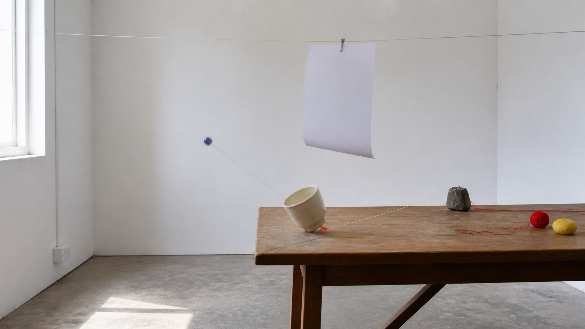</a> <strong>Fluxus</strong> <a href="./fluxus/README.en.md">Open README</a></td></tr>
<tr><td width="33%" valign="top" align="center"> <strong>Gothic</strong> <a href="./gothic/README.en.md">Open README</a></td><td width="33%" valign="top" align="center"> <strong>Graffiti</strong> <a href="./graffiti/README.en.md">Open README</a></td><td width="33%" valign="top" align="center"><a href="./japandi/README.en.md">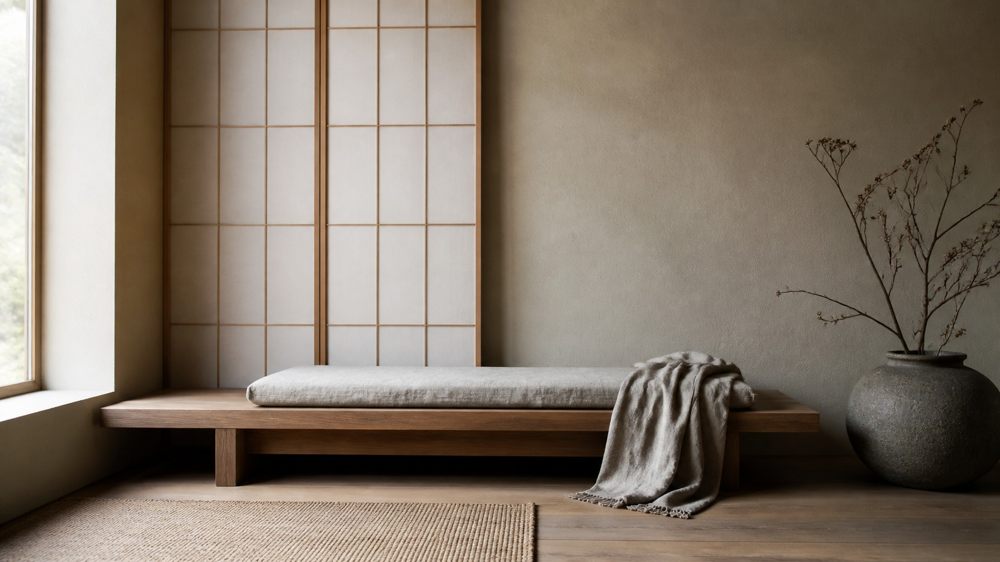</a> <strong>Japandi</strong> <a href="./japandi/README.en.md">Open README</a></td></tr>
<tr><td width="33%" valign="top" align="center"> <strong>Kawaii</strong> <a href="./kawaii/README.en.md">Open README</a></td><td width="33%" valign="top" align="center"><a href="./lyrical-abstraction/README.en.md">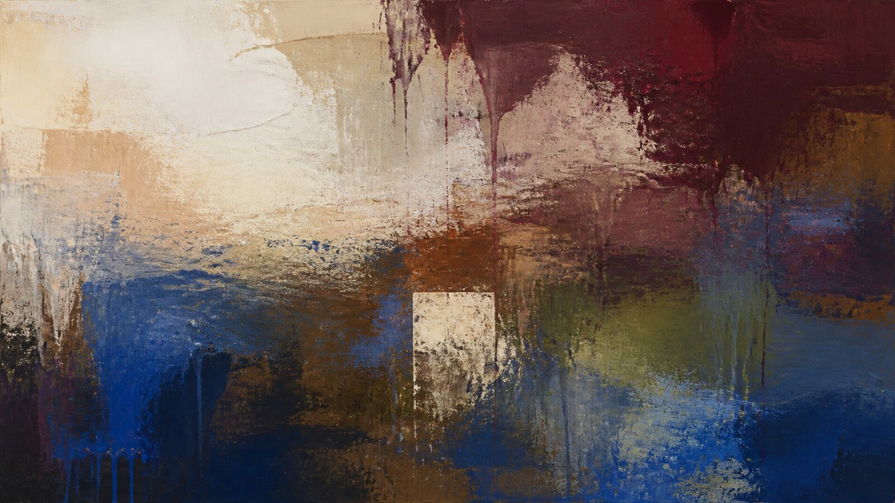</a> <strong>Lyrical Abstraction</strong> <a href="./lyrical-abstraction/README.en.md">Open README</a></td><td width="33%" valign="top" align="center"><a href="./memphis/README.en.md">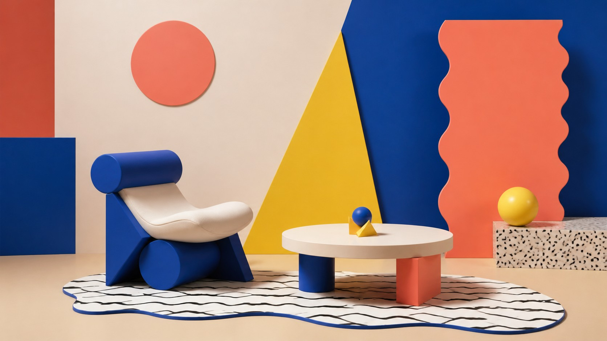</a> <strong>Memphis</strong> <a href="./memphis/README.en.md">Open README</a></td></tr>
<tr><td width="33%" valign="top" align="center"><a href="./mexican-muralism/README.en.md">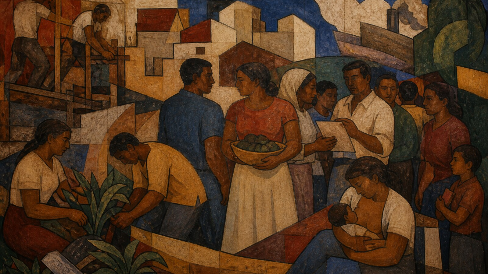</a> <strong>Mexican Muralism</strong> <a href="./mexican-muralism/README.en.md">Open README</a></td><td width="33%" valign="top" align="center"><a href="./mid-century-modern/README.en.md">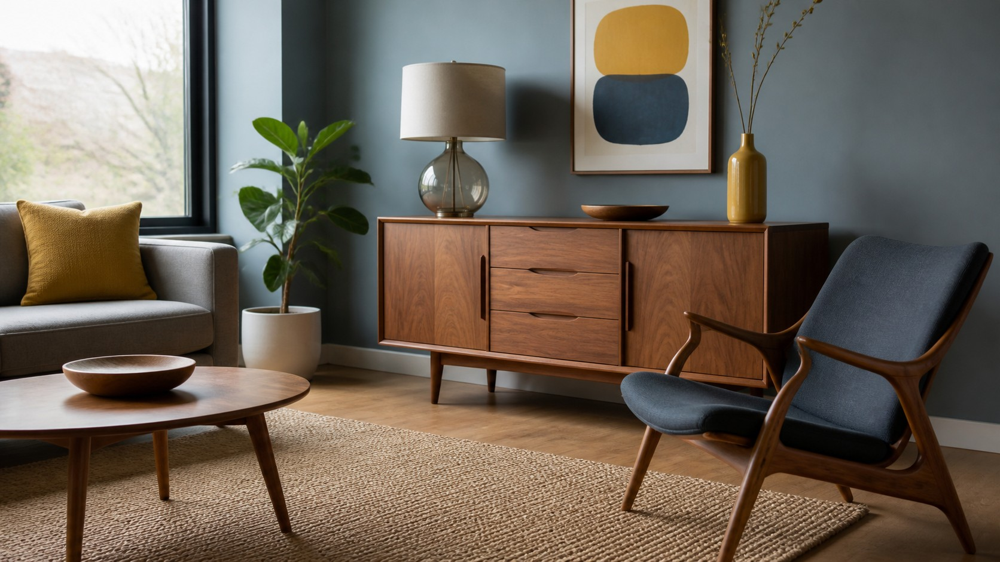</a> <strong>Mid-century Modern</strong> <a href="./mid-century-modern/README.en.md">Open README</a></td><td width="33%" valign="top" align="center"> <strong>Mughal Miniature Painting</strong> <a href="./mughal-miniature-painting/README.en.md">Open README</a></td></tr>
<tr><td width="33%" valign="top" align="center"><a href="./neo-dada/README.en.md">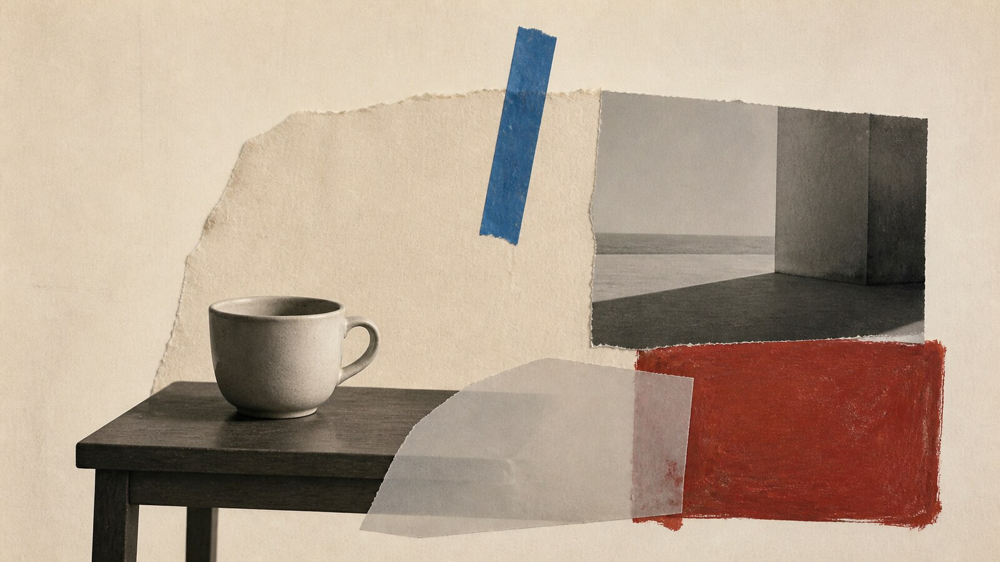</a> <strong>Neo-Dada</strong> <a href="./neo-dada/README.en.md">Open README</a></td><td width="33%" valign="top" align="center"><a href="./neo-expressionism/README.en.md">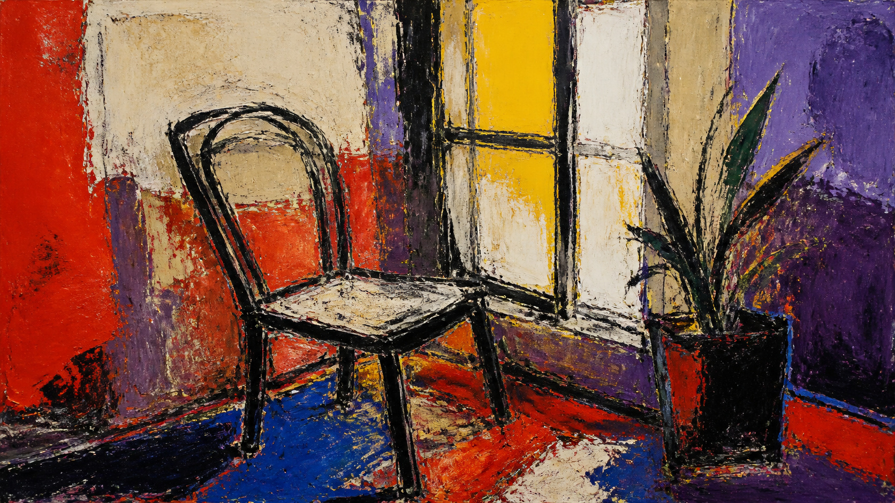</a> <strong>Neo-Expressionism</strong> <a href="./neo-expressionism/README.en.md">Open README</a></td><td width="33%" valign="top" align="center"><a href="./nihonga/README.en.md">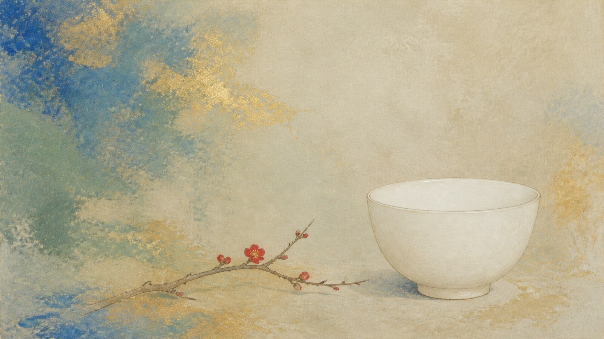</a> <strong>Nihonga</strong> <a href="./nihonga/README.en.md">Open README</a></td></tr>
<tr><td width="33%" valign="top" align="center"><a href="./orientalism/README.en.md">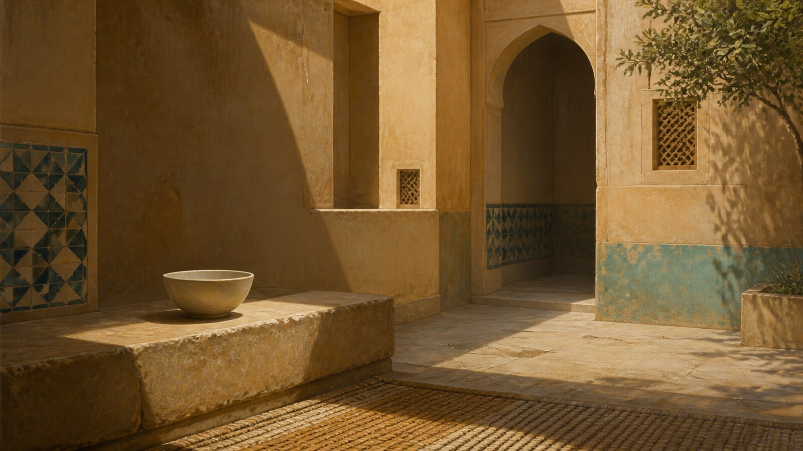</a> <strong>Orientalism</strong> <a href="./orientalism/README.en.md">Open README</a></td><td width="33%" valign="top" align="center"> <strong>Orphism</strong> <a href="./orphism/README.en.md">Open README</a></td><td width="33%" valign="top" align="center"> <strong>Pictorialism</strong> <a href="./pictorialism/README.en.md">Open README</a></td></tr>
<tr><td width="33%" valign="top" align="center"> <strong>Pointillism</strong> <a href="./pointillism/README.en.md">Open README</a></td><td width="33%" valign="top" align="center"> <strong>Rayonism</strong> <a href="./rayonism/README.en.md">Open README</a></td><td width="33%" valign="top" align="center"> <strong>Romanesque Art</strong> <a href="./romanesque-art/README.en.md">Open README</a></td></tr>
<tr><td width="33%" valign="top" align="center"> <strong>Shabby Chic</strong> <a href="./shabby-chic/README.en.md">Open README</a></td><td width="33%" valign="top" align="center"> <strong>Situationist International</strong> <a href="./situationist-international/README.en.md">Open README</a></td><td width="33%" valign="top" align="center"> <strong>Steampunk</strong> <a href="./steampunk/README.en.md">Open README</a></td></tr>
<tr><td width="33%" valign="top" align="center"> <strong>Synthwave</strong> <a href="./synthwave/README.en.md">Open README</a></td><td width="33%" valign="top" align="center"> <strong>Tenebrism</strong> <a href="./tenebrism/README.en.md">Open README</a></td><td width="33%" valign="top" align="center"> <strong>Tonalism</strong> <a href="./tonalism/README.en.md">Open README</a></td></tr>
<tr><td width="33%" valign="top" align="center"> <strong>Ukiyo-e</strong> <a href="./ukiyo-e/README.en.md">Open README</a></td><td width="33%" valign="top" align="center"> <strong>Utilitarian</strong> <a href="./utilitarian/README.en.md">Open README</a></td><td width="33%" valign="top" align="center"> <strong>Vaporwave</strong> <a href="./vaporwave/README.en.md">Open README</a></td></tr>
<tr><td width="33%" valign="top" align="center"> <strong>Victorian</strong> <a href="./victorian/README.en.md">Open README</a></td><td width="33%" valign="top" align="center"> <strong>Vienna Secession</strong> <a href="./vienna-secession/README.en.md">Open README</a></td><td width="33%" valign="top" align="center"> <strong>Vorticism</strong> <a href="./vorticism/README.en.md">Open README</a></td></tr>
</table>
