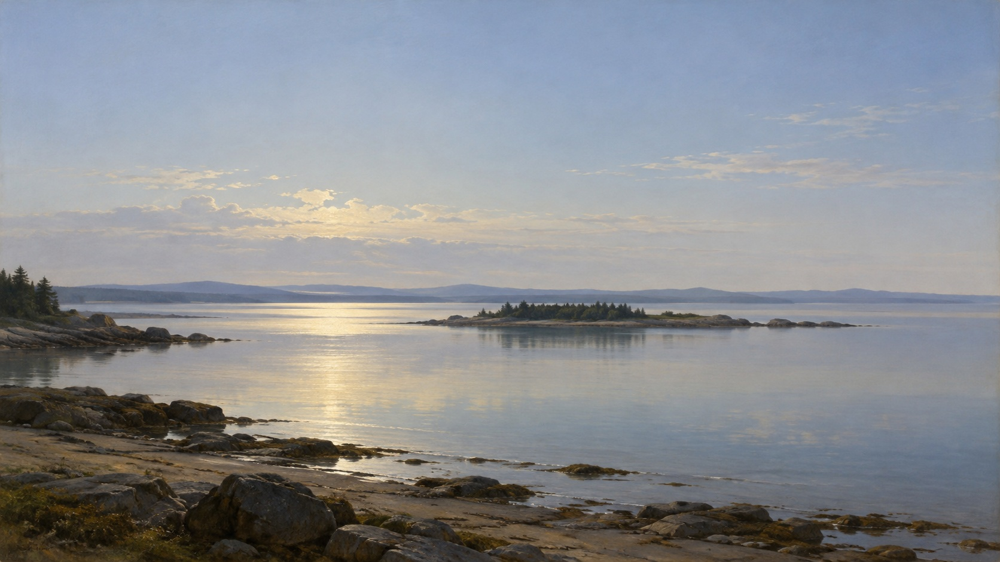

# 美国光主义

[English](README.en.md)

> **分类：** 艺术流派 
> **媒介领域：** 绘画 
> **目录：** `style-packages/movements/american-luminism`

## 简介

以稀疏的横向景观、克制的边缘、平静水面和精密大气透视捕捉冷静、清澈且近乎静止的自然光。这里的横向景观只是演示主题；你指定的主体和场景始终优先。

## 策展短评

美国光主义的宁静来自精密的空间层次和受控的反射光，而不是把画面整体虚化。让远近关系清楚、笔触退到光线之后，能和印象派的破碎笔触、浪漫主义的戏剧景观拉开距离。

## 文件导览

- `identity.yaml`：风格范围、开放主体策略与排除项
- `visual-signature.yaml`：跨主题稳定的视觉特征
- `reproduction.yaml`：媒介、材料和构建顺序
- `prompts/base.txt`、`prompts/negative.txt`：基础 Prompt 与负面约束
- `palette/palette.json`：色彩角色和值
- `evaluation.yaml`：生成后的检查标准
- `references/manifest.csv`、`provenance.yaml`：来源与权利边界

## 来源与权利

来源清单链接至美国国家美术馆的《美国之光：光主义运动，1850–1875》研究目录和展览资料，以及普林斯顿大学艺术博物馆的馆藏记录。仓库不包含原作图像。视觉规则突出稀疏横向空间、平静反射、细致大气透视和被压低的可见笔触，避免与浪漫主义的戏剧光线或印象派的笔触分解混淆。

## 使用此包

读取 `prompts/base.txt`，替换 `{SUBJECT}` 与 `{LOCATION}`，并一并提交 `prompts/negative.txt`。生成后按 `evaluation.yaml` 检查主体遵循、空间层次、反射光与表面控制。代表图和样例是新生成内容，尚待人工审核，不是历史作品。
