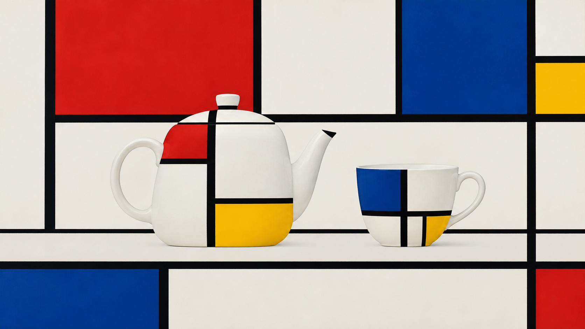
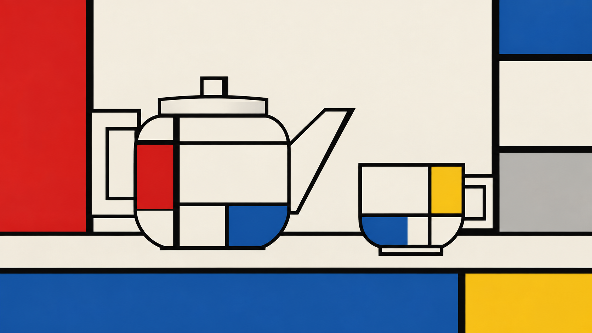

# 荷兰风格派：同题静物视觉对照

> 状态：单次同题对照，供规则可见性复核；不证明结构化方向稳定优于旧包。

## 图像

| 旧包提示 | 新版结构化方向 |
| --- | --- |
|  |  |

两张图均保留了一只白色陶瓷茶壶和一只茶杯，没有加入额外道具或文字。旧包输出把器物画成较写实的白色器形，并在器物周围叠加黑线与红、蓝、黄色矩形；新版方向把几何分割延伸到器物表面，水平、垂直结构和负空间更直接。新版因此更清楚地显示了规则的作用，但茶壶的几何分割也改变了器物表面结构；这一张图不足以判断它对用户所需画面更好。

## 运行记录

- 共同主体：横版 16:9，一只白色陶瓷茶壶和一只茶杯并排放在普通桌面上，背景简洁，无文字。
- 两组分别使用相同的内置图像生成工具，每组独立生成一次；均未输入参考图片。提示词和编译后的 provider-neutral job 均存档在本目录。
- 两张结果图均为 1672 × 941 像素（约 16:9）。工具没有暴露具体模型版本或随机种子；画幅比例由提示词约束。
- 视觉复核：两组主体数量正确；新方向更明确呈现矩形色面、黑色结构线和器物几何化。旧包本身已生成相似的荷兰风格派色面，因此本组只能说明新版规则会作用于主体形状，不能证明质量提升或跨题材稳定性。
- 复核为单次、单名视觉检查；方向仍保持 `experimental`，规则级 `visual_review` 不据此改为通过。

## English note

Both outputs preserve one white ceramic teapot and one cup without extra props or text. The legacy output keeps more conventional vessel forms and places structural lines and primary-color rectangles around them. The structured direction carries geometric segmentation onto the objects, making the horizontal and vertical structure more explicit. This shows that the new rule changes the treatment of the requested subject; it does not establish a quality advantage or cross-subject stability. The model version and seed were unavailable, and each arm has one independent output.
