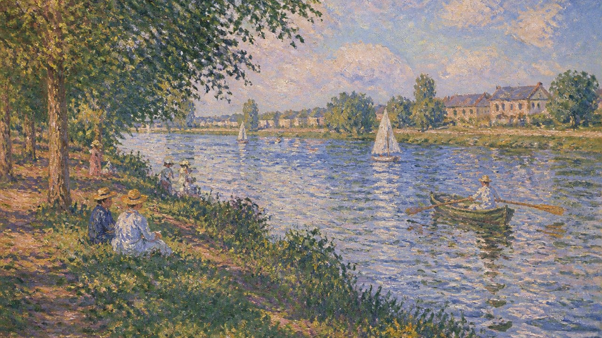

# Impressionism

[中文](README.md)



> **Category:** movements
> **Type:** movement
> **Path:** `style-packages/movements/impressionism`

## Overview

This independent style package for **Impressionism** turns public references and observable decisions about medium, composition, color, light, material, and texture into executable constraints. It is intended for new subjects, not for reproducing a specific artwork.

## Visual focus

瞬时光、破碎笔触、反射色与户外空气. The prompt emphasizes these observable traits while requiring a new subject, arrangement, and object relationship.

See `visual-signature.yaml`, `reproduction.yaml`, `palette/palette.json`, and `evaluation.yaml` for the complete rule set.

## New direction (experimental)

`art-direction.yaml` defines Impressionism at the **movement level**: visible rapid painting actions, local colors shaped by light, color-bearing shadows, and immediate yet composed framing. It does not claim that every painter used the same mark or that pointillism is the movement's default technique.

This differs from the Monet artist package, which focuses on one painter's weather observation, serial motifs, and atmospheric distance. This package keeps only shared tendencies across multiple participants and allows subjects and composition to vary. It also differs from Sorolla's strong directional sunlight and sourced bounce light, and from Neo-Impressionism's systematic dot arrangement. Choose an artist package when a specific painter is intended.

The new rules remain experimental and must be selected explicitly. Without `--direction`, the existing prompt path is used:

```powershell
python tools/compile-style.py style-packages/movements/impressionism --direction package --context daylight --subject "A neighborhood street market after rain, vendors arranging crates, muted spring daylight" --output runs/impressionism-v2-job.json
```

For review, compare at least three different subjects under changing light. Check that rapid marks and local light-color remain visible without automatically adding artist-specific motifs such as water lilies, dancers, or cafés.

## Reference source

- [Various artists / 19世纪后期](https://commons.wikimedia.org/w/index.php?search=Impressionism+painting&title=Special:MediaSearch&type=image)
- [The Metropolitan Museum of Art: Impressionism: Art and Modernity](https://www.metmuseum.org/pt/essays/impressionism-art-and-modernity)
- [National Gallery, London: Guide to Impressionism](https://www.nationalgallery.org.uk/paintings/learn-about-art/guide-to-impressionism?viewPage=1)
- [Musée d'Orsay: Paris 1874, Inventing Impressionism](https://www.musee-orsay.fr/en/node/278990)

## Rights and attribution

Reference links are provided for research and visual analysis only. External artworks, photographs, game images, trademarks, and platform pages remain the property of their respective rights holders. This package does not redistribute protected source works. The representative image is a new anonymous generated scene, not an original work by the named artist, photographer, designer, or game, and does not imply endorsement or authorization.

See [`provenance.yaml`](provenance.yaml), [`references/manifest.csv`](references/manifest.csv), and the repository [`NOTICE`](../../../NOTICE) for boundaries.

## Use only this package

Choose any one of the four methods below. They are alternatives, not steps that must all be completed.

### Method 1: Give the package to an image-capable Agent

Upload the entire style-package directory to an Agent that can generate images, or provide its local path, together with the following instruction:

```
Use this style package to help me generate an image.

First read:
- identity.yaml
- visual-signature.yaml
- art-direction.yaml (if opting into the new rules)
- reproduction.yaml
- prompts/base.txt
- prompts/negative.txt
- palette/palette.json
- evaluation.yaml

Integrate the rules from these files into the generation process. Do not treat the style name as the whole Prompt, and do not copy a reference work. When using the new direction, preserve shared movement-level methods instead of adding a single painter's signature motif or composition.

My generation request is:
<describe the subject, people, objects, scene, aspect ratio, and intended use>

First compile my request into a complete Prompt, then use your image-generation capability. After generating, check the result against evaluation.yaml for style characteristics, composition, color, material, AI artifacts, and Prompt adherence. If there are clear problems, explain them and make one targeted correction.
```

### Method 2: Copy the Prompt directly

Open `prompts/base.txt` and replace its subject, people, objects, scene, and aspect ratio with your own request. Submit the constraints in `prompts/negative.txt` as the negative Prompt on an image platform that supports text-to-image generation. For more consistent results, also consult `visual-signature.yaml` and `palette/palette.json`.

### Method 3: Configure your API key and submit a job

Configure your API key in the image platform or in your own Prompt compiler, then submit the base Prompt, negative constraints, palette, and any necessary references together. Keep the API key in your own environment. This repository does not store keys, host an online generation service, or promise free quota or compatibility with any particular provider.

### Method 4: Local model + ComfyUI

Connect `prompts/base.txt` and `prompts/negative.txt` to a local model or ComfyUI workflow. Use `palette/palette.json` for color targets, `references/manifest.csv` to choose references, and `reproduction.yaml` to constrain composition, materials, and lighting. Use `evaluation.yaml` for manual or automated review after generation.

Use references to understand observable characteristics. Do not copy a source work's exact composition, people, text, trademarks, or marks. Model weights, API keys, and generated images remain under your control.## Curatorial note

“instant light, broken touch, reflected colour, and air carried through an outdoor scene” sets the viewing distance. People, objects, and places can change independently.

## Overview

This independent style package for **Impressionism** turns public references and observable decisions about medium, composition, color, light, material, and texture into executable constraints. It is intended for new subjects, not for reproducing a specific artwork.

## Visual focus

瞬时光、破碎笔触、反射色与户外空气. The prompt emphasizes these observable traits while requiring a new subject, arrangement, and object relationship.

See `visual-signature.yaml`, `reproduction.yaml`, `palette/palette.json`, and `evaluation.yaml` for the complete rule set.

## Reference source

- [Various artists / 19世纪后期](https://commons.wikimedia.org/w/index.php?search=Impressionism+painting&title=Special:MediaSearch&type=image)

## Rights and attribution

Reference links are provided for research and visual analysis only. External artworks, photographs, game images, trademarks, and platform pages remain the property of their respective rights holders. This package does not redistribute protected source works. The representative image is a new anonymous generated scene, not an original work by the named artist, photographer, designer, or game, and does not imply endorsement or authorization.

See [`provenance.yaml`](provenance.yaml), [`references/manifest.csv`](references/manifest.csv), and the repository [`NOTICE`](../../../NOTICE) for boundaries.

## Use only this package

Choose any one of the four methods below. They are alternatives, not steps that must all be completed.

### Method 1: Give the package to an image-capable Agent

Upload the entire style-package directory to an Agent that can generate images, or provide its local path, together with the following instruction:

```
Use this style package to help me generate an image.

First read:
- identity.yaml
- visual-signature.yaml
- reproduction.yaml
- prompts/base.txt
- prompts/negative.txt
- palette/palette.json
- evaluation.yaml

Integrate the rules from these files into the generation process. Do not treat the style name as the whole Prompt, and do not copy a reference work.

My generation request is:
<describe the subject, people, objects, scene, aspect ratio, and intended use>

First compile my request into a complete Prompt, then use your image-generation capability. After generating, check the result against evaluation.yaml for style characteristics, composition, color, material, AI artifacts, and Prompt adherence. If there are clear problems, explain them and make one targeted correction.
```

### Method 2: Copy the Prompt directly

Open `prompts/base.txt` and replace its subject, people, objects, scene, and aspect ratio with your own request. Submit the constraints in `prompts/negative.txt` as the negative Prompt on an image platform that supports text-to-image generation. For more consistent results, also consult `visual-signature.yaml` and `palette/palette.json`.

### Method 3: Configure your API key and submit a job

Configure your API key in the image platform or in your own Prompt compiler, then submit the base Prompt, negative constraints, palette, and any necessary references together. Keep the API key in your own environment. This repository does not store keys, host an online generation service, or promise free quota or compatibility with any particular provider.

### Method 4: Local model + ComfyUI

Connect `prompts/base.txt` and `prompts/negative.txt` to a local model or ComfyUI workflow. Use `palette/palette.json` for color targets, `references/manifest.csv` to choose references, and `reproduction.yaml` to constrain composition, materials, and lighting. Use `evaluation.yaml` for manual or automated review after generation.

Use references to understand observable characteristics. Do not copy a source work's exact composition, people, text, trademarks, or marks. Model weights, API keys, and generated images remain under your control.
