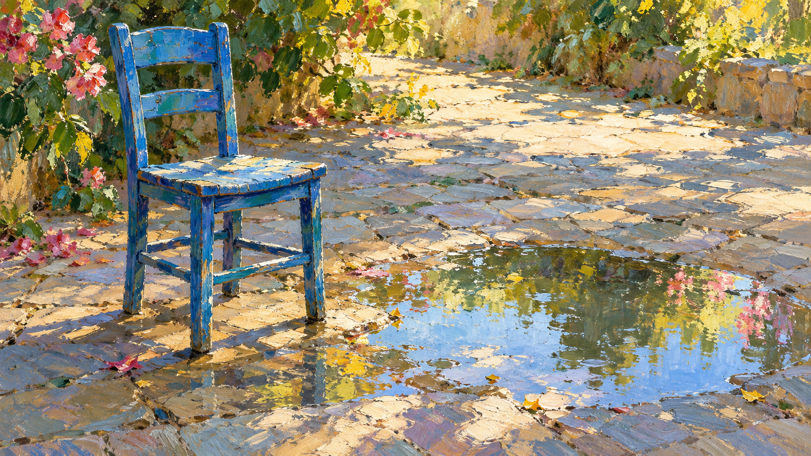
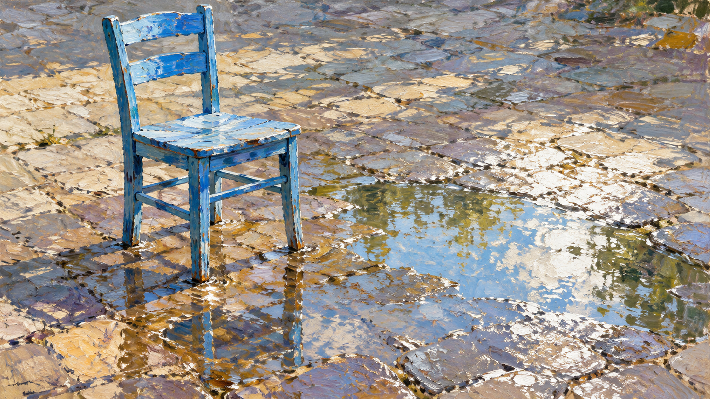

# Impressionism movement direction: same-subject comparison

> Review result: subject and movement signature are preserved, but this single pair does not show a reliable visual advantage for the structured direction over the legacy prompt. Keep the direction experimental.

## Side-by-side

| Legacy package prompt | Structured movement direction |
| --- | --- |
|  |  |

Both outputs contain one blue wooden chair and one puddle, with no people or buildings. Both show broken brush marks, reflected daylight, and readable form. At this resolution the images are very similar; the old package prompt already names changing daylight, broken strokes, and reflected color. This pair therefore supports style preservation, not a claim that the new representation improves the image.

## Run record

- Shared subject: one blue-painted wooden chair beside a shallow rain puddle on a paved courtyard in afternoon daylight; no people, buildings, or readable text.
- Both arms used the same built-in image-generation tool, 16:9 landscape output, no reference images, and a single-view constraint. Calls were independent; the tool did not expose a model version or seed.
- Legacy compiled prompt SHA-256: `89ea324ee5cb692981a25d7d3d87972459049e5edbf8ba37df6912723e41987c`.
- Direction compiled prompt SHA-256: `b67760c8034bd80014f9a37fad6ddffd34729436999f024f89096b17cbbb42b8`.
- Both compiled jobs are archived beside the images. One reviewer checked subject count, readability, visible mark-making, local reflected color, and whether a named artist's default motif appeared.
- Limitation: one output per arm does not establish cross-subject stability or prove a benefit from the schema. The movement direction remains experimental and its rule-level `visual_review` values remain pending.

## 中文复核

两张图都只出现一把蓝色木椅和一处水洼，没有人物或建筑；可见破碎笔触、日光反射，主体仍然清楚。当前尺寸下两图非常接近，旧包提示本来就写了变化的日光、可见笔触和反射色。因此这组结果只能说明新方向保留了原有画风，不能证明新结构带来了图像质量提升。

两组均使用同一生图工具、16:9 画幅、无参考图，并附加单视图要求；调用独立执行。工具未提供模型版本或随机种子。评审仅由一人完成，检查主体数量与可读性、笔触、局部反射色以及是否自动套用某位艺术家的母题。每组只有一次输出，不能据此推断跨题材稳定性；方向仍保持实验状态，规则级 `visual_review` 仍待补充验证。
