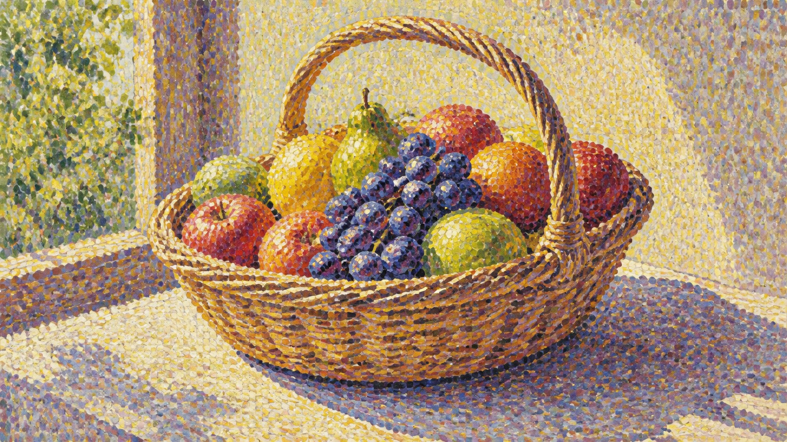

# Pointillism

[中文版](README.md)



> **Category:** movement
> **Domain:** painting
> **Path:** `style-packages/movements/pointillism`

## Overview

以独立色点、光学混色、局部色彩并置和有节奏的点状笔触构成可辨识的绘画表面。

This is an independently usable style package. It turns observable medium,
composition, lighting, color, surface, texture, and reproduction decisions into
executable guidance for new subjects. It is not intended to reproduce a specific
work.

## Subject independence

This package controls *how* an image is generated, not *what* it depicts.
People, objects, places, architecture, plants, vehicles, and narrative come
from your prompt. Concrete scenes in this package are examples or tests only
and must never be added as default content.

## Read before use

- `identity.yaml`: scope, subjects, and exclusions
- `visual-signature.yaml`: features that should survive a subject change
- `art-direction.yaml`: optional rules under the new architecture; opt in explicitly
- `reproduction.yaml`: medium, materials, and construction order
- `prompts/base.txt`, `prompts/negative.txt`: prompt constraints
- `palette/palette.json`: color roles and values
- `evaluation.yaml`: post-generation checks
- `references/manifest.csv`, `provenance.yaml`: sources and rights boundaries

## New direction (experimental)

The new direction uses format 2.1.0 and has five reviewable parts: discrete visible dots, form and contours built from dot fields, colors kept separate up close and optically mixed at normal viewing distance, dot size and spacing adapted to material and depth, and strict preservation of the requested subject. The adjacent-color-pair rule activates only when the caller declares `chromatic-light-contrast`; the core dot-organization rules remain active otherwise. The main difference from the Impressionism movement package is that Impressionism emphasizes fast, freely varying marks, while Pointillism deliberately separates color and organizes dot fields. It also differs from a printed halftone screen; the image should not collapse into a uniform grid or pixel pattern.

Research is grounded in The Met's discussion of optical mixture and the distinction between Pointillism and Divisionism, and the Art Institute of Chicago's explanation of dots forming light, shadow, and contour. The rules remain experimental and the legacy prompt remains the default. Compile the new direction explicitly:

```powershell
python tools/compile-style.py style-packages/movements/pointillism --direction package --context chromatic-light-contrast --subject "A red ceramic teapot and two lemons on a wooden table, warm window light" --output runs/pointillism-v2-job.json
```

Review the result both close up and at normal viewing distance: dots should remain separate nearby and form coherent color, light, and subject from farther away. Repeat with a different material to check that dot size, density, and color relationships adapt to the object.

## Sources and rights

References are used for research and visual analysis. External artworks,
photographs, game imagery, trademarks, and platform pages remain the property of
their respective rights holders. Generated examples are new anonymous scenes and
are not original works by, or endorsements from, the referenced person, movement,
school, or game.

See [`provenance.yaml`](provenance.yaml),
[`references/manifest.csv`](references/manifest.csv), and the repository
[`NOTICE`](../../../NOTICE) for source and redistribution boundaries.

- [The Met: Georges Seurat and Neo-Impressionism](https://www.metmuseum.org/zh/essays/georges-seurat-1859-1891-and-neo-impressionism)
- [The Met: Study for A Sunday on La Grande Jatte](https://www.metmuseum.org/art/collection/search/437658?nextInternalLocale=en)
- [Art Institute of Chicago: Pointillist technique and optical mixing](https://archive.artic.edu/sciarttech/global_pages/g3.4.html)

## Use only this package

Choose one of the following methods.

### Method 1: Give the package to an image-capable Agent

Upload this package directory to an Agent, or provide its local path, and ask:

```text
Use this style package to help me generate an image.

First read identity.yaml, visual-signature.yaml, art-direction.yaml (if opting into the new rules), reproduction.yaml,
prompts/base.txt, prompts/negative.txt, palette/palette.json, and evaluation.yaml.
Compile their rules into the generation process. Do not use only the style name
as a prompt and do not copy a reference work.

My image request is:
<subject, objects, scene, aspect ratio, and purpose>

Compile the full prompt first, then generate the image. After generation, check
style features, composition, color, material, AI artifacts, and request adherence
against evaluation.yaml, and report remaining risks.
```

### Method 2: Copy the prompts

Replace the subject, objects, scene, and aspect ratio in `prompts/base.txt` and
send `prompts/negative.txt` as the negative prompt. Use the visual signature and
palette for tighter control.

### Method 3: Submit through your own API tool

Configure your API key in your own image platform or prompt compiler, then submit
the base prompt, negative constraints, palette, and any required reference list.
The repository does not host a generation service or manage API keys.

### Method 4: Local model + ComfyUI

Connect the prompts to a local model or ComfyUI workflow. Use the palette,
reproduction notes, and reference manifest to set color, composition, material,
and lighting. Review the output against `evaluation.yaml`.

Users manage model weights, API keys, and generated images themselves. References
are for observable traits only; do not copy a source work's exact composition,
figures, text, trademark, or logo.## Curatorial note

Get “independent colour dots, optical mixing, local contrast, and a rhythmic painted surface” right first; leave the actual content to your prompt. The style can then travel to another subject.

## Overview

以独立色点、光学混色、局部色彩并置和有节奏的点状笔触构成可辨识的绘画表面。

This is an independently usable style package. It turns observable medium,
composition, lighting, color, surface, texture, and reproduction decisions into
executable guidance for new subjects. It is not intended to reproduce a specific
work.

## Subject independence

This package controls *how* an image is generated, not *what* it depicts.
People, objects, places, architecture, plants, vehicles, and narrative come
from your prompt. Concrete scenes in this package are examples or tests only
and must never be added as default content.

## Read before use

- `identity.yaml`: scope, subjects, and exclusions
- `visual-signature.yaml`: features that should survive a subject change
- `reproduction.yaml`: medium, materials, and construction order
- `prompts/base.txt`, `prompts/negative.txt`: prompt constraints
- `palette/palette.json`: color roles and values
- `evaluation.yaml`: post-generation checks
- `references/manifest.csv`, `provenance.yaml`: sources and rights boundaries

## Sources and rights

References are used for research and visual analysis. External artworks,
photographs, game imagery, trademarks, and platform pages remain the property of
their respective rights holders. Generated examples are new anonymous scenes and
are not original works by, or endorsements from, the referenced person, movement,
school, or game.

See [`provenance.yaml`](provenance.yaml),
[`references/manifest.csv`](references/manifest.csv), and the repository
[`NOTICE`](../../../NOTICE) for source and redistribution boundaries.

## Use only this package

Choose one of the following methods.

### Method 1: Give the package to an image-capable Agent

Upload this package directory to an Agent, or provide its local path, and ask:

```text
Use this style package to help me generate an image.

First read identity.yaml, visual-signature.yaml, reproduction.yaml,
prompts/base.txt, prompts/negative.txt, palette/palette.json, and evaluation.yaml.
Compile their rules into the generation process. Do not use only the style name
as a prompt and do not copy a reference work.

My image request is:
<subject, objects, scene, aspect ratio, and purpose>

Compile the full prompt first, then generate the image. After generation, check
style features, composition, color, material, AI artifacts, and request adherence
against evaluation.yaml, and report remaining risks.
```

### Method 2: Copy the prompts

Replace the subject, objects, scene, and aspect ratio in `prompts/base.txt` and
send `prompts/negative.txt` as the negative prompt. Use the visual signature and
palette for tighter control.

### Method 3: Submit through your own API tool

Configure your API key in your own image platform or prompt compiler, then submit
the base prompt, negative constraints, palette, and any required reference list.
The repository does not host a generation service or manage API keys.

### Method 4: Local model + ComfyUI

Connect the prompts to a local model or ComfyUI workflow. Use the palette,
reproduction notes, and reference manifest to set color, composition, material,
and lighting. Review the output against `evaluation.yaml`.

Users manage model weights, API keys, and generated images themselves. References
are for observable traits only; do not copy a source work's exact composition,
figures, text, trademark, or logo.
