# Photographers

[中文](README.md)

This directory contains 66 independent style packages. Each card uses a horizontal 16:9 representative image; click an image or name to open the package README.

<table>
<tr>
<td width="33%" valign="top" align="center"> <strong>Henri Cartier-Bresson</strong> <a href="henri-cartier-bresson/README.en.md">Open README</a></td>
<td width="33%" valign="top" align="center"> <strong>Lewis Hine</strong> <a href="lewis-hine/README.en.md">Open README</a></td>
<td width="33%" valign="top" align="center"><a href="eadweard-muybridge/README.en.md">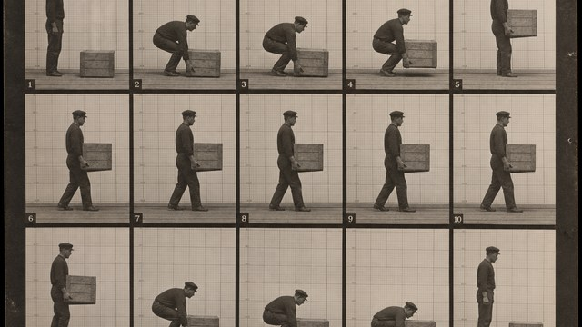</a> <strong>Eadweard Muybridge</strong> <a href="eadweard-muybridge/README.en.md">Open README</a></td>
</tr>
<tr>
<td width="33%" valign="top" align="center"> <strong>Dorothea Lange</strong> <a href="dorothea-lange/README.en.md">Open README</a></td>
<td width="33%" valign="top" align="center"><a href="william-eggleston/README.en.md">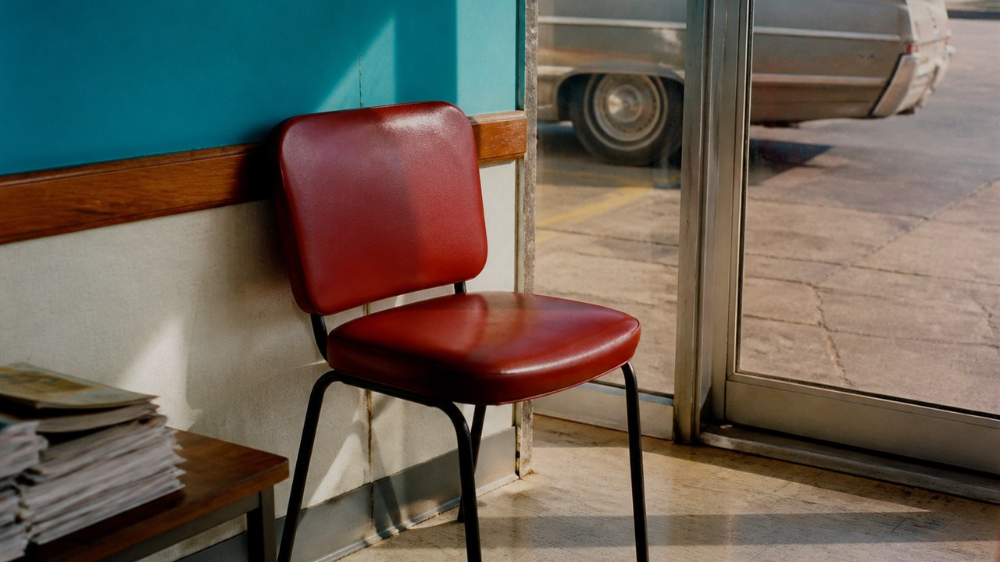</a> <strong>William Eggleston</strong> <a href="william-eggleston/README.en.md">Open README</a></td>
<td width="33%" valign="top" align="center"> <strong>Ansel Adams</strong> <a href="ansel-adams/README.en.md">Open README</a></td>
</tr>
<tr>
<td width="33%" valign="top" align="center"> <strong>Julia Margaret Cameron</strong> <a href="julia-margaret-cameron/README.en.md">Open README</a></td>
<td width="33%" valign="top" align="center"> <strong>Daido Moriyama</strong> <a href="daido-moriyama/README.en.md">Open README</a></td>
<td width="33%" valign="top" align="center"> <strong>Eugène Atget</strong> <a href="eugene-atget/README.en.md">Open README</a></td>
</tr>
<tr>
<td width="33%" valign="top" align="center"> <strong>Walker Evans</strong> <a href="walker-evans/README.en.md">Open README</a></td>
<td width="33%" valign="top" align="center"> <strong>Masahisa Fukase</strong> <a href="masahisa-fukase/README.en.md">Open README</a></td>
<td width="33%" valign="top" align="center"><a href="nadar/README.en.md">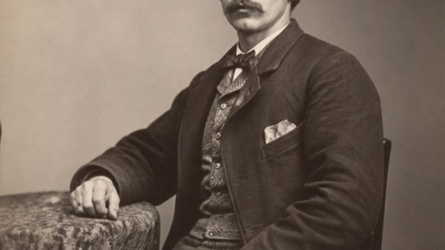</a> <strong>Nadar</strong> <a href="nadar/README.en.md">Open README</a></td>
</tr>
<tr>
<td width="33%" valign="top" align="center"> <strong>Robert Capa</strong> <a href="robert-capa/README.en.md">Open README</a></td>
<td width="33%" valign="top" align="center"><a href="roger-fenton/README.en.md">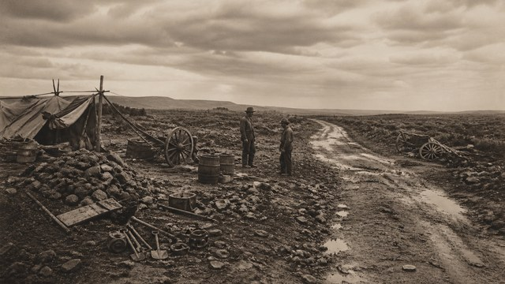</a> <strong>Roger Fenton</strong> <a href="roger-fenton/README.en.md">Open README</a></td>
<td width="33%" valign="top" align="center"><a href="etienne-jules-marey/README.en.md">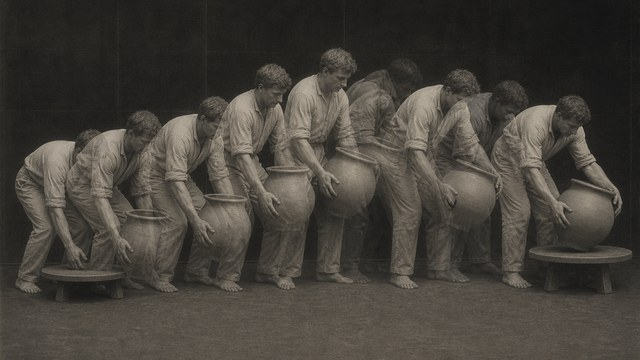</a> <strong>Étienne-Jules Marey</strong> <a href="etienne-jules-marey/README.en.md">Open README</a></td>
</tr>
<tr>
<td width="33%" valign="top" align="center"> <strong>Alfred Stieglitz</strong> <a href="alfred-stieglitz/README.en.md">Open README</a></td>
<td width="33%" valign="top" align="center"> <strong>Diane Arbus</strong> <a href="diane-arbus/README.en.md">Open README</a></td>
<td width="33%" valign="top" align="center"> <strong>Saul Leiter</strong> <a href="saul-leiter/README.en.md">Open README</a></td>
</tr>
<tr>
<td width="33%" valign="top" align="center"> <strong>Vivian Maier</strong> <a href="vivian-maier/README.en.md">Open README</a></td>
<td width="33%" valign="top" align="center"> <strong>Rinko Kawauchi</strong> <a href="rinko-kawauchi/README.en.md">Open README</a></td>
<td width="33%" valign="top" align="center"><a href="man-ray/README.en.md">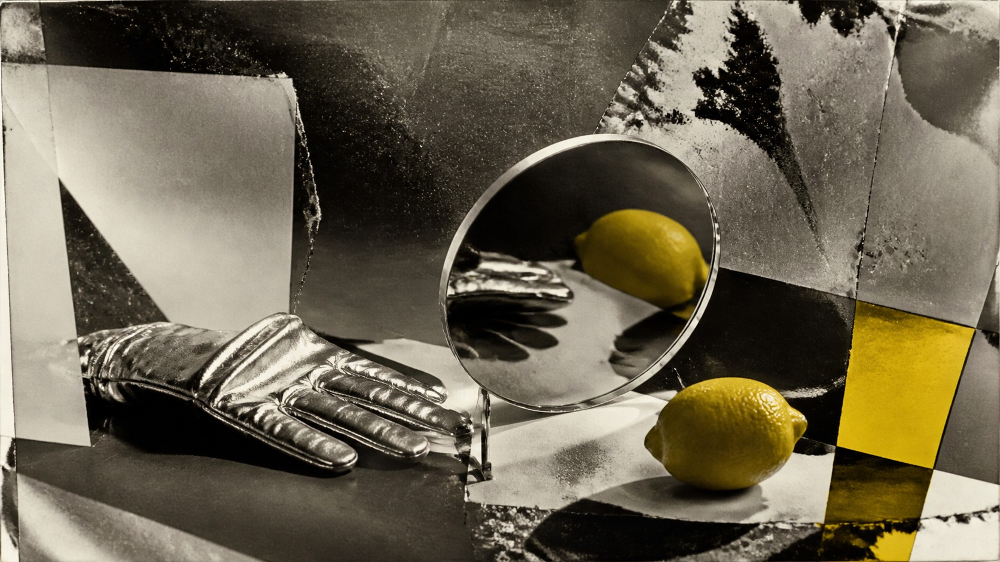</a> <strong>Man Ray</strong> <a href="man-ray/README.en.md">Open README</a></td>
</tr>
<tr>
<td width="33%" valign="top" align="center"> <strong>Berenice Abbott</strong> <a href="berenice-abbott/README.en.md">Open README</a></td>
<td width="33%" valign="top" align="center"><a href="gordon-parks/README.en.md">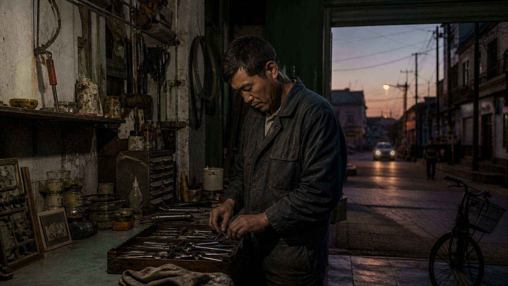</a> <strong>Gordon Parks</strong> <a href="gordon-parks/README.en.md">Open README</a></td>
<td width="33%" valign="top" align="center"> <strong>William Klein</strong> <a href="william-klein/README.en.md">Open README</a></td>
</tr>
<tr>
<td width="33%" valign="top" align="center"><a href="mary-ellen-mark/README.en.md">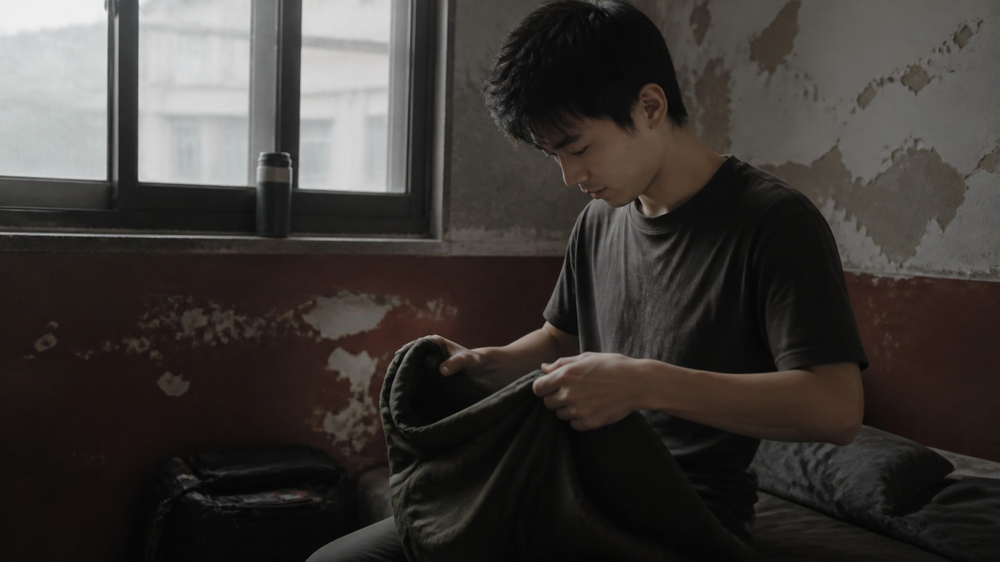</a> <strong>Mary Ellen Mark</strong> <a href="mary-ellen-mark/README.en.md">Open README</a></td>
<td width="33%" valign="top" align="center"><a href="nick-brandt/README.en.md">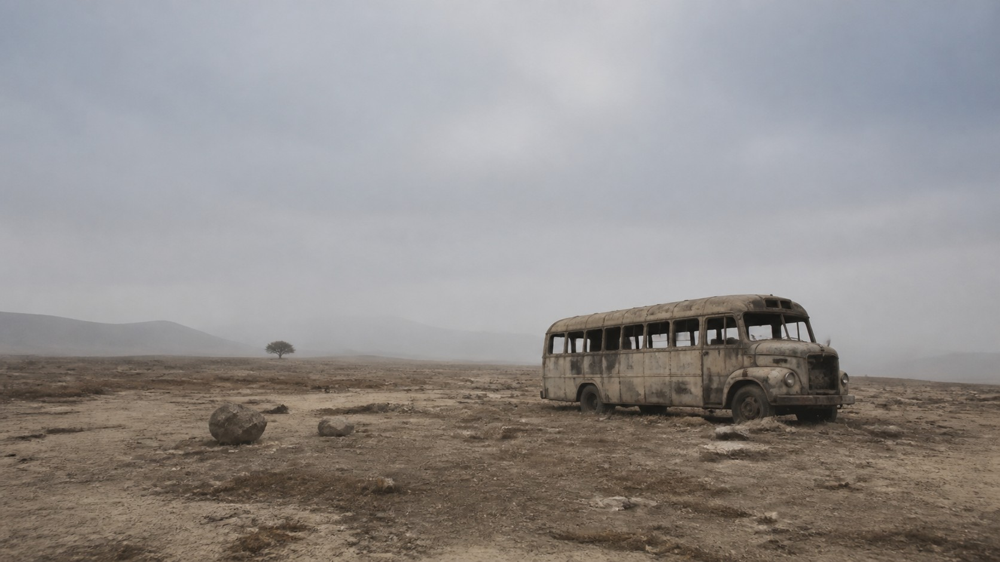</a> <strong>Nick Brandt</strong> <a href="nick-brandt/README.en.md">Open README</a></td>
<td width="33%" valign="top" align="center"><a href="gregory-crewdson/README.en.md">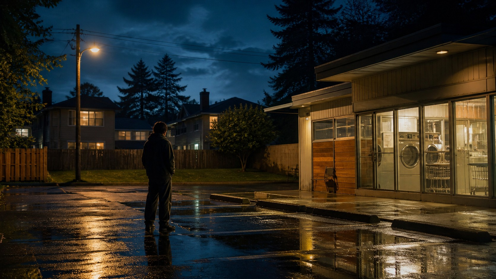</a> <strong>Gregory Crewdson</strong> <a href="gregory-crewdson/README.en.md">Open README</a></td>
</tr>
<tr>
<td width="33%" valign="top" align="center"><a href="cindy-sherman/README.en.md">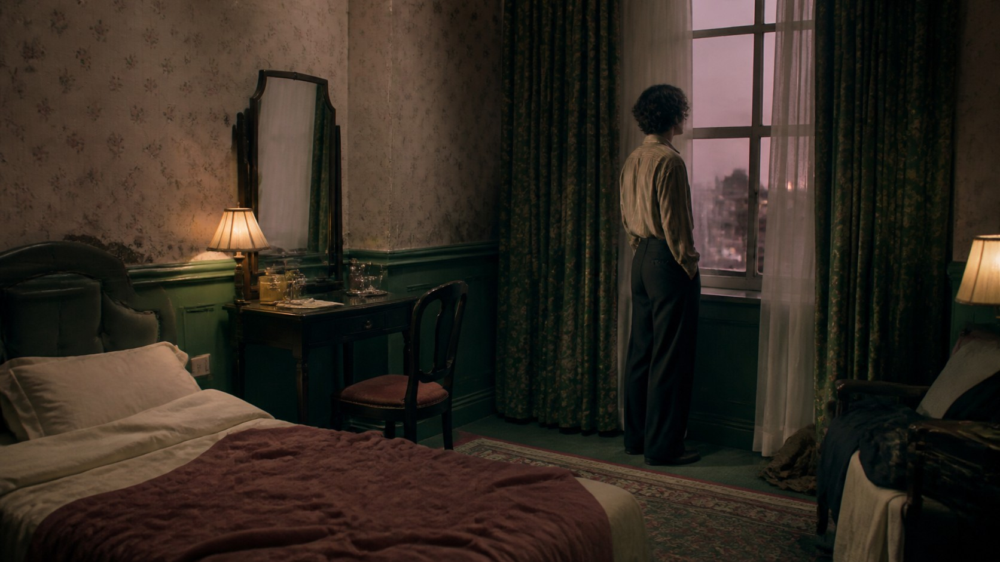</a> <strong>Cindy Sherman</strong> <a href="cindy-sherman/README.en.md">Open README</a></td>
<td width="33%" valign="top" align="center"> <strong>Sebastião Salgado</strong> <a href="sebastiao-salgado/README.en.md">Open README</a></td>
<td width="33%" valign="top" align="center"><a href="peter-lindbergh/README.en.md">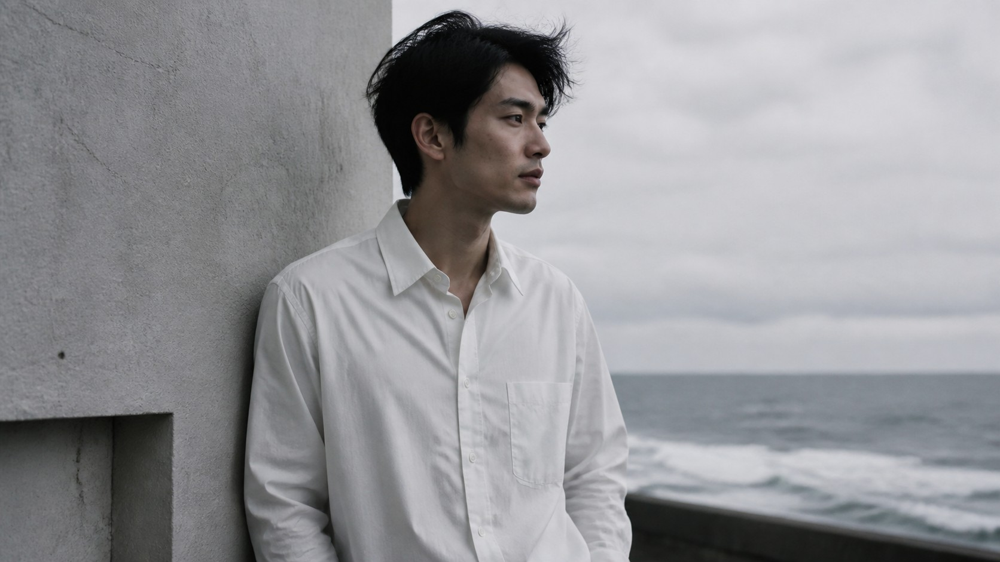</a> <strong>Peter Lindbergh</strong> <a href="peter-lindbergh/README.en.md">Open README</a></td>
</tr>
</table>

## Additional packages

The cards below complete the category index.

<table width="100%">
<tr><td width="33%" valign="top" align="center"><a href="./alec-soth/README.en.md">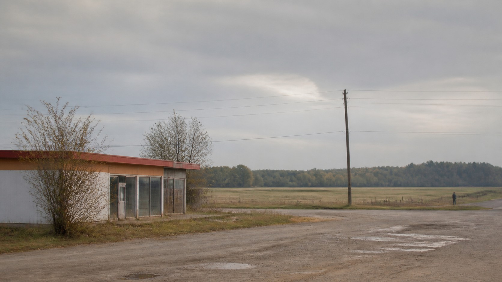</a> <strong>Alec Soth</strong> <a href="./alec-soth/README.en.md">Open README</a></td><td width="33%" valign="top" align="center"> <strong>Alex Webb</strong> <a href="./alex-webb/README.en.md">Open README</a></td><td width="33%" valign="top" align="center"> <strong>Andreas Gursky</strong> <a href="./andreas-gursky/README.en.md">Open README</a></td></tr>
<tr><td width="33%" valign="top" align="center"> <strong>August Sander</strong> <a href="./august-sander/README.en.md">Open README</a></td><td width="33%" valign="top" align="center"> <strong>Bruce Davidson</strong> <a href="./bruce-davidson/README.en.md">Open README</a></td><td width="33%" valign="top" align="center"> <strong>Elliott Erwitt</strong> <a href="./elliott-erwitt/README.en.md">Open README</a></td></tr>
<tr><td width="33%" valign="top" align="center"> <strong>Emilie Hofferber</strong> <a href="./emilie-hofferber/README.en.md">Open README</a></td><td width="33%" valign="top" align="center"> <strong>Ernst Haas</strong> <a href="./ernst-haas/README.en.md">Open README</a></td><td width="33%" valign="top" align="center"><a href="./erwin-blumenfeld/README.en.md">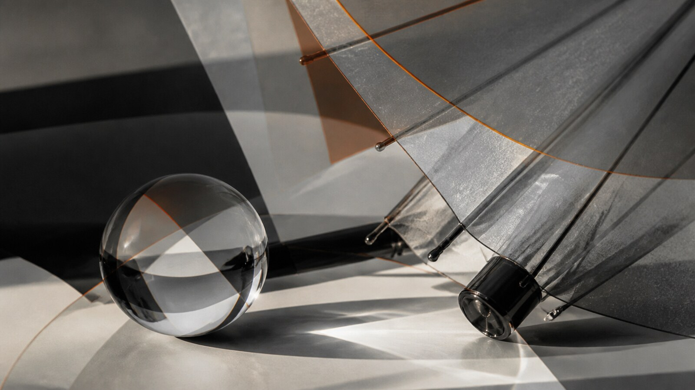</a> <strong>Erwin Blumenfeld</strong> <a href="./erwin-blumenfeld/README.en.md">Open README</a></td></tr>
<tr><td width="33%" valign="top" align="center"> <strong>何藩</strong> <a href="./fan-ho/README.en.md">Open README</a></td><td width="33%" valign="top" align="center"> <strong>Garry Winogrand</strong> <a href="./garry-winogrand/README.en.md">Open README</a></td><td width="33%" valign="top" align="center"> <strong>Helen Levitt</strong> <a href="./helen-levitt/README.en.md">Open README</a></td></tr>
<tr><td width="33%" valign="top" align="center"> <strong>Hiroshi Sugimoto</strong> <a href="./hiroshi-sugimoto/README.en.md">Open README</a></td><td width="33%" valign="top" align="center"> <strong>Imogen Cunningham</strong> <a href="./imogen-cunningham/README.en.md">Open README</a></td><td width="33%" valign="top" align="center"> <strong>Irving Penn</strong> <a href="./irving-penn/README.en.md">Open README</a></td></tr>
<tr><td width="33%" valign="top" align="center"> <strong>Joel Meyerowitz</strong> <a href="./joel-meyerowitz/README.en.md">Open README</a></td><td width="33%" valign="top" align="center"> <strong>Josef Koudelka</strong> <a href="./josef-koudelka/README.en.md">Open README</a></td><td width="33%" valign="top" align="center"> <strong>Josef Sudek</strong> <a href="./josef-sudek/README.en.md">Open README</a></td></tr>
<tr><td width="33%" valign="top" align="center"> <strong>Kikuji Kawada</strong> <a href="./kikuji-kawada/README.en.md">Open README</a></td><td width="33%" valign="top" align="center"> <strong>Lee Friedlander</strong> <a href="./lee-friedlander/README.en.md">Open README</a></td><td width="33%" valign="top" align="center"> <strong>Lillian Bassman</strong> <a href="./lillian-bassman/README.en.md">Open README</a></td></tr>
<tr><td width="33%" valign="top" align="center"> <strong>Lisa Arima</strong> <a href="./lisa-arima/README.en.md">Open README</a></td><td width="33%" valign="top" align="center"><a href="./luigi-ghirri/README.en.md">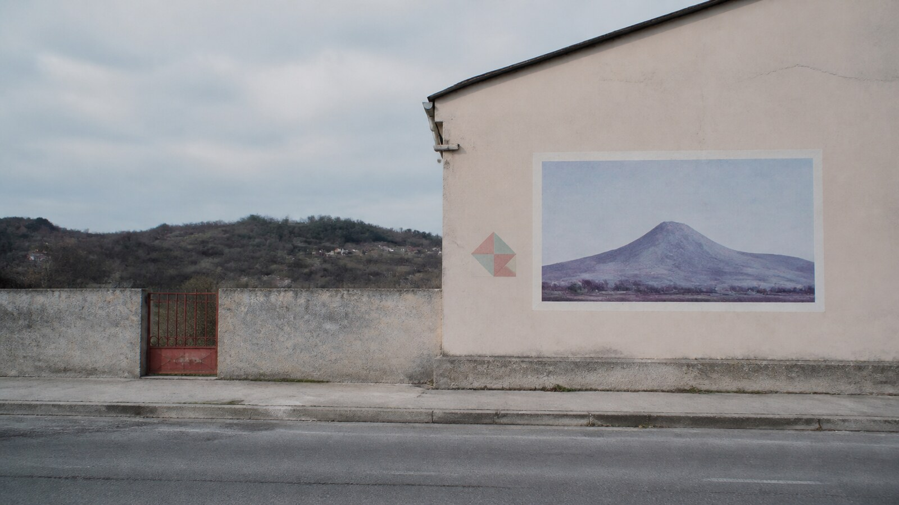</a> <strong>Luigi Ghirri</strong> <a href="./luigi-ghirri/README.en.md">Open README</a></td><td width="33%" valign="top" align="center"><a href="./martin-parr/README.en.md">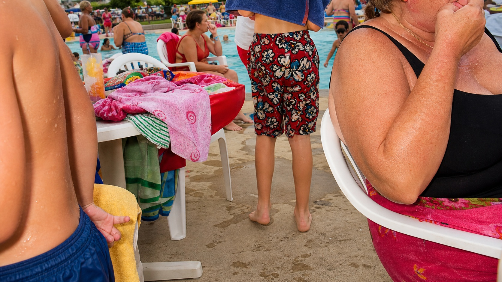</a> <strong>Martin Parr</strong> <a href="./martin-parr/README.en.md">Open README</a></td></tr>
<tr><td width="33%" valign="top" align="center"> <strong>Michael Kenna</strong> <a href="./michael-kenna/README.en.md">Open README</a></td><td width="33%" valign="top" align="center"><a href="./miyako-ishiuchi/README.en.md">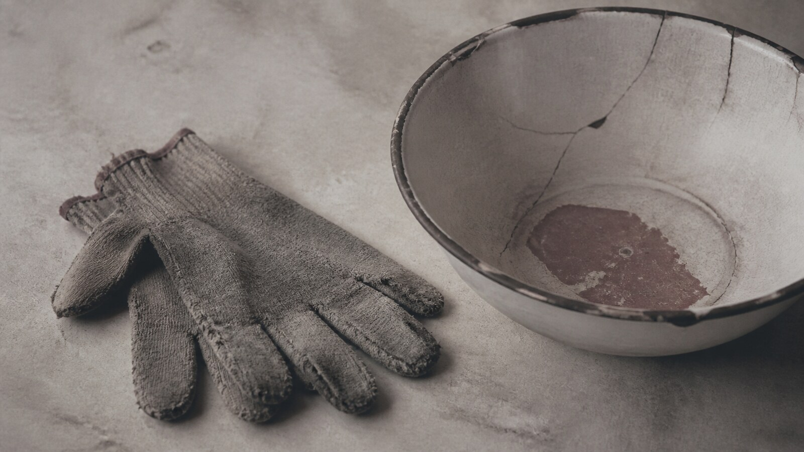</a> <strong>Miyako Ishiuchi</strong> <a href="./miyako-ishiuchi/README.en.md">Open README</a></td><td width="33%" valign="top" align="center"> <strong>Nan Goldin</strong> <a href="./nan-goldin/README.en.md">Open README</a></td></tr>
<tr><td width="33%" valign="top" align="center"> <strong>Raghubir Singh</strong> <a href="./raghubir-singh/README.en.md">Open README</a></td><td width="33%" valign="top" align="center"> <strong>Robert Frank</strong> <a href="./robert-frank/README.en.md">Open README</a></td><td width="33%" valign="top" align="center"> <strong>Ruth Bernhard</strong> <a href="./ruth-bernhard/README.en.md">Open README</a></td></tr>
<tr><td width="33%" valign="top" align="center"> <strong>Sally Mann</strong> <a href="./sally-mann/README.en.md">Open README</a></td><td width="33%" valign="top" align="center"> <strong>Shomei Tomatsu</strong> <a href="./shomei-tomatsu/README.en.md">Open README</a></td><td width="33%" valign="top" align="center"><a href="./stephen-shore/README.en.md">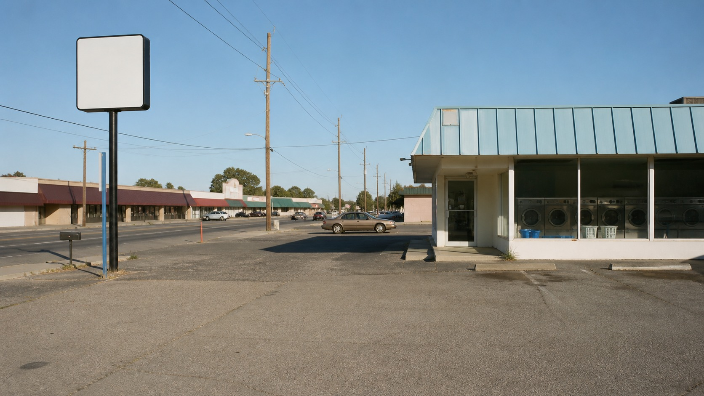</a> <strong>Stephen Shore</strong> <a href="./stephen-shore/README.en.md">Open README</a></td></tr>
<tr><td width="33%" valign="top" align="center"> <strong>Susan Meiselas</strong> <a href="./susan-meiselas/README.en.md">Open README</a></td><td width="33%" valign="top" align="center"><a href="./todd-hido/README.en.md">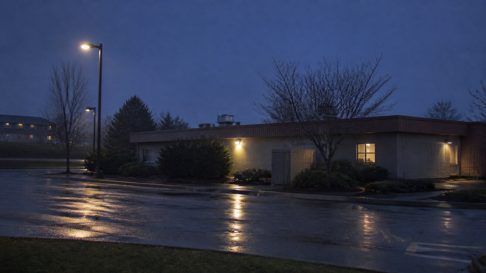</a> <strong>Todd Hido</strong> <a href="./todd-hido/README.en.md">Open README</a></td><td width="33%" valign="top" align="center"> <strong>Weegee</strong> <a href="./weegee/README.en.md">Open README</a></td></tr>
</table>
