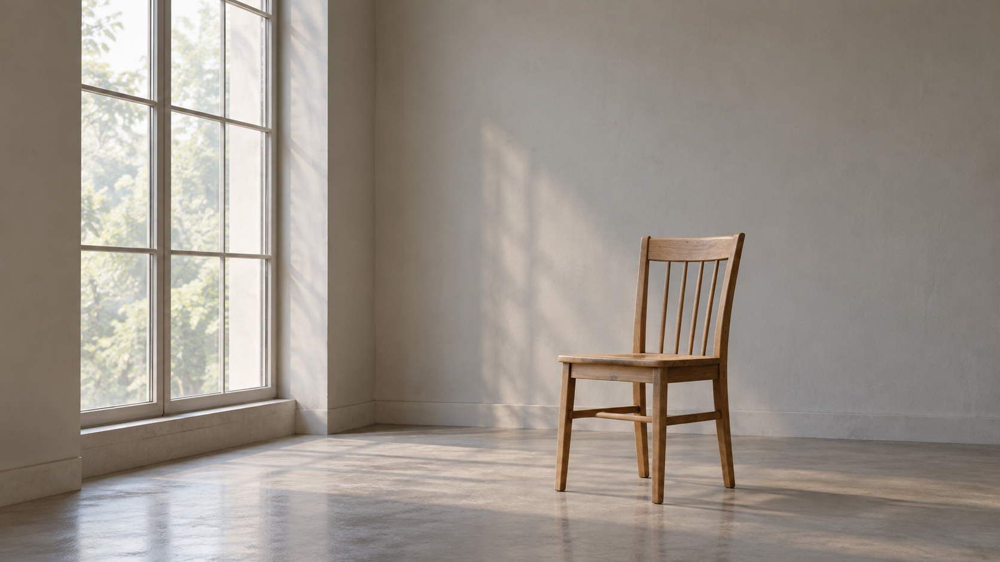
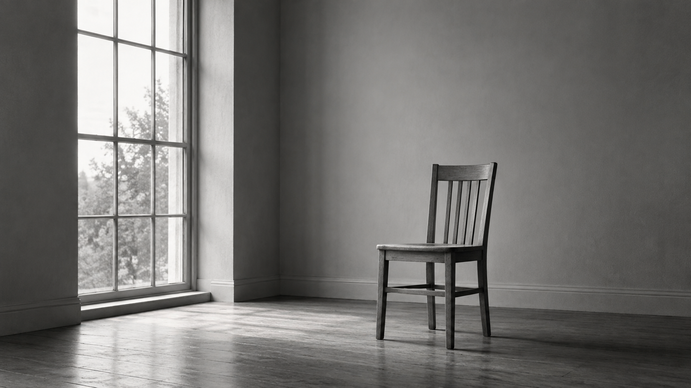

# Hiroshi Sugimoto direction: same-subject comparison

> Review result: the new direction gives clearer monochrome and reduced-detail behavior in this one sample. Keep the direction experimental; a single unseeded output is not a reliability estimate.

## Side-by-side

| Legacy package prompt | Structured photographer direction |
| --- | --- |
|  |  |

Both outputs retain the requested single wooden chair and tall window. The legacy output renders a warm, ordinary interior. The direction output uses monochrome silver-gelatin-like tones, fewer tonal planes, and a quieter axis, while keeping the chair and window readable. This is observable evidence of stronger monochrome adherence in this run, not proof of cross-subject reliability or general image-quality improvement.

## Run record

- Shared subject: one plain wooden chair in an empty room beside a tall window, diffuse daylight, neutral wall and floor; no people, other furniture, curtains, or text.
- Both arms used the same built-in image-generation tool, 16:9 landscape output, no references, and an identical single-chair/single-window gate. Calls were independent; the tool did not expose model version or seed.
- Legacy compiled prompt SHA-256: `d22cce0d421b51d305cb35b155100031c64465c35b51c899aa32bd936c5e6d0a`.
- Direction compiled prompt SHA-256: `69c02848f6f39a5bc1b154c1b619f4cabfe9313374c5ff7a36a35be2cdf830f7`.
- The compiled jobs are archived beside the images. One reviewer checked subject count, requested details, monochrome treatment, information density, and whether an unrequested Sugimoto motif appeared.
- Limitation: one unseeded output per arm; no cross-subject or repeat-run evidence. The package and direction remain experimental.

## 中文复核

两张图均保留用户指定的一把木椅和一扇高窗。旧包输出是偏暖色的普通室内；新方向输出更明确地采用黑白银盐感、较少的明暗层级和安静轴线，同时椅子与窗户仍可辨认。这是本次生成中“新方向更遵循黑白要求”的可见证据，但不能据此推断跨题材稳定性或整体画质提升。

两组使用同一生图工具、16:9 画幅、无参考图和相同的单椅 / 单窗要求，分别独立调用；工具未提供模型版本或随机种子。单人检查了主体数量、任务细节、黑白处理、信息密度以及是否出现未要求的杉本式母题。每组仅一次输出，不能证明复现稳定性；包和方向仍处实验状态。
