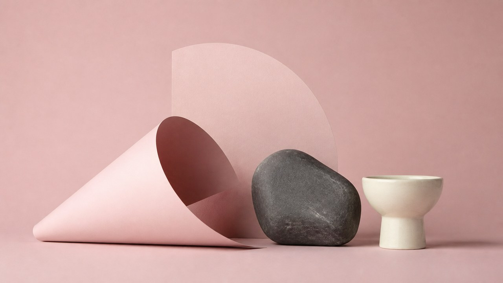

# Dusty-Rose Studio Still Life

[Chinese version](README.md)

> **Category:** photography
> **Directory:** `style-packages/presets/dusty-rose-studio`

## Overview

A soft, contemporary still-life studio preset built from a dusty-rose backdrop, paper forms, and matte materials. The package turns medium, composition, lighting, palette, material, and surface decisions into executable rules that can be transferred to new subjects and scenes.

## Observable features

dusty rose seamless background, paper forms, matte materials, soft frontal light.

## References

- [OhMyStyle project overview](https://github.com/ZhouYinLong-lab/OhMyStyle)
- [Original curation statement](https://github.com/ZhouYinLong-lab/OhMyStyle)

## Origin and rights

This is an original preset independently curated for OhMyStyle. It is not associated with any specific artist, photographer, school, or artwork. External works, school names, marks, and page content remain with their respective rights holders. The generated example is a new anonymous scene and does not imply endorsement or authorization.

## Use only this package

Choose one of the following methods; they do not need to be combined.

### Method 1: Give the package to an image-capable Agent

Upload this directory to an image-capable Agent, or provide its local path, and ask it to read `identity.yaml`, `visual-signature.yaml`, `reproduction.yaml`, `prompts/base.txt`, `prompts/negative.txt`, `palette/palette.json`, and `evaluation.yaml`. Ask the Agent to compile your brief into a complete prompt, generate a new scene, and review the result against `evaluation.yaml` without copying a reference work, mark, or composition.

### Method 2: Copy the prompt

Replace the subject, scene, aspect ratio, and purpose in `prompts/base.txt`; submit `prompts/negative.txt` as the negative prompt. Use the visual signature and palette when tighter control is needed.

### Method 3: Submit through an API-key workflow

Configure your own API key in the image platform or compiler, then submit this package’s base prompt, negative constraints, palette, and selected references. This repository does not host a generation service or manage secrets.

### Method 4: Local model + ComfyUI

Connect the prompts to a local model or ComfyUI workflow; use the palette, reference manifest, and reproduction rules as controls, then review the output with `evaluation.yaml`.

References are for observable feature study only. Do not reproduce source composition, people, text, marks, school emblems, or logos.## Curatorial note

Get “dusty-rose ground, paper-like forms, matte surfaces, and a soft contemporary still-life light” right first; leave the actual content to your prompt. The style can then travel to another subject.

## Overview

A soft, contemporary still-life studio preset built from a dusty-rose backdrop, paper forms, and matte materials. The package turns medium, composition, lighting, palette, material, and surface decisions into executable rules that can be transferred to new subjects and scenes.

## Observable features

dusty rose seamless background, paper forms, matte materials, soft frontal light.

## References

- [OhMyStyle project overview](https://github.com/ZhouYinLong-lab/OhMyStyle)
- [Original curation statement](https://github.com/ZhouYinLong-lab/OhMyStyle)

## Origin and rights

This is an original preset independently curated for OhMyStyle. It is not associated with any specific artist, photographer, school, or artwork. External works, school names, marks, and page content remain with their respective rights holders. The generated example is a new anonymous scene and does not imply endorsement or authorization.

## Use only this package

Choose one of the following methods; they do not need to be combined.

### Method 1: Give the package to an image-capable Agent

Upload this directory to an image-capable Agent, or provide its local path, and ask it to read `identity.yaml`, `visual-signature.yaml`, `reproduction.yaml`, `prompts/base.txt`, `prompts/negative.txt`, `palette/palette.json`, and `evaluation.yaml`. Ask the Agent to compile your brief into a complete prompt, generate a new scene, and review the result against `evaluation.yaml` without copying a reference work, mark, or composition.

### Method 2: Copy the prompt

Replace the subject, scene, aspect ratio, and purpose in `prompts/base.txt`; submit `prompts/negative.txt` as the negative prompt. Use the visual signature and palette when tighter control is needed.

### Method 3: Submit through an API-key workflow

Configure your own API key in the image platform or compiler, then submit this package’s base prompt, negative constraints, palette, and selected references. This repository does not host a generation service or manage secrets.

### Method 4: Local model + ComfyUI

Connect the prompts to a local model or ComfyUI workflow; use the palette, reference manifest, and reproduction rules as controls, then review the output with `evaluation.yaml`.

References are for observable feature study only. Do not reproduce source composition, people, text, marks, school emblems, or logos.
