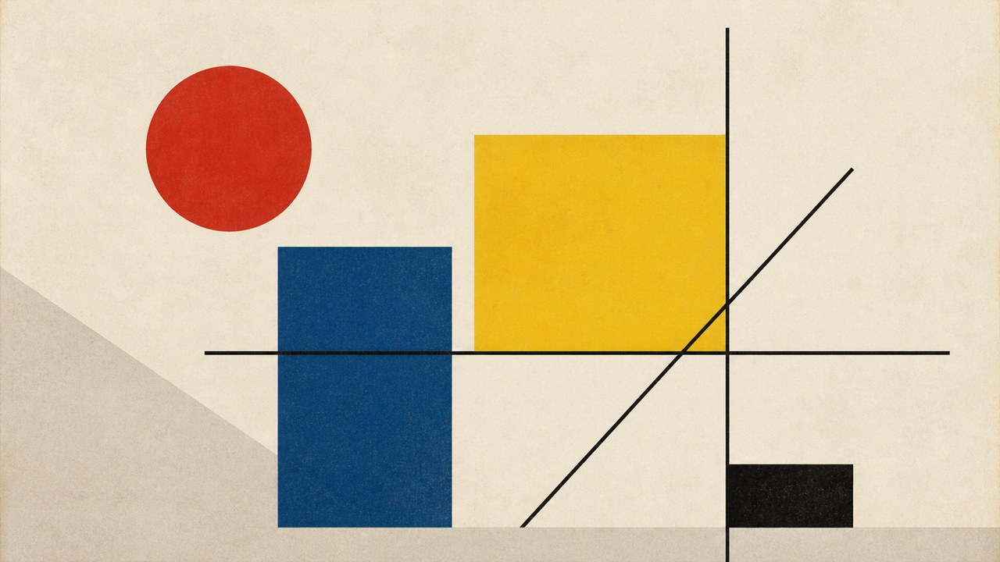
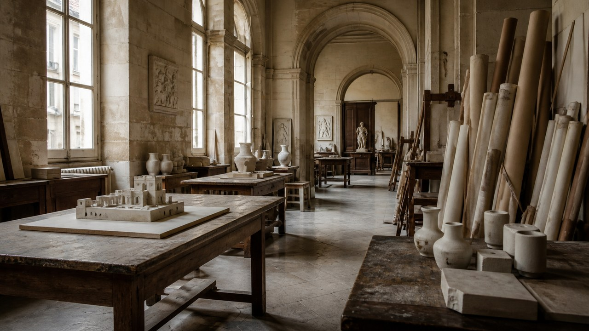
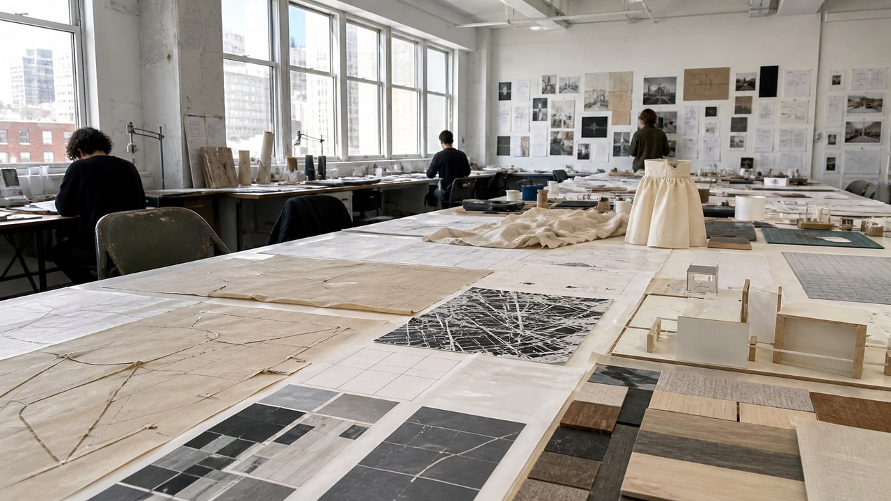
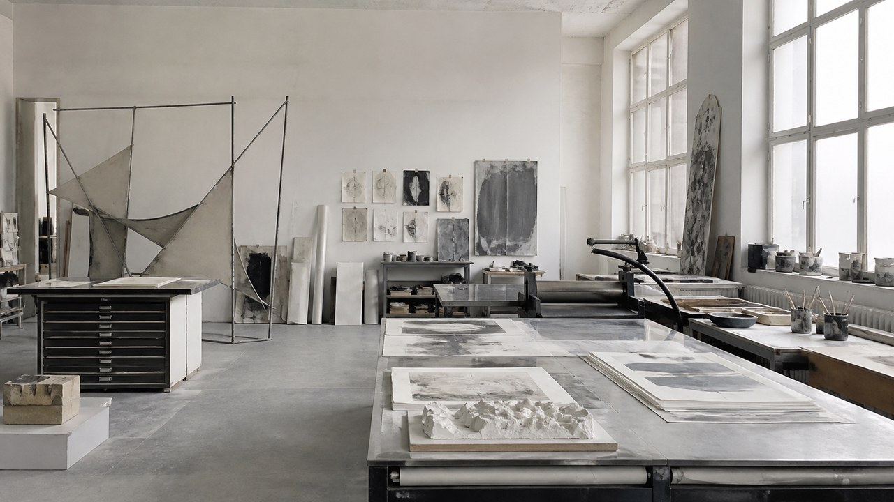
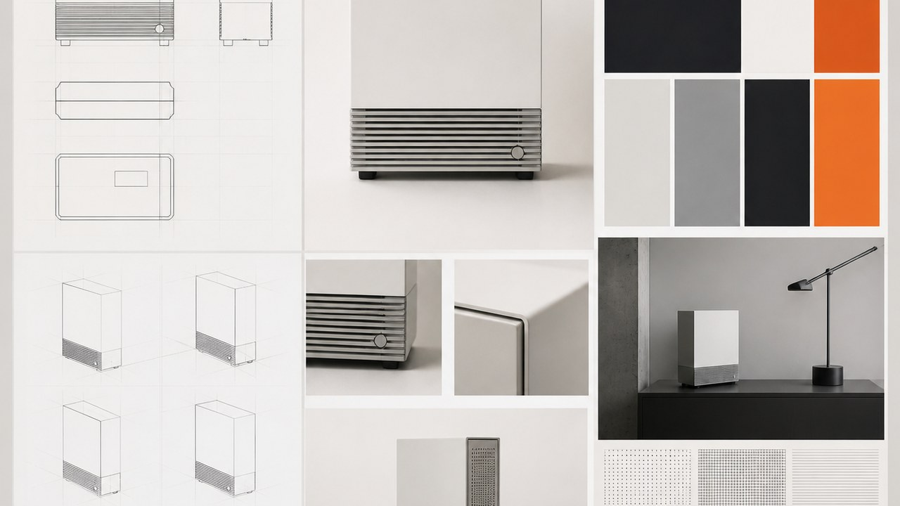
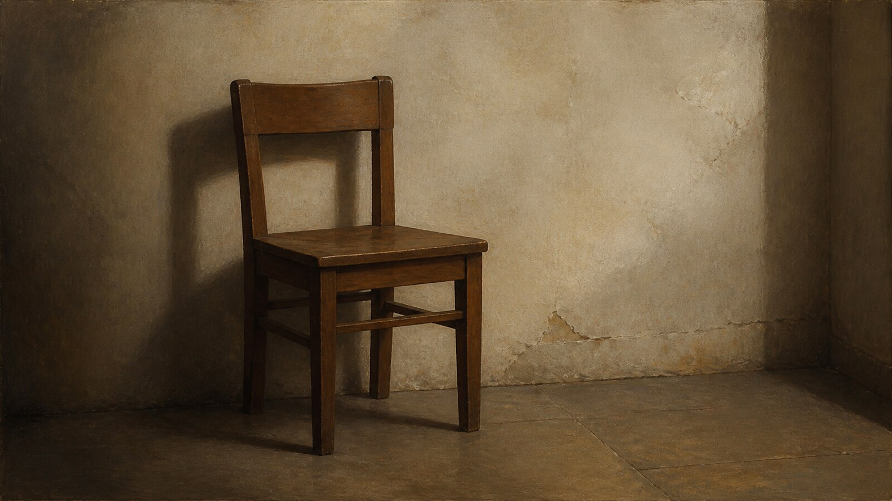
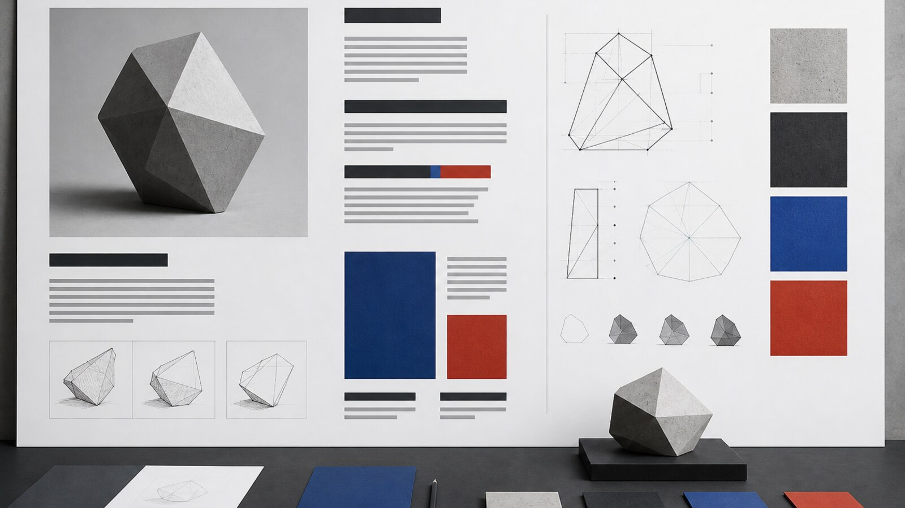
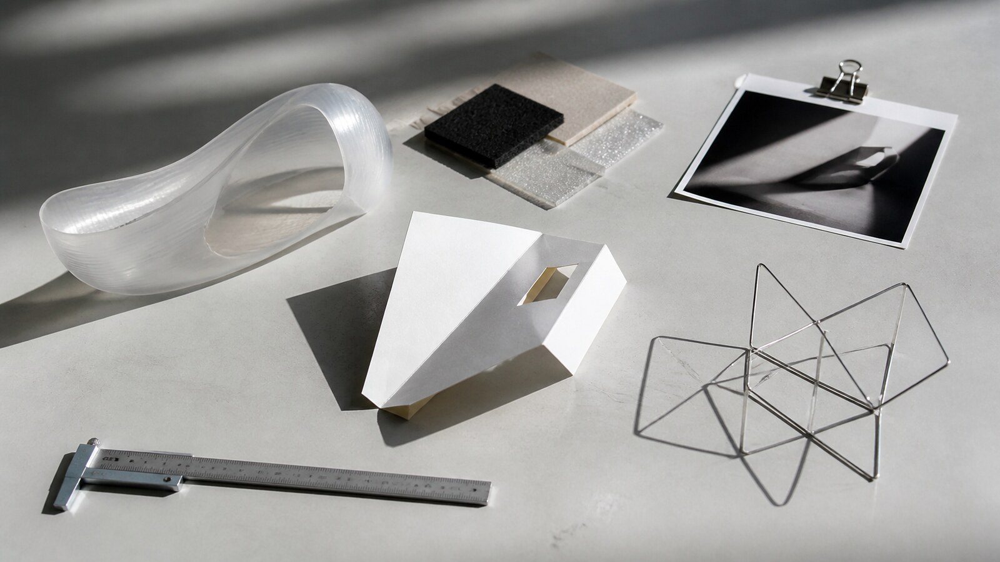
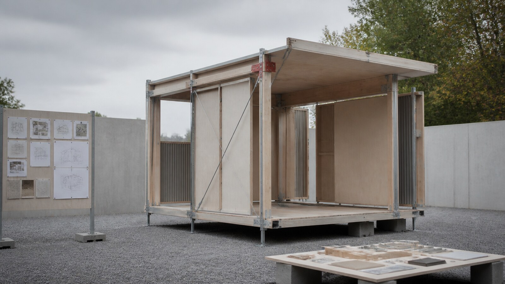

# 设计学院

[English](README.en.md)

本目录收录 24 个独立风格包。每个卡片使用统一的横版 16:9 代表图，点击图片或名称进入风格包 README。

<table>
<tr>
<td width="33%" valign="top" align="center"> <strong>包豪斯</strong> <a href="./bauhaus/README.md">打开 README</a></td>
<td width="33%" valign="top" align="center"> <strong>黑山学院</strong> <a href="./black-mountain-college/README.md">打开 README</a></td>
<td width="33%" valign="top" align="center"> <strong>加州艺术学院</strong> <a href="./california-college-of-the-arts/README.md">打开 README</a></td>
</tr>
<tr>
<td width="33%" valign="top" align="center"> <strong>克兰布鲁克艺术学院</strong> <a href="./cranbrook-academy/README.md">打开 README</a></td>
<td width="33%" valign="top" align="center"> <strong>格拉斯哥艺术学院</strong> <a href="./glasgow-school-of-art/README.md">打开 README</a></td>
<td width="33%" valign="top" align="center"> <strong>新包豪斯</strong> <a href="./new-bauhaus/README.md">打开 README</a></td>
</tr>
<tr>
<td width="33%" valign="top" align="center"> <strong>巴黎美术学院</strong> <a href="./paris-beaux-arts/README.md">打开 README</a></td>
<td width="33%" valign="top" align="center"> <strong>帕森斯设计学院</strong> <a href="./parsons-school-of-design/README.md">打开 README</a></td>
<td width="33%" valign="top" align="center"> <strong>罗德岛设计学院</strong> <a href="./risd/README.md">打开 README</a></td>
</tr>
<tr>
<td width="33%" valign="top" align="center"> <strong>皇家艺术学院</strong> <a href="./royal-college-of-art/README.md">打开 README</a></td>
<td width="33%" valign="top" align="center"> <strong>斯莱德美术学院</strong> <a href="./slade-school-of-fine-art/README.md">打开 README</a></td>
<td width="33%" valign="top" align="center"> <strong>乌尔姆设计学院</strong> <a href="./ulm-school/README.md">打开 README</a></td>
</tr>
<tr>
<td width="33%" valign="top" align="center"> <strong>耶鲁艺术学院</strong> <a href="./yale-school-of-art/README.md">打开 README</a></td>
<td width="33%"></td>
<td width="33%"></td>
</tr>
</table>

## 其他风格包

以下卡片补齐本分类的完整索引。

<table width="100%">
<tr><td width="33%" valign="top" align="center"> <strong>朱利安学院</strong> <a href="./academie-julian/README.md">打开 README</a></td><td width="33%" valign="top" align="center"> <strong>维也纳美术学院</strong> <a href="./academy-of-fine-arts-vienna/README.md">打开 README</a></td><td width="33%" valign="top" align="center"> <strong>艺术中心设计学院</strong> <a href="./artcenter/README.md">打开 README</a></td></tr>
<tr><td width="33%" valign="top" align="center"> <strong>加州艺术学院</strong> <a href="./california-institute-of-the-arts/README.md">打开 README</a></td><td width="33%" valign="top" align="center"> <strong>中央圣马丁艺术与设计学院</strong> <a href="./central-saint-martins/README.md">打开 README</a></td><td width="33%" valign="top" align="center"> <strong>埃因霍温设计学院</strong> <a href="./design-academy-eindhoven/README.md">打开 README</a></td></tr>
<tr><td width="33%" valign="top" align="center"> <strong>洛桑艺术设计学院</strong> <a href="./ecal/README.md">打开 README</a></td><td width="33%" valign="top" align="center"> <strong>皇家美术学院学校</strong> <a href="./royal-academy-schools/README.md">打开 README</a></td><td width="33%" valign="top" align="center"> <strong>丹麦皇家艺术学院</strong> <a href="./royal-danish-academy/README.md">打开 README</a></td></tr>
<tr><td width="33%" valign="top" align="center"> <strong>芝加哥艺术学院</strong> <a href="./school-of-the-art-institute-of-chicago/README.md">打开 README</a></td><td width="33%" valign="top" align="center"> <strong>视觉艺术学院</strong> <a href="./school-of-visual-arts/README.md">打开 README</a></td><td width="33%"></td></tr>
</table>
