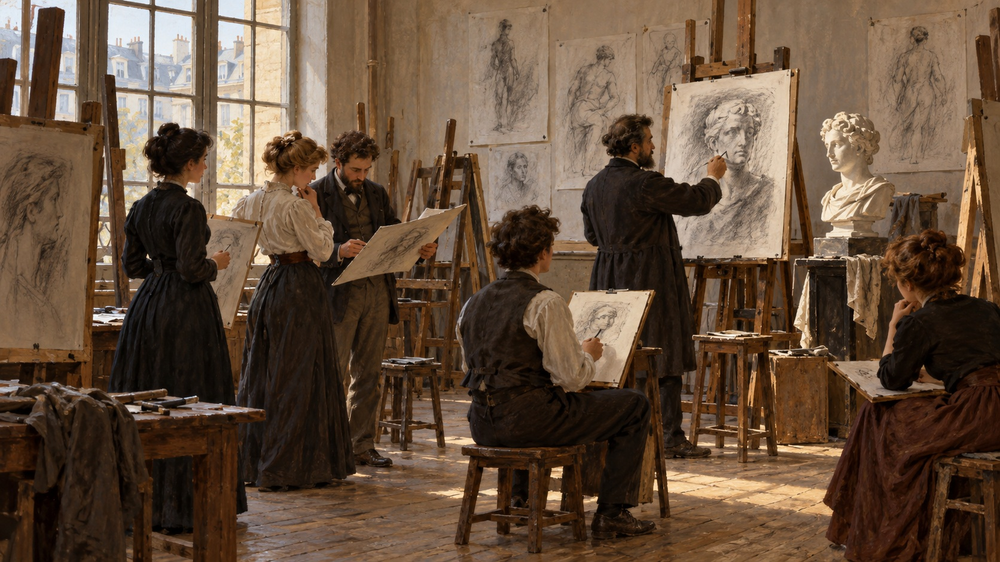

# Académie Julian

[Chinese version](README.md)

> **Category:** art school 
> **Domain:** painting 
> **Path:** `style-packages/schools/academie-julian`

## Overview

Académie Julian was a private art-teaching institution in Paris. This package abstracts its atelier-based working method: observe, establish a study, check proportions, revise, and resolve only the necessary details. It describes a way of working; it does not require every image to show a classroom, easel, or student.

## Curatorial note

The signature is not a period studio but the way an image is built: first observe form and proportion, then compare values, and finally decide where detail is needed. A few purposeful study marks can keep that process visible.

## Package files

- `identity.yaml`: scope, open subject policy, and exclusions
- `visual-signature.yaml`: traits of the working method
- `reproduction.yaml`: materials and construction order
- `prompts/base.txt`, `prompts/negative.txt`: base prompt and negative constraints
- `palette/palette.json`: colors for optional studio examples only
- `evaluation.yaml`: post-generation checks
- `references/manifest.csv`, `provenance.yaml`: sources and rights boundaries

## Sources and rights

The references link to Musée d'Orsay records on Marie Bashkirtseff and her painting *Un meeting*, alongside The Met's essay on women artists in nineteenth-century France. Musée d'Orsay records her study at Académie Julian and the academy's history of providing life-drawing classes to women. No collection artwork or photograph is included.

## Use this package

Read `prompts/base.txt`, replace `{SUBJECT}` and `{LOCATION}`, and submit `prompts/negative.txt` alongside it. The package should affect your requested subject through observation, proportion, value grouping, and selective revision; it must not add students, a model, a studio, or period clothing on its own. Use `evaluation.yaml` to review prompt adherence and process marks.

The gallery and sample are newly generated studio scenes pending human review. They are not archival images or historical works by students of Académie Julian.
