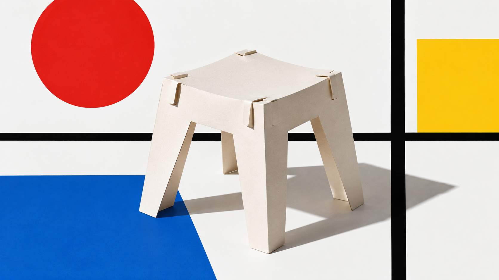
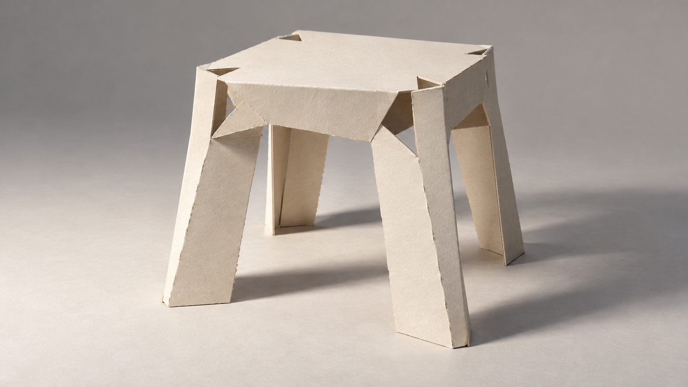

# Bauhaus paper construction: same-subject visual study

> Status: provisional visual-rule review. One unseeded image per arm; this is a focused pilot, not a physical prototype test or a maturity upgrade.

## Side-by-side

| Legacy package | Experimental paper-study direction |
| --- | --- |
|  |  |

Both jobs use the same subject, model family, aspect ratio, no-reference setting, and single-view requirement. The legacy arm foregrounds the package's familiar primary-color geometry. The new direction keeps the stool and palette neutral and makes folded card, cut slots, contacts, and negative space the visual subject. This is a focused method study, not a claim that the full Bauhaus package should always look like paper construction.

The direction output shows one complete stool in one view. The first output was rejected because it repeated the stool in a multi-panel sequence; it is retained at [`examples/rejected/paper-stool-multipanel-v1.png`](../../examples/rejected/paper-stool-multipanel-v1.png). The retry added the same single-view gate to the render request.

## Inputs and limits

- Shared subject: one small stool made from one sheet of uncolored card; show its full form and visible cut, tear, and fold connections; no glue, hidden support, people, or text.
- Legacy compiled prompt SHA-256: `4cbf686e43c25079b37bd262ec9a3d4ac2b876532c7c7e62b03b7edc2cbb7988`.
- Direction compiled prompt SHA-256: `50d1651c3cab3e161cff812d961aeaefc5e3f6ff8d3ea34af6ea7f0ba72f000f`.
- Direction file SHA-256: `a27c05729ca55b405e4edea7bf657cdaabf1fcd1262c1c6875d963fab1e188c1`.
- Both compiled jobs are archived here. They contain no image references. The provider's model version and random seed were not exposed; outputs are not deterministic.
- One reviewer found the new output shows the intended paper process cues more clearly. Neither image proves that the stool can be folded as shown, stand stably, or bear weight.

## 中文记录

这是一次聚焦纸材方法的临时视觉评审：两组各生成一张、未固定随机种子的图，不代表实物结构测试，也不提升风格包成熟度。

两个任务使用相同主体、模型家族、画幅、无参考图设置和单视图要求。旧包强调熟悉的红黄蓝几何构成；新方向保留同一纸凳主体与素纸配色，把折叠、切口、接触关系和负空间放到视觉中心。它只展示包豪斯教学方法中的一个纸材研究方向，不代表整个包豪斯风格。

新方向的最终图在一个画面中呈现一把完整纸凳。第一次生成把纸凳重复排列成多格步骤图，因违反单主体单视图要求而拒收；失败图和重试原因一并保留。评审只确认新图更清楚地呈现纸材操作线索，不证明它可真实折叠、稳定站立或承重。
