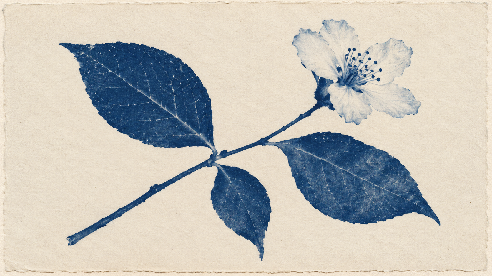

# 氰版印相：同题植物接触印相对照

> 状态：单次同题对照，检查媒介规则是否改变了可见呈现；不证明新版方向稳定优于旧包。

## 图像

| 旧包提示 | 新版结构化方向 |
| --- | --- |
|  |  |

两张图都保留一枝、三片叶和一朵白花，未增加器具、第二株植物或文字。旧包把深蓝色铺成大面积底色，植物以浅色显影；新版把深蓝主要用于枝叶和花蕊，让暖纸底与蓝色影像分开，并留出更宽的纸边和负空间。新版因此让“深色影像／未曝光纸面”的关系更直接，但旧包本来也呈现了明显的接触印相和纸张痕迹；这组输出显示规则差异，不构成质量提升结论。

## 运行记录

- 共同主体：横版 16:9，一枝有三片叶和一朵白色花的植物枝条，以接触印相方式呈现于浅色纸面，背景简洁，无文字。
- 两组分别使用相同的内置图像生成工具，各独立生成一次；没有输入参考图片。实际生成提示和编译后的 provider-neutral job 均存档在本目录。
- 两张结果图均为 1672 × 941 像素（约 16:9）。工具未暴露具体模型版本或随机种子。
- 视觉复核：两组主体数量与媒介均可辨认；新版更清楚地分离深蓝影像和暖纸地，并保留空白边缘。该判断来自单名复核和每组单次输出，不能说明重复稳定性或用户普遍偏好。
- 方向继续保持 `experimental`；规则级 `visual_review` 不据此改为通过。

## English note

Both images preserve one branch, three leaves, and one white flower without extra props or text. The legacy output uses a broad dark-blue ground with the plant exposed in pale tones. The structured direction puts dark blue mainly in the plant and flower center, separating the image from a warm paper ground and leaving wider margins. This makes the positive/negative relation more explicit, but the legacy image already reads as a cyanotype contact print. One unseeded output per arm cannot establish a quality advantage or repeatability.
